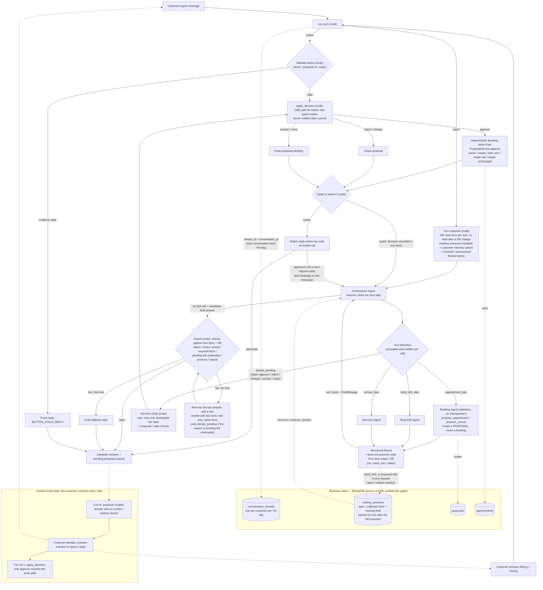

# Kiến trúc đích — agent đặt lịch Salona

Đây là **kiến trúc đích** (chủ dự án chốt 08/11). Spec
`docs/superpowers/specs/2026-11-08-subagents-rebuild-design.md` và plan
`docs/superpowers/plans/2026-11-08-subagents-rebuild.md` triển khai đúng sơ đồ này; chỗ nào lệch thì
sơ đồ thắng và spec / plan phải sửa theo.

## Luật cốt lõi

1. **Không agent nào ghi lịch.** Agent Đặt lịch chỉ tạo **đề xuất** (`propose_appointment`,
   `propose_cancel`). Chỉ `ProposalService.approve`, gọi từ `apply_decision`, mới ghi lịch.
2. **Human-in-the-loop bằng đề xuất qua hai lượt**, không bằng `interrupt()` /
   `HumanInTheLoopMiddleware`: `interrupt()` chạy lại cả node khi resume và mất chỗ đang treo khi
   server khởi động lại (CONTEXT.md bẫy 15). Khách là người duyệt: bấm nút hoặc gõ chữ.
3. **Một đường duy nhất** cho quyết định đề xuất: nút bấm và chữ gõ đều tới `apply_decision`. Với
   chữ gõ, nhãn của Orchestrator đi qua **Decision Gate** (`veto` chỉ được hạ nhãn, không nâng).
   Sau khi commit, `apply_decision` gửi thông báo cho chủ tiệm. **Nút bấm là một API bằng code**
   (chủ dự án 09/11): duyệt hoặc từ chối, rồi trả câu báo do code viết, không gọi model. Ngoại lệ duy
   nhất: khách vừa bấm Đồng ý mà phiên Đặt lịch còn yêu cầu kế (khách nói hai lịch trong một tin) thì
   Orchestrator chạy tiếp, đề xuất lịch kế, và khách bấm nút lần nữa.
4. **Có đề xuất chờ thì lượt phải quyết nó**: câu trả lời cuối mà đề xuất còn chưa quyết bị guard
   từ chối (`pending_undecided`); nhãn `none` hợp lệ khi khách nói chuyện khác.
5. **Câu trả lời cuối luôn qua guard bằng code**, đối chiếu với dữ kiện code trích từ kết quả tool
   và DB — không tin chữ model. Viết lại **một lần và không có tool** (không tra cứu lại, không tạo
   đề xuất lại); vẫn sai thì câu mẫu code. Ngoại lệ: lý do bị loại là `pending_undecided` thì lần viết
   lại chỉ được gọi `decide_pending`.
6. **Bối cảnh**: đọc DB một lần mỗi lượt, đọc lại sau mỗi tool làm DB đổi; tool không dùng được bị ẩn
   ở từng lần gọi model; mỗi agent con chỉ nhận phần bối cảnh nó cần.
7. **Phiên chờ** giữ việc dở của agent con qua lượt (loại việc, dữ kiện đã thu, trường còn thiếu,
   hạn 10 phút); Orchestrator chọn làm tiếp (`continue_session`) hay mở việc mới (phiên cũ bị thay).
   Phiên nằm trong collection Mongo `waiting_sessions` (qua `WaitingSessionService`), **không** trong
   state của graph: mỗi khách tối đa một phiên chờ cho mỗi agent con, hết hạn do code kiểm lúc đọc.
   Agent Đặt lịch tạo đề xuất mà khách còn yêu cầu kế thì phiên vẫn mở để giữ yêu cầu kế.
   Đây là **human-in-the-loop để thu thông tin còn thiếu**, không dùng `interrupt()` trong agent con
   (chủ dự án 08/11): khách hay hỏi xen chuyện khác (graph đang treo sẽ coi tin kế tiếp là câu trả lời),
   câu hỏi phải qua Orchestrator và guard, resume chạy lại tool cha từ đầu và bắt agent con phải có
   `checkpointer=True`, và `interrupt()` không có hạn 10 phút.
   **Spike 09/11** (Azure thật, `interrupt()` trong agent con `checkpointer=True` gọi từ tool):
   - Khách trả lời đúng câu hỏi thì resume chạy tiếp được, agent con tiếp từ checkpoint riêng.
   - Khách hỏi chuyện khác lúc resume ("tiệm mở tới mấy giờ?") thì agent con coi đó là câu trả lời,
     bot trả lời sai và câu hỏi đang chờ bị mất.
   - Khách gửi tin thường khi graph đang treo thì thread cha còn tool call không có ToolMessage, Azure
     trả 400 và thread hỏng luôn.
   - Câu hỏi của `interrupt()` tới thẳng khách, không qua guard: bot xưng "bạn" và nói "hôm nay".
8. **Thread và trạng thái.** Orchestrator chạy trên `thread_id = conversation_id`, một bản ghi trong
   collection `conversation_threads` (qua `ConversationThreadService`). Mỗi ngày giờ Việt Nam mở một
   cuộc trò chuyện mới; lượt trong 30 phút sau nửa đêm vẫn tiếp cuộc cũ. Lượt đầu của cuộc mới gom
   memory dài hạn từ cuộc trước. Agent con **không trạng thái** (không `checkpointer=True`, dựng lại mỗi
   lần gọi). Thứ cần sống qua lượt nằm ở Mongo (phiên chờ, đề xuất, lịch, cuộc trò chuyện) hoặc store
   (memory). Checkpoint của thread chỉ giữ lịch sử chat và khoá theo lượt.
