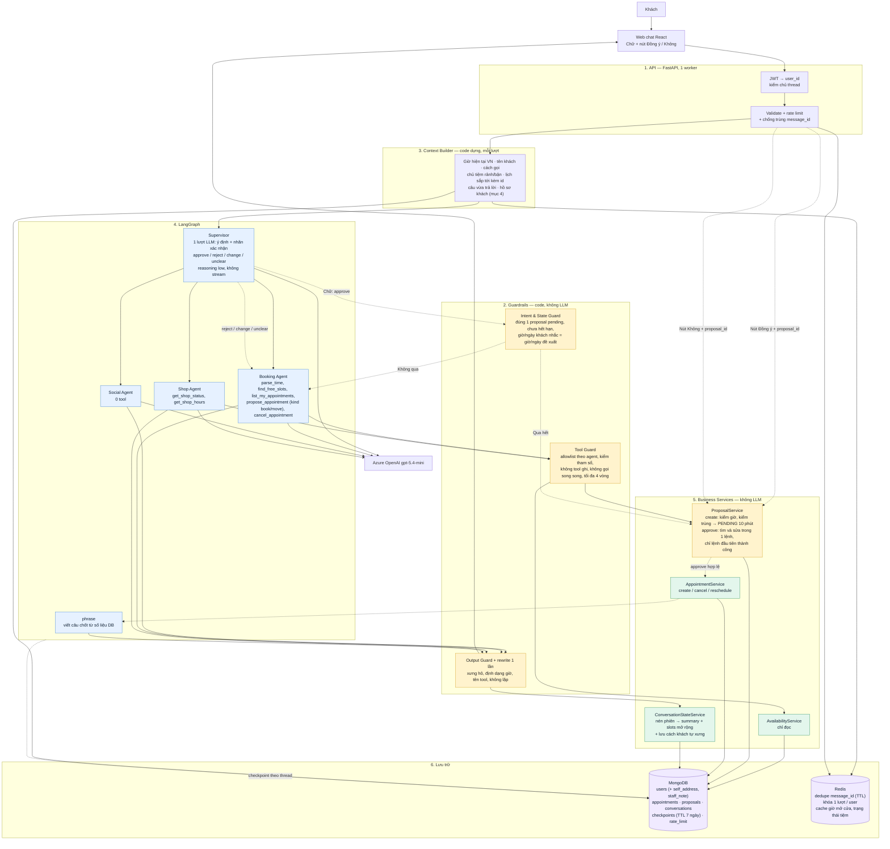
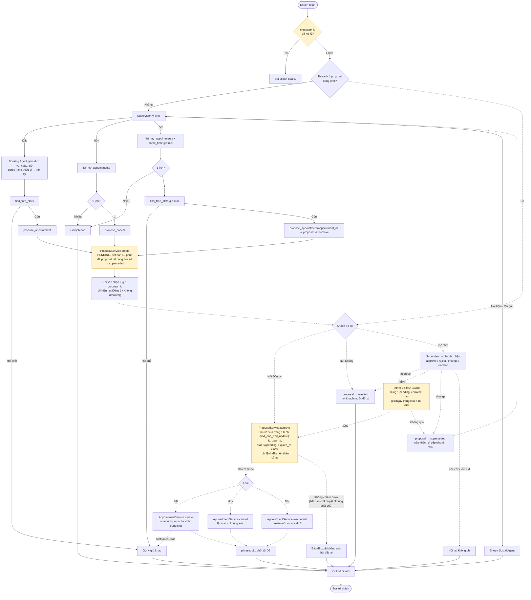
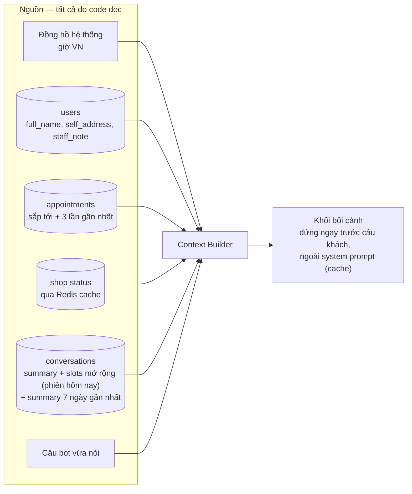

# Kiến trúc đích — Salona Booking trên nền Harness B

Bản sửa ngày 2026-10-20 theo các quyết định đã chốt khi brainstorm:

- Xây trên nhánh `feat/langchain-harness` (Harness B), không viết lại từ đầu.
- Không có Time Agent. `parse_time` là tool của Booking Agent; thiếu buổi/ngày/giờ
  thì agent hỏi lại khách bằng câu thường. Giờ hiện tại đến từ Context Builder.
- Gọi khách là "anh chị" là chủ ý; chỉ đổi khi khách **tự xưng** ("chị làm móng").
- Nút **Đồng ý** / **Không** dưới câu hỏi chốt lịch. Gõ chữ vẫn được, nhưng là đường phụ.
- Redis làm trong đợt này. Trí nhớ: mở rộng `ConversationState` trong phiên (mục 3)
  + hồ sơ khách do code dựng qua nhiều phiên; **không** có memory do LLM tự trích qua phiên.
- Mongo chạy đơn lẻ: không có transaction, dùng `find_one_and_update` + index unique partial.

Ô vàng là chỗ chặn an toàn. Nét đứt là đường lượt sau (khách trả lời đề xuất).

# 1. Kiến trúc tổng thể

Ghi chú so với code hiện có trên Harness B:

- Đã có: supervisor một lượt, ba agent + middleware, guard/rewrite, `proposals` với
  approve kiểu chiếm, lưới code + bộ phân loại, `interrupt()`, checkpointer Mongo,
  chống chạy song song cùng user.
- Mới: nút Đồng ý/Không (Socket.IO event mới), nhãn xác nhận gộp vào supervisor
  (thay bộ phân loại riêng), Redis,
  slots mở rộng trong `ConversationState`, hồ sơ khách trong Context Builder.
- Bỏ: Time Agent; danh sách từ khóa phủ quyết (chỉ giữ phép so giờ/ngày) — **quyết
  sau khi benchmark nhóm `edge` có lưới và không lưới**.

# 2. Luồng đặt / hủy / dời — từ tin nhắn đến lịch ghi

Luật bất biến của luồng này:

1. Không có tool nào ghi lịch. `propose_*` chỉ tạo PENDING.
2. Mọi đường ghi (`CREATE`/`CANCEL`/`RESCHED`) đều đi qua `APPROVE`, kể cả nút bấm.
3. `approve` chỉ là **ứng viên**. Chiếm proposal thất bại thì không ghi gì.
4. LLM lỗi, trả sai schema, hoặc `unclear` → không ghi, hỏi lại.
5. Một thread chỉ có một proposal pending. Proposal mới đè proposal cũ thành `superseded`.
6. Ghi lịch dựng từ `proposal` trong DB, không từ chuỗi model gõ.

# 3. Context Builder và hồ sơ khách

Thứ tự message model nhận (giữ nguyên bẫy #9): **System → [summary + slots] → lịch sử
hôm nay → khối bối cảnh → câu khách**. Dòng đầu khối bối cảnh luôn là giờ hiện tại.

## Trí nhớ — hai tầng

### Tầng 1: trong phiên — `ConversationState` mở rộng

Benchmark cho thấy bot quên 4 thứ ngay trong một phiên (LLM-09, compaction-long,
pending-het-han). Mở rộng `slots` hiện có (ý định, dịch vụ, ngày, giờ, giờ đã từ
chối) thêm 4 trường, LLM điền lúc nén, code lọc, không thêm lượt LLM:

| Trường | Lưu gì | Dùng để | Ví dụ |
|---|---|---|---|
| `stated` | điều khách đã nói rõ hoặc từ chối | không hỏi lại điều khách đã trả lời | "để tiệm chọn giờ", "chỉ rảnh sau 5 giờ" |
| `asked` | câu bot đã hỏi + đã có đáp chưa | câu có đáp thì thôi; khách phớt lờ 2 lần thì đổi cách | "hỏi dịch vụ: chưa đáp ×2" |
| `told` | điều bot đã khẳng định | dữ liệu mới mâu thuẫn thì phải nói "em xem lại thì…" | "chiều mai hết chỗ" |
| `agreed_at` | khách đã đồng ý đề xuất nào, lúc nào | viết câu cho đúng khi đề xuất hết hạn; **không** là căn cứ ghi | "đồng ý 15:00 18/10 lúc 14:02" |

Luật: mỗi trường tối đa 5 mục, mỗi mục ≤ 60 ký tự, code loại mục chứa số điện
thoại/địa chỉ/câu mệnh lệnh. Vào khối `[summary + slots]` sẵn có.

### Tầng 2: qua nhiều phiên — hồ sơ khách do code dựng

| Lưu gì | Ai ghi | Ở đâu | Ví dụ |
|---|---|---|---|
| cách khách tự xưng | code bắt khi khách tự xưng trong câu | `users.self_address` | "chị" → gọi "chị Lan" từ đó |
| ghi chú nhân viên | admin nhập tay | `users.staff_note` | "đi lại khó, cần ghế gần cửa" |
| 3 lần đến gần nhất | truy vấn `appointments` | không lưu thêm | "12/10 làm móng gel" |
| việc dang dở | summary của 7 ngày gần nhất | `conversations` sẵn có | "hôm qua hỏi giá gel, chưa đặt" |

Không có tầng memory do LLM tự trích qua nhiều phiên trong đợt này: chưa có bằng
chứng cần, và nhớ sai còn tệ hơn không nhớ. Xem lại sau khi chạy thật.

# 4. Redis — dùng cho gì, không dùng cho gì

| Dùng | Lý do |
|---|---|
| Dedupe `message_id` với TTL 24 giờ | Socket.IO gửi lại không tạo proposal đôi |
| Khóa "tin đang xử lý" `turn:{user_id}:{message_id}` | cùng `message_id` gửi lại khi lượt còn chạy → bỏ qua, không huỷ lượt. Tin KHÁC vẫn huỷ lượt cũ như hiện nay (`_ACTIVE_TURNS`) |
| Cache giờ mở cửa, trạng thái tiệm (TTL ngắn) | bớt 2 truy vấn Mongo mỗi lượt |

| Không dùng | Lý do |
|---|---|
| Lưu proposal, lịch, memory | Mongo là nguồn sự thật duy nhất |
| Rate limit | đã nằm trong Mongo, không đổi |
| Checkpointer | đã là `MongoDBSaver` trong DB app |

Redis sập thì app vẫn chạy: dedupe và khóa lùi về Mongo (`message_inbox` + biến tiến
trình), cache bỏ qua. Không fail-hard như Mongo.

# 5. Tự nhiên hơn — phần sơ đồ không vẽ được

Benchmark: tự nhiên 1.98/5, giọng máy 2.67, lặp ý 2.82. Ba việc, đo lại sau mỗi việc:

1. **Câu chốt** trong `phrase`: đổi khung câu theo ngữ cảnh (lần đầu / khách quen /
   vừa đổi giờ), không còn một mẫu "Dạ em đã giữ lịch cho anh chị vào … ạ".
2. **Xưng hô**: gọi theo cách khách tự xưng, lưu vào `users.self_address`, chưa tự xưng
   thì giữ "anh chị". Sửa rubric judge cho khớp ý đồ này.
3. **Model**: chạy benchmark với deployment lớn hơn `gpt-5.4-mini` để biết model là
   nút thắt tới đâu, trước khi tốn công vào prompt.

# 6. Cổng đo

So với baseline A (17/10, k=4) trên cùng bộ benchmark:

- Ghi sai nhóm `edge`: 28 → **0**.
- Nhóm `edge` pass: 30% → ≥ 90%. Nhóm `llm` không thấp hơn 96% quá nhiễu.
- `first_token_ms` trung vị không tăng quá 500 ms so với A (6.8 s).
- Judge `tu_nhien` ≥ 3.0, `giong_may` ≥ 3.5 sau mục 5.
- Fault 12/12, không lộ lỗi kỹ thuật, không lộ tên tool.
