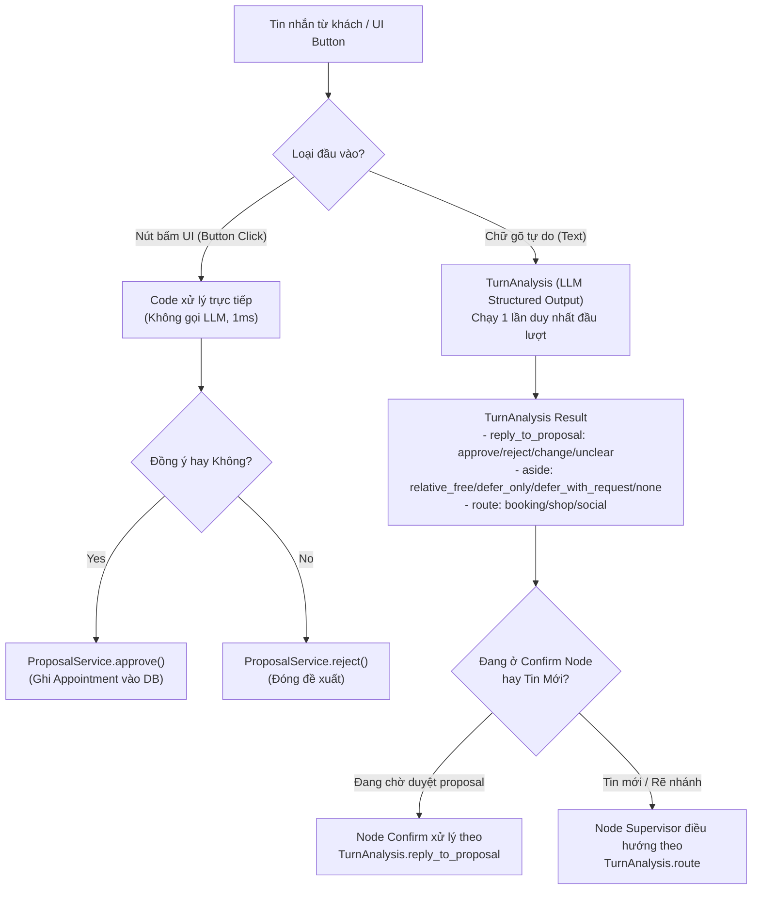

# Thiết Kế Loại Bỏ Triệt Để Từ Điển Từ Khóa Tĩnh (Eliminate Static Keyword Dictionaries)

**Ngày**: 2026-10-28  
**Tác giả**: Antigravity  
**Trạng thái**: Approved (Sẵn sàng triển khai)  
**Phạm vi**: `app/agents/booking_graph/` (`relatives.py`, `reply.py`, `confirm.py`, `supervisor.py`, `analyzer.py`)

---

## 1. Bối cảnh & Vấn đề (Context & Problem)

Trong quá trình phát triển các phiên bản đầu của hệ thống đặt lịch, một số bộ từ điển tĩnh và logic so khớp chuỗi đã được thêm vào:
1. `app/agents/booking_graph/relatives.py`:
   - Các danh sách từ khóa: `_PERSONS_ACC`, `_PERSONS_BARE`, `_DEFER_VERBS_*`, `_DEFER_PHRASES_*`, `_REQUEST_PHRASES_*`, `_REQUEST_VERBS_*`, `_REQUEST_OBJS_*`.
   - Các hàm quét chuỗi: `defers(text)`, `asks_if_relative_free(text)`, `has_request(text)`.
2. `app/agents/booking_graph/reply.py`:
   - Các danh sách từ khóa phủ định, đồng ý, nghi vấn: `_NEG_PHRASES_*`, `_NEG_WORDS_*`, `_GO_VERBS`, `_GO_AGREE`, `_GO_FILLER`, `_QUESTION_WORDS`, `_QUESTION_TAILS`.
   - Hàm phủ quyết chuỗi tĩnh `veto_reason(...)`.

### Điểm yếu nghiêm trọng trong thực tế
- **Cái bẫy "Whack-A-Mole"**: Ngôn ngữ tự nhiên có vô vàn biến thể. Việc so khớp chuỗi tĩnh dẫn đến việc bắt nhầm tai hại (false positives / false negatives).
  - *Ví dụ thực tế*: Khách nói *"chị xem lại lịch hẹn của chị với"*, từ khóa `"xem lại"` trong danh sách hoãn kích hoạt `defers = True`, khiến hệ thống tưởng khách xin hoãn quyết định và từ chối đề xuất thay vì tra cứu lịch.
- **Xung đột cấu trúc**: Khi cố gắng thêm các ngoại lệ để sửa một câu, danh sách từ khóa tĩnh lại gây ra xung đột chéo với các câu khác (tiếng lóng, phương ngữ, phủ định kép).
- **Trùng lặp trách nhiệm**: Hệ thống đã có `TurnAnalysis` (Structured Output với Pydantic schema) chạy ở đầu mỗi lượt. Việc dùng code quét chuỗi đi trước vừa thừa thãi vừa ngăn cản LLM hiểu ngữ cảnh đầy đủ.

---

## 2. Mục tiêu (Goals & Non-Goals)

### Mục tiêu (Goals)
1. **Loại bỏ 100% các bộ từ điển từ khóa chuỗi tĩnh** trong `relatives.py` và `reply.py`.
2. **Ủy thác 100% việc hiểu ngữ nghĩa tự do** cho mô hình phân tích `TurnAnalysis` với Structured Output (`temperature=0.0`).
3. **Giữ nguyên tắc Fail-Closed an toàn**: Khi LLM lỗi mạng hoặc timeout, hệ thống tự động fallback về `unclear`, hỏi lại khách một câu xác nhận rõ ràng, tuyệt đối không tự ý ghi đè hay duyệt lịch.
4. **Bảo tồn Write Fence 100%**: Chỉ duy nhất `ProposalService.approve` ghi DB khi có xác nhận. Agent tools không bao giờ được ghi lịch trực tiếp.
5. **Không làm tăng chi phí và độ trễ**: Tái sử dụng lần gọi `TurnAnalysis` vốn có ở đầu lượt.

### Phi mục tiêu (Non-Goals)
- Không can thiệp vào cơ chế xử lý nút bấm UI (`button: "yes" | "no"`): Nút bấm UI là tín hiệu số tường minh, xử lý 100% bằng code nguyên thủy, không đi qua LLM.
- Không thay đổi các validation logic nghiệp vụ bằng code (kiểm tra hạn 10 phút, kiểm tra trùng slot, kiểm tra giờ mở cửa).

---

## 3. Kiến trúc Chi Tiết (Detailed Architecture)

### 3.1. Phân định Ranh Giới (Separation of Concerns)



### 3.2. Cấu trúc Schema `TurnAnalysis` (`analyzer.py`)

Mô hình `TurnAnalysis` giữ vai trò nguồn chân lý ngữ nghĩa duy nhất:

```python
Route = Literal["booking", "shop", "social"]
ReplyLabel = Literal["approve", "reject", "change", "unclear"]
SelfAddress = Literal["anh", "chị"]
AsideKind = Literal["relative_free", "defer_only", "defer_with_request"]

class TurnAnalysis(BaseModel):
    route: Route = "booking"
    reply_to_proposal: Optional[ReplyLabel] = None
    aside: Optional[AsideKind] = None
    mentioned_times: List[MentionedTime] = Field(default_factory=list)
    service: Optional[str] = None
    time_text: Optional[str] = None
    self_address: Optional[SelfAddress] = None
    stated: List[str] = Field(default_factory=list)
    answers_question: bool = False

    @classmethod
    def fallback(cls, has_pending: bool) -> "TurnAnalysis":
        """Fail-closed: khi model lỗi/timeout, mặc định route='booking',
        và reply_to_proposal='unclear' nếu có đề xuất đang chờ."""
        return cls(route="booking",
                   reply_to_proposal="unclear" if has_pending else None)
```

### 3.3. Tái cấu trúc Node `confirm` (`confirm.py`)

1. **Loại bỏ `veto_reason` và `_is_go_ahead`**: Xóa bỏ hoàn toàn lớp quét chuỗi tĩnh trước LLM.
2. **Luồng ra quyết định tại `confirm`**:
   - Nếu `text` là dict (resume từ nút bấm UI): Xử lý trực tiếp qua `_handle_button`.
   - Nếu `text` là chuỗi (khách gõ chữ):
     - Lấy kết quả từ `TurnAnalysis` (đã có từ đầu lượt hoặc phân tích câu khách kèm thông tin đề xuất).
     - **Nếu `aside == "defer_only"`**: Khách hoãn đơn thuần (*"để chị tính lại sau"*...) $\rightarrow$ Đóng đề xuất (`reject`), bot đáp câu mời nhắn lại sau bằng code.
     - **Nếu `reply_to_proposal == "approve"`**: Gọi `ProposalService.approve` ghi lịch $\rightarrow$ chuyển sang `phrase` xuất câu chốt.
     - **Nếu `reply_to_proposal == "change"`**: Đánh dấu `supersede` đề xuất cũ $\rightarrow$ Same-turn handoff sang Agent Booking (`gate_next="booking"`) để tạo đề xuất giờ mới.
     - **Nếu `reply_to_proposal == "reject"`**: Đóng đề xuất cũ (`reject`) $\rightarrow$ Same-turn handoff sang Booking hoặc Supervisor nếu khách hỏi chuyện khác.
     - **Nếu `reply_to_proposal == "unclear"` (hoặc LLM timeout)**: Gọi `proposals.mark_unclear` $\rightarrow$ Bot hỏi lại 1 câu rõ ràng, giữ nguyên đề xuất.

### 3.4. Dọn dẹp `relatives.py`

- Xóa bỏ toàn bộ:
  - `_PERSONS_ACC`, `_PERSONS_BARE`
  - `_DEFER_VERBS_ACC`, `_DEFER_VERBS_BARE`
  - `_DEFER_PHRASES_ACC`, `_DEFER_PHRASES_BARE`
  - `_REQUEST_PHRASES_ACC`, `_REQUEST_PHRASES_BARE`
  - `_REQUEST_VERBS_BARE`, `_REQUEST_OBJS_BARE`
  - `defers(text)`, `asks_if_relative_free(text)`, `has_request(text)`
- Giữ lại và tinh gọn:
  - `aside_line(text, analysis)`: Chỉ đọc `analysis.get("aside")`, không quét chuỗi.
  - `deferral_reply(text, address, previous_replies, analysis)`: Chỉ kích hoạt khi `analysis.get("aside") in ("defer_only", "defer_with_request")`.

### 3.5. Dọn dẹp `reply.py`

- Xóa bỏ toàn bộ:
  - `_NEG_PHRASES_*`, `_NEG_WORDS_*`
  - `_GO_VERBS`, `_GO_AGREE`, `_GO_FILLER`
  - `_QUESTION_WORDS`, `_QUESTION_TAILS`
  - `veto_reason(...)`
  - `_is_go_ahead(...)`
  - `_is_question(...)`
- Node `confirm` không gọi `reply.decide` dạng heuristic chuỗi nữa mà dựa trực tiếp vào `TurnAnalysis`.

---

## 4. Kế hoạch Kiểm Thử & An Toàn (Testing & Safety Plan)

1. **Unit Tests**:
   - Cập nhật `tests/test_relatives.py`: Bỏ các bài test so khớp chuỗi tĩnh, giữ các bài test sinh câu `deferral_reply` và `aside_line` dựa trên `analysis.aside`.
   - Cập nhật `tests/test_reply_veto.py`: Chuyển đổi các ca kiểm thử sang kiểm tra quyết định dựa trên `TurnAnalysis`.
   - Bổ sung các bài test nhận diện ngữ nghĩa trong `tests/test_analyzer.py`.
2. **Write Fence Regression**:
   - Chạy `tests/test_write_fence.py` để bảo đảm không có đường ghi lén nào bị hở.
3. **End-to-End Regression**:
   - Toàn bộ 1682 tests hiện tại tiếp tục xanh.
   - Chạy script `test_live_10_turns.py` để kiểm chứng thực tế với Azure OpenAI.

---

## 5. Ràng buộc Hệ thống (Hard Constraints Compliance)

- **Worker count**: Duy nhất 1 worker.
- **Config**: Chỉ từ `.env`.
- **Ngân sách Regex**: Giữ nguyên $\le 2$ regex trong `guard.py` (loại bỏ từ điển tĩnh không làm tăng bất kỳ regex nào).
- **Viết hoa/Ngôn ngữ**: Toàn bộ tài liệu tiếng Việt, commit tiếng Anh ngắn gọn.
