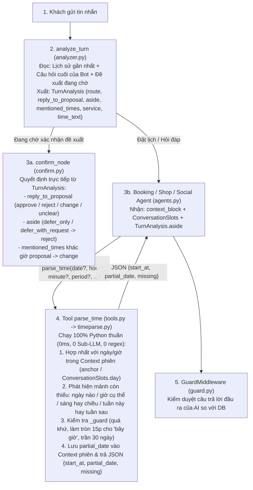

# Kiến trúc Đọc Hiểu Đầu Vào bằng LLM + Context Xuyên Suốt Phiên — Thiết Kế

Ngày: 2026-10-28.

## 1. Vì sao (Motivation)

Sau khi rút gọn regex từ 45 xuống 3 (spec `2026-10-27-regex-reduction-design.md`), rà soát thực tế và kiểm thử live cho thấy kiến trúc tầng đầu vào của `app/agents/booking_graph/` vẫn còn 3 điểm bất cập cốt lõi:

1. **Hai bộ não cùng đọc một câu nói (Input Token-Matching cạnh tranh với LLM):**
   - Các module `supervisor.py`, `relatives.py`, và `reply.py` vẫn dùng các hàm đếm từ trong `tokens.py` (`asks_if_relative_free`, `defers`, `_has_negation`, `_is_question`, `has_aside`, `veto_reason`, `is_go_ahead`, `is_short_affirmation`) để tự đoán ý khách trên chuỗi chữ thô, thay vì tin vào kết quả phân tích ngữ cảnh có cấu trúc `TurnAnalysis` của `analyzer.analyze_turn`.
2. **Anti-pattern "LLM gọi Tool, Tool lại gọi Sub-LLM mù ngữ cảnh" trong `parse_time`:**
   - `Booking Agent` (vốn đã là một LLM có đầy đủ lịch sử hội thoại, `context_block` và `ConversationSlots`) khi gọi tool `parse_time(text)` chỉ truyền một mảnh chữ cắt rời.
   - Bên trong `timeparse.py`, hàm `_ask_model` lại gọi một **Sub-LLM thứ hai** không hề nhìn thấy lịch sử hội thoại hay ngày đang bàn (`anchor`), dẫn tới vừa tốn thêm ~1.5–2 giây/lượt, vừa sinh lỗi quên ngày (khi khách chỉ đáp `"10 giờ 15 sáng"`) hoặc hiểu sai `"2 giờ chiều cùng ngày"` thành ngày hôm nay.
3. **`tokens.py` ôm cả việc hiểu đầu vào lẫn kiểm tra đầu ra:**
   - Các hàm như `names_a_day`, `names_a_clock`, `padded_unaccented_only` chỉ tồn tại để phục vụ việc đoán ý khách ở đầu vào.

Bản thiết kế này giải quyết triệt để cả 3 vấn đề trên theo nguyên tắc:
- **Đầu vào (User Input):** 100% do **LLM + Context xuyên suốt phiên** đọc hiểu (`analyze_turn` và `Booking Agent`). Xoá bỏ hoàn toàn việc đếm chữ đoán ý khách ở đầu vào và xoá bỏ Sub-LLM `_ask_model` trong `timeparse.py`.
- **Tool `parse_time`:** Giữ vai trò là công cụ **hợp nhất thông tin ngày/giờ do Booking Agent LLM trích xuất với Context đang có của phiên (`ConversationSlots` / `anchor`)**, chạy **100% bằng Python thuần (0ms, 0 Sub-LLM, 0 regex)** để phát hiện khách còn thiếu ngày, thiếu giờ hay thiếu buổi (`missing`) và kiểm tra hợp lệ (`_guard`).
- **Đầu ra (Agent Output):** Chỉ giữ `guard.py` (và các hàm tách câu/giờ cần thiết trong `tokens.py`) để kiểm duyệt câu trả lời đầu ra của AI so với dữ liệu thật trong DB.

---

## 2. Kiến trúc Luồng Dữ Liệu (Data Flow)

---

## 3. Thiết kế Chi tiết Từng Thành Phần

### 3.1. Tầng Đọc Hiểu Đầu Vào (`supervisor.py`, `relatives.py`, `reply.py`, `confirm.py`)

1. **`supervisor.py`:**
   - Giữ nhánh kiểm tra trạng thái hệ thống `if live_queue(state.get("queued")): return {"route": "booking"}` và nhánh tái sử dụng `state.get("analysis")`.
   - **Xoá** 2 nhánh kiểm tra chữ thô trước `analyze_turn`:
     - `if asks_if_relative_free(text) or defers(text)`
     - `if state.get("last_route") == "booking" and is_short_affirmation(text)`
   - Cập nhật `ANALYZE_PROMPT` trong `prompts.py` để đảm bảo:
     - Khi `Receptionist's last message` là câu hỏi xác nhận/đặt lịch mà khách trả lời ngắn gọn kiểu đồng ý (`"ok"`, `"ừ"`, `"chốt"`) hoặc hỏi người thân rảnh không / hẹn nhắn lại (`aside` khác `None`), `route` luôn là `"booking"`.

2. **`relatives.py` & `agents.py`:**
   - **Xoá** các hàm quét từ vựng trên chuỗi gốc: `_person_near_free`, `_has_de_verb`, `has_request`, `asks_if_relative_free`, `defers`, cùng các tập từ `_PERSONS`, `_SHOP_PERSONS`, `_FREE_WORDS`, `_DEFER_PHRASES`, `_REQUEST_VERBS`, `_TIME_HINT_WORDS`.
   - `aside_line(analysis)` và `deferral_reply(address, previous_replies, analysis)` chỉ đọc trực tiếp trường `aside` (`"relative_free" | "defer_only" | "defer_with_request"`) từ `TurnAnalysis`.

3. **`reply.py` & `confirm.py`:**
   - **Xoá** các hàm quét chữ đầu vào trong `reply.py`: `_has_negation`, `_is_question`, `has_aside`, `veto_reason`, `is_short_affirmation`, `is_go_ahead`, `_without_queued_clauses`, và `classify_reply` (đã được thay thế bởi `analyzer.analyze_turn`).
   - Giữ lại trong `reply.py`:
     - `_describe(proposal)`: dựng mô tả đề xuất cho `analyze_turn`.
     - `mentions_other_time(proposal_start, now, mentioned_times, queued=())`: kiểm tra thuần dữ liệu xem danh sách `MentionedTime` trong `TurnAnalysis` có chứa mốc ngày/giờ nào khác với `proposal.start_at` (và không nằm trong `queued`) hay không.
     - `decide(proposal, bot_question, customer_text, now, *, label_fn, veto_mode="full")`: gọi `label_fn` (tức `analyze_turn`) và kết hợp với kiểm tra `aside` + `mentioned_times` để trả về `"approve" | "reject" | "change" | "unclear"`.

---

### 3.2. Tầng Thời Gian Thuần Python + Context Phiên (`timeparse.py` & `tools.py`)

1. **Xoá bỏ Sub-LLM `_ask_model` và Regex `_FULL` trong `timeparse.py`:**
   - `timeparse.py` trở thành module **100% Python thuần (0 LLM call, 0 `re.compile`)**.
   - Xoá `_FULL`, `_match_regex`, `_PROMPT`, `_ask_model`, `put_on_anchor_day`, `anchor_day_applies`.

2. **Hàm hợp nhất & kiểm tra thời gian `resolve_booking_time(...)` trong `timeparse.py`:**
   Nhận các trường có cấu trúc do `Booking Agent` truyền vào khi gọi tool `parse_time` (hoặc từ `TurnAnalysis.mentioned_times`), kết hợp với `anchor` của phiên:
   - Tham số đầu vào:
     - `day: Optional[date] = None` (ngày khách nêu, đã quy ra `YYYY-MM-DD`)
     - `hour: Optional[int] = None` (`0..23` hoặc `1..12`)
     - `minute: int = 0` (`0..59`)
     - `period: Optional[Literal["sáng", "trưa", "chiều", "tối"]] = None`
     - `is_now: bool = False` (`True` khi khách nói `"bây giờ"`, `"qua liền"`, `"ngay lúc này"`)
     - `ambiguous_week: bool = False` (`True` khi khách chỉ nói `"thứ Năm"` mà chưa rõ tuần này hay tuần sau)
     - `now: datetime`
     - `anchor: Optional[datetime] = None` (mốc đang bàn trong phiên)
     - `session_day: Optional[date] = None` (ngày đã lưu trong `ConversationSlots.day` của phiên hôm nay)
     - `hours: Optional[ShopHours] = None`
   - Quy tắc hợp nhất với Context phiên & phát hiện `missing` (`ParsedTime`):
     1. **Trường hợp `is_now=True`:** Trả về `_guard(ParsedTime(start_at=now), now)` (tự động đẩy lên mốc 15 phút kế tiếp).
     2. **Trường hợp `ambiguous_week=True` (chưa rõ tuần này hay tuần sau):** Trả về `ParsedTime(missing=["tuần này hay tuần sau"], partial_hour=resolved_hour, partial_minute=minute)`.
     3. **Xác định Ngày (`resolved_day`):**
        - Ưu tiên 1: `day` do khách nêu ở lượt này.
        - Ưu tiên 2: Nếu `day is None`, lấy từ `anchor.astimezone(TZ).date()` hoặc `session_day`.
        - Nếu vẫn không có ngày:
          - Nếu có giờ: trả về `ParsedTime(missing=["ngày nào"[, "sáng hay chiều"]], partial_hour=..., partial_minute=minute)`.
          - Nếu không có cả giờ: trả về `ParsedTime(missing=["giờ cụ thể"])`.
     4. **Xác định Giờ & Buổi (`resolved_hour`):**
        - Nếu `hour is None`: đã có `resolved_day` nhưng chưa có giờ $\rightarrow$ trả về `ParsedTime(partial_date=resolved_day, missing=["giờ cụ thể"])`.
        - Nếu có `period` (`"sáng" | "trưa" | "chiều" | "tối"`) hoặc `hour >= 13`: quy đổi ra giờ 24h qua `_to_24h(hour, period)`.
        - Nếu `1 <= hour <= 12` và `period is None`: dùng `apply_anchor` (suy buổi từ `anchor` hoặc từ giờ mở cửa `hours` nếu chỉ có 1 buổi mở cửa; nếu cả sáng lẫn chiều đều mở và không có `anchor` $\rightarrow$ trả về `ParsedTime(partial_date=resolved_day, partial_hour=hour, partial_minute=minute, missing=["sáng hay chiều"])`).
     5. **Kiểm tra hợp lệ cuối cùng (`_guard`):**
        - Giữ nguyên 100% logic `_guard(candidate, now)`:
          - Trong vòng 15 phút vừa qua (`now - 15m < start <= now`) $\rightarrow$ đẩy lên slot 15 phút kế tiếp.
          - Đã qua trong quá khứ (`start <= now`) $\rightarrow$ `start_at=None, missing=["ngày khác — giờ đó qua mất rồi"]`.
          - Xa quá 30 ngày (`start > now + 30d`) $\rightarrow$ `start_at=None, missing=["ngày gần hơn"]`.

3. **Tự động đọc/ghi Context phiên trong Tool `parse_time` (`tools.py`):**
   - Trong `context_block` (`context.py`), dòng thời gian đầu tiên in kèm **lịch tham chiếu 14 ngày tới** (từ hôm nay đến 14 ngày sau: `T4 28/10=2026-10-28, T5 29/10=2026-10-29...`) để `Booking Agent` và `analyze_turn` ánh xạ tức thì mọi từ chỉ ngày (`"mai"`, `"mốt"`, `"thứ sáu tuần này"`, `"thứ ba tuần sau"`, `"cùng ngày"`) sang `YYYY-MM-DD` chính xác 100%.
   - Khi `Booking Agent` gọi `parse_time`:
     - Nếu `anchor` không được truyền, `parse_time` tự động tra đề xuất gần nhất trong phiên hoặc `ConversationSlots.day` của khách trong DB làm mốc neo.
     - Nếu kết quả trả về có `partial_date` (hoặc `start_at`), `parse_time` cập nhật luôn `day` vào bộ nhớ phiên để lượt sau khách chỉ nói giờ (`"10 giờ 15 sáng nha em"`) là tự động nối được ngay.

---

### 3.3. Thu gọn `tokens.py` & Ngân sách Regex Mới (`2 regex` toàn hệ thống)

1. **`tokens.py`:**
   - Xoá các hàm chỉ phục vụ đoán ý đầu vào: `names_a_day`, `names_a_clock`, `padded_unaccented_only`, `_DAY_MARKER_WORDS`.
   - Chỉ giữ các hàm tiện ích phục vụ `guard.py` kiểm tra câu trả lời đầu ra của AI (`words`, `cased_words`, `padded`, `padded_bare`, `has_phrase`, `digits_in`, `split_sentences`, `split_clauses`, `scan_times`, `scan_spoken_clocks`, `has_slash_date`).
2. **Ngân sách Regex (`tests/test_regex_budget.py`):**
   - Toàn bộ `app/agents/booking_graph/` giảm từ **3 regex xuống còn đúng 2 regex** (chỉ còn `_TOOL_GROUP` và `_TOOL_BARE` trong `guard.py` để xoá tên tool bị lộ; `timeparse.py` giảm về **0 regex**).

---

## 4. Xử lý Lỗi & Kiểm thử (Error Handling & Testing)

- **Fail-soft:** Nếu `Booking Agent` truyền sai định dạng `date` hoặc `hour` ngoài khoảng `0..23` vào `parse_time`, hàm không ném exception làm sập lượt chat mà trả về JSON `missing` tương ứng để Agent hỏi lại khách.
- **Kiểm thử:**
  - Cập nhật `tests/test_timeparse.py` để kiểm thử trực tiếp `resolve_booking_time` và `parse_time` với mọi tổ hợp: đủ ngày giờ, thiếu ngày, thiếu giờ, thiếu buổi sáng/chiều, nối ngày từ `anchor` / `session_day` qua nhiều lượt (`"sáng mai"` $\rightarrow$ `"10 giờ 15"`), giờ quá khứ, giờ `"bây giờ"`, và quá 30 ngày.
  - Cập nhật `tests/test_relatives.py`, `tests/test_reply_veto.py`, `tests/test_reply_classify.py`, `tests/test_supervisor.py` theo luồng dựa trên `TurnAnalysis`.
  - Cập nhật `tests/test_regex_budget.py`: khoá ngân sách regex toàn `app/agents/booking_graph/` ở mức **2 regex** (`guard.py: 2`, mọi file khác kể cả `timeparse.py: 0`).
