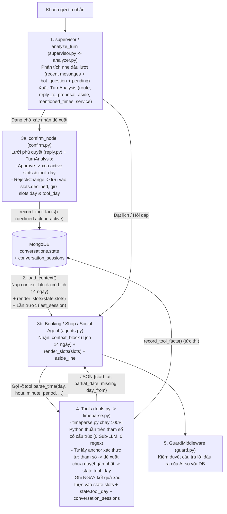

# Kiến trúc Tool `parse_time` Có Cấu Trúc (0 Sub-LLM, 0 Regex) + Working Memory & Episodic Memory Tức Thì — Thiết Kế

Ngày: 2026-10-28.

## 1. Vì sao (Motivation)

Sau khi rút gọn regex từ 45 xuống 3 (spec `2026-10-27-regex-reduction-design.md`), rà soát toàn bộ luồng Context Engineering của `app/agents/booking_graph/` cho thấy **4 điểm đứt gãy ngữ cảnh giữa các lượt** và **1 anti-pattern trong `timeparse.py`**:

### 1.1. Bốn điểm đứt gãy ngữ cảnh giữa các lượt (Context Loss)
1. **Kết quả trung gian của tool chỉ sống trong 1 lượt:**
   - Thiết kế hiện tại cố ý không lưu `ToolMessage` vào thread checkpointer ngoài (`test_thread_holds_only_question_and_answer_not_tool_messages` giữ thread sạch, chỉ gồm câu hỏi khách và câu đáp lễ tân). Thứ duy nhất được giữ lại qua `ConfirmMiddleware` là `proposal_id` và `queued`.
   - Tuy nhiên, khi kết quả của `parse_time` (vd. `partial_date: "2026-10-29"` khi khách mới nói `"sáng mai"` mà chưa nói giờ) hoặc `find_free_slots` không được lưu vào Working Memory (`state.slots`), sang lượt kế tiếp dữ kiện đã xác thực đó biến mất khỏi trạng thái có cấu trúc.
2. **`ConversationSlots` (`day`, `time`, `intent`, `declined`) chỉ được ghi khi nén lịch sử (> 800 tokens):**
   - Model `ConversationSlots` (`app/models/conversation.py`) và hàm `render_slots` (`app/agents/booking_graph/context.py`) đã được thiết kế để hiển thị khối `Trạng thái cuộc trò chuyện:` cho Agent.
   - Thế nhưng `apply_turn_analysis` (`app/services/conversation_state.py:185-190`) chỉ ghi `service`, `stated`, `asked`. Còn `day`, `time`, `intent`, `declined` chỉ được ghi trong `_compact` (khi phần tin cũ ngoài cửa sổ vượt 800 tokens $\approx$ 15–20 tin nhắn).
   - Hệ quả: Trong phần lớn cuộc hội thoại đặt lịch thông thường (dưới 15 lượt), `slots.day`, `slots.time`, `slots.intent`, `slots.declined` luôn rỗng.
3. **Dòng `[declined: ...]` chỉ sống đúng 1 lượt duy nhất (`context.py:553-576`):**
   - Khi khách hoãn hoặc từ chối đề xuất ở Lượt 5, dòng `[declined: ...]` chỉ hiện ở Lượt 6. Nếu Lượt 6 khách hỏi chuyện phụ (vd. hỏi giờ mở cửa/giá) rồi Lượt 7 mới chốt giờ khác, dòng `[declined: ...]` biến mất trong khi `slots.day` và `slots.declined` vẫn rỗng $\rightarrow$ Agent mất dấu ngày đang bàn và các mốc giờ khách đã lắc đầu.
4. **Episodic Memory (`conversation_sessions` — dòng `"Lần trước"`) bị khoá sau ngưỡng nén 800 tokens (`conversation_state.py:311`, `context.py:375-386`):**
   - Hệ thống đã thiết kế Episodic Memory qua bảng `conversation_sessions` (TTL 30 ngày, hiển thị dòng `"Lần trước (hôm qua...)"` trong 7 ngày nếu phiên trước còn `slots.intent` dang dở mà chưa đặt lịch mới).
   - **NHƯNG** `self.sessions.upsert(...)` hiện chỉ được gọi bên trong `_compact()` (> 800 tokens). Nếu khách chat 3–5 câu rồi hẹn mai nhắn lại, `_compact()` không chạy $\rightarrow$ `conversation_sessions` không có bản ghi nào $\rightarrow$ hôm sau khách quay lại mất sạch Episodic Memory.
   - Ngoài ra, `render_last_session_line` (`context.py:382-385`) chỉ đọc `digest.wants + digest.open`; khi phiên trước ngắn (chưa có `digest`, chỉ có `slots`), dòng `"Lần trước"` bị rỗng phần mô tả.

### 1.2. Anti-pattern "LLM gọi Tool, Tool lại gọi Sub-LLM mù ngữ cảnh" trong `parse_time`
- `Booking Agent` (vốn đã là một LLM có đầy đủ lịch sử hội thoại, `context_block` và `ConversationSlots`) khi gọi tool `parse_time(text)` chỉ truyền một mảnh chữ cắt rời.
- Bên trong `timeparse.py`, hàm `_ask_model` lại gọi một **Sub-LLM thứ hai** không thấy lịch sử hội thoại, vừa tốn thêm ~2 giây/lượt, vừa dễ đoán sai ngày khi câu khách ngắn (`"10 giờ 15 sáng"`, `"2 giờ chiều cùng ngày"`).
- Hơn nữa, `timeparse.py` vẫn còn giữ 1 regex `_FULL`. Nếu thay `_FULL` bằng một bộ quét chữ tiếng Việt tự viết trong `timeparse.py` thì lại vi phạm bẫy #11 trong `CONTEXT.md` ("parser thứ hai làm được một nửa").
- **Giải pháp chuẩn:** Giao việc trích xuất ngữ nghĩa thời gian cho chính **Booking Agent LLM** (dựa trên lịch tham chiếu 14 ngày trong `context_block` + lịch sử hội thoại) và truyền **tham số có cấu trúc** (`day`, `hour`, `minute`, `period`, `is_now`, `ambiguous_week`, `anchor`) vào tool `parse_time`. Bên trong `timeparse.py` chỉ làm nhiệm vụ **quy đổi 24h, hợp nhất mốc neo (`anchor` / `tool_day`) và kiểm tra hàng rào `_guard` bằng Python thuần** (0 Sub-LLM, 0 Regex, 0 bộ quét chữ tự chế).

### 1.3. Phạm vi (Scope Boundary)
- Spec này tập trung giải quyết dứt điểm:
  1. Chuyển `parse_time` / `timeparse.py` sang kiến trúc tham số có cấu trúc thuần Python (0 Sub-LLM, 0 Regex).
  2. Ghi tức thì dữ kiện xác thực từ tool và node `confirm` vào Working Memory (`state.slots` + `state.tool_day`) và đồng bộ ngay sang Episodic Memory (`conversation_sessions`).
- Các lưới kiểm tra đầu vào bằng Python thuần (`0 regex`) trong `supervisor.py`, `relatives.py` và `reply.py` (từ spec `2026-10-27-regex-reduction-design.md`) được giữ nguyên hoàn toàn.

---

## 2. Kiến trúc Luồng Dữ Liệu Mới (Data Flow & Working Memory)



---

## 3. Thiết kế Chi tiết Từng Thành Phần

### 3.1. Bất biến An toàn: "Code không bao giờ hành động dựa trên Slots do LLM sinh"

Tuân thủ tuyệt đối quy tắc khóa trong `docs/superpowers/specs/2026-09-19-conversation-state-design.md`:
- `ConversationSlots` (`state.slots`) chỉ được render thành chữ tiếng Việt trong prompt (`render_slots(slots)`, không in mã ISO thô để giữ nguyên giọng tự nhiên cho người lớn tuổi — `test_render_speaks_vietnamese_not_iso`).
- `apply_turn_analysis` **không** ghi `TurnAnalysis.mentioned_times` vào `state.slots.day` hay `state.slots.time` (tránh việc bộ phân tích đầu lượt đoán nhầm ngày rồi tự biến thành trạng thái).
- Để `parse_time` có thể tự động nối ngày giữa 2 lượt liên tiếp (vd. Lượt 1 khách nói `"sáng mai"` $\rightarrow$ `parse_time` giải ra `partial_date = "2026-10-29"`, Lượt 2 khách chỉ nói `"10 giờ 15 sáng"` mà Agent quên truyền `day`), `ConversationState` bổ sung một trường chỉ-do-code-ghi:
  - `tool_day: Optional[str] = None` (lưu tại `state.tool_day` trong MongoDB).
  - **Chỉ duy nhất `record_tool_facts`** (được gọi từ kết quả đã qua kiểm tra của `parse_time`, `find_free_slots`, `propose_appointment`, `cancel_appointment`, `confirm`) mới được ghi `state.tool_day`, và xoá về `None` khi `clear_active=True`.
  - Lượt nén LLM (`_compact`) **không bao giờ** ghi vào `state.tool_day`. Nhờ đó, mốc ngày dự phòng trong `parse_time` 100% đến từ dữ kiện code đã xác thực, không bao giờ đến từ slot do LLM nén.

### 3.2. Lịch Tham Chiếu 14 Ngày & Working Memory Tức Thì (`context.py`, `conversation_state.py`)

1. **Lịch tham chiếu 14 ngày trong `build_context_block` (`app/agents/booking_graph/context.py`):**
   - Ngay dưới dòng `"Bây giờ là ..."`, bổ sung dòng lịch 14 ngày tới do code tính sẵn:
     `Lịch 14 ngày tới: Thứ Sáu 7/8=2026-08-07, Thứ Bảy 8/8=2026-08-08, ...`
   - Giúp `Booking Agent` ánh xạ tức thì mọi cách nói ngày của khách (`"mai"`, `"mốt"`, `"thứ Tư tuần này"`, `"thứ Năm tuần sau"`, `"Chủ nhật tới"`, hoặc `"Thứ Bảy 8/8"` trong `Trạng thái cuộc trò chuyện`) ra đúng `YYYY-MM-DD` để truyền vào `parse_time(day=...)` và `find_free_slots(day=...)`.

2. **Phương thức `record_tool_facts` (`app/services/conversation_state.py`):**
   - Chữ ký:
     ```python
     async def record_tool_facts(
         self,
         user_id: str,
         *,
         intent: Optional[str] = None,
         day: Optional[str] = None,
         time: Optional[str] = None,
         service: Optional[str] = None,
         declined_iso: Optional[str] = None,
         clear_active: bool = False,
     ) -> None
     ```
   - Dùng chung pipeline nguyên tử `_set_today_fields`:
     - Khi `clear_active=True` (ngay sau khi `confirm.py` duyệt lịch thành công — `booked`, `moved`, `cancelled`):
       - Xoá `state.slots.intent = None`, `state.slots.day = None`, `state.slots.time = None`, và `state.tool_day = None`.
     - Khi **`parse_time`** giải ra `start_at` hoặc `partial_date` / `partial_hour`:
       - Nếu có `start_at`: ghi `state.slots.day = local_start.date().isoformat()`, `state.tool_day = local_start.date().isoformat()`, và `state.slots.time = local_start.strftime("%H:%M")`.
       - Nếu chỉ có `partial_date`: ghi `state.slots.day = partial_date.isoformat()`, `state.tool_day = partial_date.isoformat()`.
       - Nếu chỉ có `partial_hour` đã rõ buổi (`0..23` và `"sáng hay chiều"` không nằm trong `missing`): ghi `state.slots.time = f"{partial_hour:02d}:{partial_minute:02d}"`.
     - Khi **`find_free_slots`** chạy với `parsed_day` hợp lệ (từ hôm nay tới 90 ngày tới):
       - Ghi `state.slots.day = parsed_day.isoformat()` và `state.tool_day = parsed_day.isoformat()`. (Không ghi vào `slots.told` vì `find_free_slots` là dữ liệu thô trước khi bot chọn câu trả lời).
     - Khi **`propose_appointment`** giữ chỗ thành công:
       - Ghi `state.slots.intent = "reschedule" if old else "book"`, `state.slots.day = local_start.date().isoformat()`, `state.tool_day = local_start.date().isoformat()`, `state.slots.time = local_start.strftime("%H:%M")`, và `state.slots.service = note` (nếu có).
     - Khi **`cancel_appointment`** tạo đề xuất hủy:
       - Ghi `state.slots.intent = "cancel"`, `state.slots.day = local_start.date().isoformat()`, `state.tool_day = local_start.date().isoformat()`, `state.slots.time = local_start.strftime("%H:%M")`.
     - Khi **`confirm.py`** từ chối / đổi ý (`reject` / `supersede` / nút `"no"`):
       - Ghi mốc đề xuất vừa từ chối vào `state.slots.declined`, giữ `state.slots.day = local_start.date().isoformat()` và `state.tool_day = local_start.date().isoformat()`.

3. **Đồng bộ Episodic Memory (`conversation_sessions`) ngay trong `record_tool_facts` (`conversation_state.py`, `context.py`):**
   - Ngay sau khi `_set_today_fields` cập nhật `state`, `record_tool_facts` đọc lại `updated = await self.conversations.get_state(user_id)` và gọi:
     ```python
     if updated and updated.slots is not None:
         await self.sessions.upsert(
             user_id=user_id,
             day=today,
             digest=updated.digest,
             slots=updated.slots,
             expires_at=now + timedelta(days=SESSION_TTL_DAYS),
         )
     ```
   - Việc truyền `digest=updated.digest` bảo toàn nguyên vẹn bản `digest` (nếu phiên đã từng nén trước đó), và việc gọi `upsert` cả khi `clear_active=True` đảm bảo khi khách chốt lịch thành công, `slots.intent` trong `conversation_sessions` của hôm nay cũng được xoá về `None` (không để sót ý định dang dở giả sang ngày mai).
   - Lúc này, mốc `expires_at - SESSION_TTL_DAYS` trong `_last_session_for_context` (`context.py:547`) mang ý nghĩa chính xác là **"mốc cập nhật trạng thái cuối cùng của phiên đó"**.
   - Trong `render_last_session_line` (`context.py:375-386`): khi `session.digest` rỗng (do phiên trước ngắn dưới 800 tokens), hàm tự dựng chuỗi tóm tắt từ `session.slots` (`intent`, `service`, `day`, `time`, `stated`) để dòng `"Lần trước (...)"` luôn có nội dung đầy đủ.

---

### 3.3. Tool `parse_time` Có Cấu Trúc & `timeparse.py` Thuần Python (0 Sub-LLM, 0 Regex)

1. **Xoá bỏ Sub-LLM `_ask_model` và Regex `_FULL` trong `timeparse.py`:**
   - `timeparse.py` trở thành module **100% Python thuần (0 LLM call, 0 `re.compile`, 0 quét chữ tự do)**.
   - Xoá `_FULL`, `_DAY_PATTERN`, `_TIME_PATTERN`, `_match_regex`, `_PROMPT`, `_ask_model`.
   - `ParsedTime.source` đổi kiểu thành `Literal["code", "regex", "llm"] = "code"` và bổ sung trường `day_from: Optional[Literal["explicit", "anchor"]] = None`.
   - Ngân sách regex toàn bộ `app/agents/booking_graph/` giảm từ **3 xuống còn 2 regex** (`guard.py: 2`, `timeparse.py: 0`, mọi file khác `0`).

2. **Chữ ký và quy tắc giải mã của `parse_vi_time` (`app/agents/booking_graph/timeparse.py`):**
   ```python
   async def parse_vi_time(
       now: datetime,
       *,
       day: Optional[str] = None,
       hour: Optional[int] = None,
       minute: int = 0,
       period: Optional[str] = None,
       is_now: bool = False,
       ambiguous_week: bool = False,
       anchor: Optional[datetime] = None,
       session_day: Optional[date] = None,
       hours: Optional[ShopHours] = None,
   ) -> ParsedTime
   ```
   - **Bước 1 (`is_now=True`):** Trả về `_guard(ParsedTime(start_at=now, day_from="explicit", source="code"), now)` (tự động đẩy lên mốc 15 phút kế tiếp qua `next_slot_after(now)`).
   - **Bước 2 (Kiểm tra `day`, `hour`, `minute`, `period`):**
     - `parsed_day`: parse `date.fromisoformat(day)` nếu `day` được truyền; sai định dạng thì coi là `None` (fail-soft).
     - Kiểm tra khoảng `hour` (`0..23`) và `minute` (`0..59`); ngoài khoảng thì trả về `ParsedTime(partial_date=parsed_day, missing=["giờ cụ thể"], source="code")`.
     - Quy đổi giờ 24h qua `_to_24h(hour, norm_period)`:
       - Hỗ trợ cả giờ 12h kèm buổi (`hour=3, period="chiều"` $\rightarrow$ `15`) lẫn trường hợp LLM đã đổi sẵn giờ 24h kèm buổi (`hour=15, period="chiều"` $\rightarrow$ `15`; `hour=19, period="tối"` $\rightarrow$ `19`; `hour=12, period="trưa"` $\rightarrow$ `12`).
       - Không có `period`: chỉ chấp nhận giờ 24h tường minh (`13..23` hoặc `0`); nếu `1 <= hour <= 12` thì giữ `partial_hour = hour` và thêm `"sáng hay chiều"` vào `missing`.
   - **Bước 3 (Xây dựng `candidate` & Hợp nhất mốc neo `anchor` / `session_day`):**
     - Nếu `ambiguous_week=True` và chưa có `parsed_day`: `missing` bắt đầu bằng `["tuần này hay tuần sau"]` (và `"sáng hay chiều"` nếu `1 <= hour <= 12` chưa có buổi). `apply_anchor` không tự đoán ngày khi đang vướng `"tuần này hay tuần sau"`.
     - Nếu thiếu ngày (`parsed_day is None`, `ambiguous_week=False`) và có `hour`:
       - Chạy `apply_anchor(candidate, anchor, hours)` nếu có `anchor` (điền ngày từ `anchor`, và điền buổi từ `anchor` nếu chỉ một buổi nằm trong `ShopHours`).
       - Nếu chưa có `anchor` nhưng có `session_day` (`state.tool_day`): điền `partial_date = session_day`, `day_from = "anchor"`; nếu giờ đã rõ 24h thì tạo luôn `start_at` trên `session_day` và xoá `"ngày nào"` khỏi `missing`.
       - Mọi trường hợp ngày được lấy từ `anchor` hoặc `session_day` đều đánh dấu `day_from = "anchor"`.
   - **Bước 4 (`_guard(candidate, now)`):** Kiểm tra giờ quá khứ (`"ngày khác — giờ đó qua mất rồi"`), cửa sổ 15 phút hiện tại, và trần 90 ngày (`"ngày gần hơn"`).

3. **Tự động lấy mốc neo an toàn trong Tool `parse_time` (`app/agents/booking_graph/tools.py`):**
   - Khi `anchor` không được truyền vào `parse_time`, tool chỉ tự động tra cứu mốc neo từ **2 nguồn dữ kiện code đã xác thực**:
     1. Đề xuất gần nhất của khách (`ProposalService(db).latest(user)`): **CHỈ** lấy khi `latest.status == "pending"` HOẶC (`latest.status in ("rejected", "superseded", "expired")` và `now_utc() - ensure_aware(latest.updated_at) <= timedelta(minutes=DECLINED_MAX_AGE_MINUTES)`). **TUYỆT ĐỐI KHÔNG** lấy đề xuất đã `approved`.
     2. `state.tool_day` từ `ConversationService(db).get_state(str(user.id))` (chỉ khi `state.day == today`).
   - Khi kết quả trả về có `day_from == "anchor"`, JSON trả về của `parse_time` có thêm `"day_from": "anchor"` và docstring hướng dẫn `Booking Agent` luôn nêu rõ lại thứ/ngày đầy đủ cho khách biết.

---

## 4. Xử lý Lỗi & Kiểm thử (Error Handling & Testing)

- **Fail-soft:**
  - Mọi đầu vào ngoài khoảng (`hour=25`, `day="không phải ngày"`, `anchor="không phải iso"`, gọi rỗng không tham số) đều trả về `ParsedTime(missing=[...])` hợp lệ thay vì ném exception.
  - Mọi thao tác `record_tool_facts` bọc `try/except` log warning để lỗi DB tạm thời không làm hỏng kết quả tool trả về cho Agent.
- **Kiểm thử:**
  - `tests/test_regex_budget.py`: Khoá chặt ngân sách regex toàn `app/agents/booking_graph/` ở mức **2 regex** (`guard.py: 2`, `timeparse.py: 0`, mọi file khác `0`).
  - `tests/test_timeparse.py`: Kiểm thử toàn diện `parse_vi_time` thuần Python (0 LLM, 0 regex) cho mọi ca: đủ ngày giờ, thiếu ngày, thiếu giờ, thiếu buổi, thứ chưa rõ tuần (`ambiguous_week=True`), `"bây giờ"` (`is_now=True`), nối ngày/buổi từ `anchor` và `session_day` kèm `day_from="anchor"`, giờ quá khứ, quá 90 ngày, và giờ ngoài khoảng (`hour=25`).
  - `tests/test_conversation_slots.py`, `tests/test_conversation_sessions.py`, `tests/test_tools.py`, `tests/test_confirm.py`, `tests/test_confirm_flow.py`: Kiểm thử `record_tool_facts`, đồng bộ `conversation_sessions` (cả khi tạo mới lẫn khi `clear_active=True`), không lấy đề xuất `approved` làm anchor, và giữ ngữ cảnh xuyên suốt nhiều lượt.
