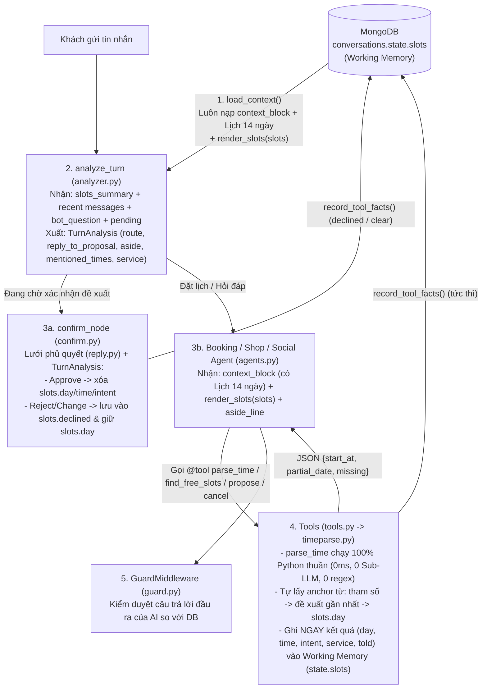

# Kiến trúc Tool `parse_time` Thuần Python (0 Sub-LLM, 0 Regex) + Working Memory Xuyên Suốt Phiên — Thiết Kế

Ngày: 2026-10-28.

## 1. Vì sao (Motivation)

Sau khi rút gọn regex từ 45 xuống 3 (spec `2026-10-27-regex-reduction-design.md`), rà soát toàn bộ luồng Context Engineering và kiểm thử live cho thấy kiến trúc của `app/agents/booking_graph/` còn **4 lỗ hổng làm rớt ngữ cảnh giữa các lượt** và **1 anti-pattern lớn trong `timeparse.py`**:

### 1.1. Bốn lỗ hổng làm mất Context giữa các lượt (Context Loss)
1. **Toàn bộ `ToolMessage` bị vứt bỏ cuối mỗi lượt (`agents.py:159-160, 208-210`, `graph.py:51`):**
   - Sub-agent (`booking`, `shop`, `social`) chạy với `checkpointer=False`. Khi kết thúc lượt, `make_agent_node` chỉ lấy chuỗi `AIMessage.content` cuối cùng, xoá sạch mọi `ToolMessage` (kết quả của `parse_time`, `find_free_slots`, lỗi `propose_appointment`). Thứ duy nhất được giữ lại là `proposal_id` và `queued` qua `ConfirmMiddleware`.
   - Hệ quả: Ở Lượt $N$, `parse_time` tìm ra `partial_date: "2026-10-28"` hoặc `find_free_slots` báo 3 giờ trống; sang Lượt $N+1$, toàn bộ JSON đó biến mất.
2. **`ConversationSlots` (`day`, `time`, `intent`, `declined`, `told`) chỉ được ghi khi nén lịch sử (> 800 tokens):**
   - Model `ConversationSlots` (`app/models/conversation.py`) và hàm `render_slots` (`app/agents/booking_graph/context.py`) đã được thiết kế đầy đủ để hiển thị `Trạng thái cuộc trò chuyện:` cho Agent.
   - Tuy nhiên, `apply_turn_analysis` (`app/services/conversation_state.py:185-190`) chỉ ghi `service`, `stated`, `asked`. Còn `day`, `time`, `intent`, `declined` chỉ được ghi trong `_compact` (khi hội thoại vượt 800 tokens $\approx$ 15–20 tin nhắn), và `told` chưa từng được ghi ở bất kỳ đâu!
   - Hệ quả: Trong 95% cuộc hội thoại đặt lịch thông thường (dưới 15 lượt), `slots.day` và `slots.time` luôn bằng `None`.
3. **Dòng `[declined: ...]` chỉ sống đúng 1 lượt duy nhất (`context.py:553-576`):**
   - Khi khách hoãn hoặc từ chối đề xuất ở Lượt 5, dòng `[declined: ...]` chỉ hiện ở Lượt 6. Nếu Lượt 6 khách hỏi chuyện phụ (vd. hỏi dịch vụ/giá) rồi Lượt 7 mới chốt giờ, dòng `[declined: ...]` biến mất trong khi `slots.day` vẫn là `None` $\rightarrow$ bot quên sạch ngày đang bàn.
4. **Episodic Memory (`conversation_sessions` — dòng `"Lần trước"`) cũng bị khoá sau ngưỡng nén 800 tokens (`conversation_state.py:311`, `context.py:375-386`):**
   - Hệ thống đã thiết kế Episodic Memory qua bảng `conversation_sessions` (TTL 30 ngày, hiển thị dòng `"Lần trước (hôm qua...)"` trong 7 ngày nếu phiên trước còn `slots.intent` dang dở mà chưa đặt lịch mới).
   - **NHƯNG** lệnh `self.sessions.upsert(...)` hiện chỉ được gọi bên trong `_compact()` (khi hội thoại > 800 tokens)! Nếu khách chat 3–5 câu rồi hẹn mai nhắn lại, `_compact()` không chạy $\rightarrow$ `conversation_sessions` không có bản ghi nào $\rightarrow$ hôm sau khách quay lại bị mất sạch Episodic Memory!
   - Hơn nữa, `render_last_session_line` (`context.py:382-385`) chỉ đọc `digest.wants + digest.open`; khi phiên trước ngắn (chưa có `digest`, chỉ có `slots`), dòng `"Lần trước"` bị rỗng nội dung.

### 1.2. Anti-pattern "LLM gọi Tool, Tool lại gọi Sub-LLM mù ngữ cảnh" trong `parse_time`
- `Booking Agent` (vốn đã là một LLM có đầy đủ lịch sử hội thoại, `context_block` và `ConversationSlots`) khi gọi tool `parse_time(text)` chỉ truyền một mảnh chữ cắt rời.
- Bên trong `timeparse.py`, hàm `_ask_model` lại gọi một **Sub-LLM thứ hai** không hề nhìn thấy lịch sử hội thoại hay ngày đang bàn (`anchor`), dẫn tới vừa tốn thêm ~1.5–2.5 giây/lượt, vừa sinh lỗi quên ngày (khi khách chỉ đáp `"10 giờ 15 sáng"`) hoặc hiểu sai `"2 giờ chiều cùng ngày"` thành ngày hôm nay.
- Ngoài ra, `timeparse.py` vẫn còn giữ 1 regex `_FULL`.

---

## 2. Kiến trúc Luồng Dữ Liệu Mới (Data Flow & Working Memory)

---

## 3. Thiết kế Chi tiết Từng Thành Phần

### 3.1. Working Memory Tức Thì (`ConversationStateService`, `context.py`, `tools.py`, `confirm.py`)

1. **Lịch tham chiếu 14 ngày trong `build_context_block` (`context.py`):**
   - Ngay dưới dòng `"Bây giờ là ..."`, bổ sung dòng lịch 14 ngày tới do code tính sẵn:
     `Lịch 14 ngày tới: T3 27/10=2026-10-27, T4 28/10=2026-10-28, ...`
   - Giúp cả `Booking Agent` và `analyze_turn` ánh xạ tức thì mọi cách nói ngày (`"mai"`, `"mốt"`, `"thứ Tư tuần này"`, `"thứ Năm tuần sau"`, `"Chủ nhật tới"`, `"cùng ngày"`) ra `YYYY-MM-DD` mà không bao giờ cộng nhầm ngày.
   - Trong `render_slots(slots)` (`context.py`), dòng `Ngày đang nhắm` hiển thị kèm mã ISO:
     `- Ngày đang nhắm: Thứ Tư 28/10 (2026-10-28)`
     để Agent và tool nối ngày qua nhiều lượt không cần tính lại.

2. **Ghi Working Memory tức thì từ Tool & Confirm (`ConversationStateService` trong `app/services/conversation_state.py`):**
   - Thêm phương thức `record_tool_facts(user_id, *, intent=None, day=None, time=None, service=None, told=None, declined_iso=None, clear_active=False)` dùng chung pipeline nguyên tử `_set_today_fields`:
     - Khi **`parse_time`** giải ra `start_at` hoặc `partial_date` / `partial_hour`:
       - Nếu có `start_at`: ghi `state.slots.day = local_start.date().isoformat()` và `state.slots.time = local_start.strftime("%H:%M")`.
       - Nếu chỉ có `partial_date`: ghi `state.slots.day = partial_date.isoformat()`.
       - Nếu chỉ có `partial_hour` đã rõ buổi (`0..23` và `"sáng hay chiều"` không nằm trong `missing`): ghi `state.slots.time = f"{partial_hour:02d}:{partial_minute:02d}"`.
     - Khi **`find_free_slots`** trả về danh sách giờ trống cho ngày `parsed_day`:
       - Ghi `state.slots.day = parsed_day.isoformat()`.
       - Ghi vào `state.slots.told` (tối đa `MAX_TOLD = 5` mục) câu tóm tắt ngắn: `"Ngày D/M còn trống: ..."` (hoặc `"Ngày D/M đã kín lịch"`).
     - Khi **`propose_appointment`** giữ chỗ thành công:
       - Ghi `state.slots.intent = "reschedule" if old else "book"`, `state.slots.day = local_start.date().isoformat()`, `state.slots.time = local_start.strftime("%H:%M")`, và `state.slots.service = note` (nếu có).
     - Khi **`cancel_appointment`** tạo đề xuất hủy:
       - Ghi `state.slots.intent = "cancel"`, `state.slots.day = local_start.date().isoformat()`, `state.slots.time = local_start.strftime("%H:%M")`.
     - Khi **`confirm.py`** từ chối / đổi ý (`reject` / `supersede` / nút `"no"`):
       - Ghi mốc đề xuất vừa từ chối vào `state.slots.declined` và giữ `state.slots.day = to_local(proposal.start_at).date().isoformat()`, để kể cả sau 2–3 lượt hỏi chuyện khác, ngày khách đang bàn và giờ khách đã lắc đầu vẫn còn nguyên trong `Trạng thái cuộc trò chuyện:`.
     - Khi **`confirm.py`** duyệt thành công (`execute_proposal` trả về `booked` / `moved` / `cancelled`):
       - Xoá `state.slots.intent = None`, `state.slots.day = None`, `state.slots.time = None` (`clear_active=True`, vì lịch đã chính thức nằm trong `Lịch sắp tới của khách:`).

3. **Cập nhật `apply_turn_analysis` & Đồng bộ Episodic Memory (`conversation_sessions`) ngay trong lượt (`app/services/conversation_state.py`, `app/agents/booking_graph/context.py`):**
   - Ngoài `service`, `stated`, `asked`, nếu `TurnAnalysis.mentioned_times` có mốc ngày/giờ rõ ràng (ví dụ khách nói `"sáng thứ 4 tuần này"` rồi kèm `"để chị hỏi lại nó đã"` khiến lượt đó trả lời bằng `deferral_reply` mà chưa gọi tool), `apply_turn_analysis` cũng trích `day`, `time` và `intent="book"` (khi `route == "booking"` hoặc có `service`/`day`) lưu vào `state.slots`.
   - **Cập nhật Episodic Memory (`conversation_sessions`) mỗi khi `state.slots` thay đổi:** Trong `record_tool_facts` và `apply_turn_analysis`, khi `slots.intent` có giá trị, gọi luôn `self.sessions.upsert(user_id=user_id, day=today, digest=state.digest, slots=slots, expires_at=now + timedelta(days=SESSION_TTL_DAYS))` để khách chỉ chat 2–3 câu rồi rời đi thì ngày mai quay lại vẫn có Episodic Memory `"Lần trước (hôm qua)"` (không cần đợi 800 tokens).
   - **Bổ sung fallback từ `slots` cho `render_last_session_line` (`context.py:375-386`):** Khi `session.digest` rỗng (do phiên trước ngắn dưới 800 tokens), `render_last_session_line` tự dựng tóm tắt từ `session.slots` (`service`, `day`, `time`, `stated`) để dòng `"Lần trước (...)"` luôn đầy đủ thông tin.

---

### 3.2. Tầng Thời Gian Thuần Python — 0 Sub-LLM, 0 Regex (`timeparse.py` & `tools.py`)

1. **Xoá bỏ Sub-LLM `_ask_model` và Regex `_FULL` trong `timeparse.py`:**
   - `timeparse.py` trở thành module **100% Python thuần (0 LLM call, 0 `re.compile`)**.
   - Xoá `_FULL`, `_DAY_PATTERN`, `_TIME_PATTERN`, `_match_regex`, `_PROMPT`, `_ask_model`.
   - Ngân sách regex toàn bộ `app/agents/booking_graph/` giảm từ **3 xuống còn 2 regex** (`timeparse.py: 0`, chỉ còn 2 regex xoá tên tool trong `guard.py`).

2. **Giải mã thời gian thuần Python trong `parse_vi_time` (`timeparse.py`):**
   - Hỗ trợ đồng thời cả đầu vào có cấu trúc (`day`, `hour`, `minute`, `period`, `is_now`) do `Booking Agent` truyền VÀ chuỗi `text` tiếng Việt (nhờ bộ tách từ/giờ/ngày thuần Python trong `tokens.py` + `timeparse.py`):
     1. **Nhận diện `"bây giờ"` / `"qua liền"` (`_is_now_phrase(text)` hoặc `is_now=True`):**
        - Khớp các cụm `"bây giờ"`, `"giờ này"`, `"ngay bây giờ"`, `"qua liền"`, `"qua ngay"`, `"tới liền"`, `"tới ngay"`, `"giờ em qua"`, `"giờ chị qua"`, `"giờ anh qua"` (có dấu và không dấu).
        - Trả về `_guard(ParsedTime(start_at=now), now)` (tự đẩy lên mốc 15 phút kế tiếp).
     2. **Giải mã Ngày (`_extract_day(text, local_today, day_iso)`):**
        - Nếu có `day_iso` (`YYYY-MM-DD`) hợp lệ: dùng ngay `date.fromisoformat(day_iso)`.
        - Nếu `text` có dạng ISO `YYYY-MM-DD` hoặc ngày/tháng `DD/MM` (hoặc `ngày DD tháng MM`): tính ra `date` tương ứng.
        - Nếu `text` có offset tương đối (`"hôm nay"`=0, `"mai"`/`"ngày mai"`=1, `"mốt"`/`"ngày kia"`=2; `"hôm qua"`=-1): cộng vào `local_today`.
        - Nếu `text` có thứ trong tuần (`scan_weekdays`, `0..6`):
          - Nếu kèm `"tuần này"` / `"nay"`: lấy ngày của thứ đó trong tuần hiện tại (hoặc tuần kế nếu thứ đó đã qua).
          - Nếu kèm `"tuần sau"` / `"tuần tới"` (`has_next_week`): lấy ngày của thứ đó ở tuần kế tiếp.
          - Nếu chỉ nói trống `"thứ Năm"` mà không có `"tuần này"` / `"tuần sau"` / `"nay"` / `"tới"`: đánh dấu `ambiguous_week = True` (`missing=["tuần này hay tuần sau"]`).
     3. **Giải mã Giờ & Buổi (`_extract_clock(text, hour, minute, period)`):**
        - Lấy từ tham số `(hour, minute, period)` nếu được truyền, hoặc từ `tokens.scan_times(text)` (hỗ trợ `"3h chiều"`, `"9 giờ rưỡi sáng"`, `"10 giờ 15"`, `"15:30"`).
        - Nếu câu chỉ có buổi (`"sáng mai"`, `"chiều thứ Tư"`) mà không có số giờ: `has_period_only = True` (`missing=["giờ cụ thể"]`).
     4. **Hợp nhất với `anchor` / `session_day` & Kiểm tra `_guard`:**
        - Dùng `put_on_anchor_day` và `apply_anchor(candidate, anchor, hours)` để tự động lấy ngày hoặc buổi từ `anchor` / `session_day` khi khách chỉ nói giờ (`"10 giờ 15"`, `"đổi sang 4 giờ chiều"`, `"2 giờ chiều cùng ngày"`).
        - Cho kết quả qua `_guard(candidate, now)` để kiểm tra giờ quá khứ (`"ngày khác — giờ đó qua mất rồi"`), cửa sổ 15 phút (`next_slot_after`), và trần 90 ngày (`"ngày gần hơn"`).

3. **Tự động lấy `anchor` từ Working Memory trong Tool `parse_time` (`tools.py`):**
   - Tool `parse_time(text: str, anchor: Optional[str] = None, day: Optional[str] = None, hour: Optional[int] = None, minute: Optional[int] = None, period: Optional[str] = None)` giữ nguyên tương thích ngược với mọi lời gọi `parse_time(text=..., anchor=...)` đồng thời cho phép Agent truyền thêm `day`/`hour`/`minute`/`period`.
   - Khi `anchor` không được truyền, `parse_time` tự động tra cứu mốc neo từ Working Memory theo thứ tự:
     1. Đề xuất gần nhất của khách trong ngày hôm nay (`ProposalService(db).latest(user)` đang `pending` hoặc vừa đóng trong `DECLINED_MAX_AGE_MINUTES`).
     2. `state.slots.day` (+ `state.slots.time` nếu có) từ `ConversationService(db).get_state(str(user.id))`.
   - Ngay sau khi `parse_vi_time` trả về `ParsedTime`, `parse_time` gọi `ConversationStateService(db).record_tool_facts(...)` để lưu `partial_date` / `start_at` vào `state.slots` trước khi trả JSON `{"start_at", "partial_date", "missing"}` cho Agent.

---

## 4. Xử lý Lỗi & Kiểm thử (Error Handling & Testing)

- **Fail-soft:**
  - Mọi đầu vào ngoài khoảng (`hour=25`, `anchor="không phải iso"`, câu hỏi không chứa thời gian `"chủ tiệm rảnh không con"`) đều trả về `ParsedTime(missing=["giờ cụ thể"])` thay vì ném exception.
  - Mọi thao tác `record_tool_facts` bọc `try/except` log warning để lỗi DB tạm thời không làm hỏng kết quả tool trả về cho Agent.
- **Kiểm thử:**
  - `tests/test_regex_budget.py`: Khoá chặt ngân sách regex toàn `app/agents/booking_graph/` ở mức **2 regex** (`guard.py: 2`, `timeparse.py: 0`, mọi file khác `0`).
  - `tests/test_timeparse.py`: Kiểm thử toàn diện `parse_vi_time` thuần Python (0 LLM, 0 regex) cho mọi ca: đủ ngày giờ, thiếu ngày, thiếu giờ, thiếu buổi, thứ chưa rõ tuần, `"bây giờ"` / `"giờ em qua được không"`, nối ngày/buổi từ `anchor` và `session_day`, giờ quá khứ, quá 90 ngày, và giờ ngoài khoảng (`25 giờ`).
  - `tests/test_conversation_state_service.py` & `tests/test_tools.py`: Kiểm thử `record_tool_facts` và luồng tự động nhớ `slots.day` / `slots.time` / `slots.told` / `slots.declined` qua nhiều lượt khi gọi `parse_time`, `find_free_slots`, `propose_appointment`, `cancel_appointment`, và `confirm`.
