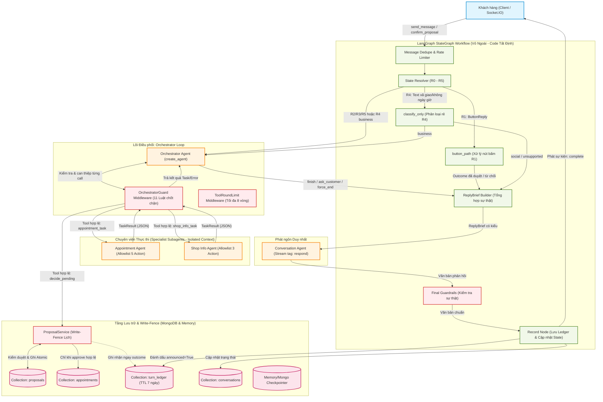
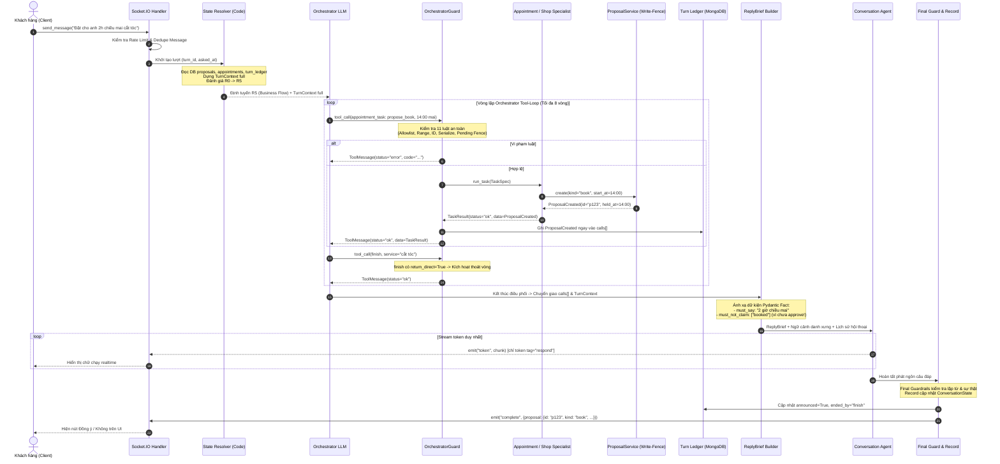
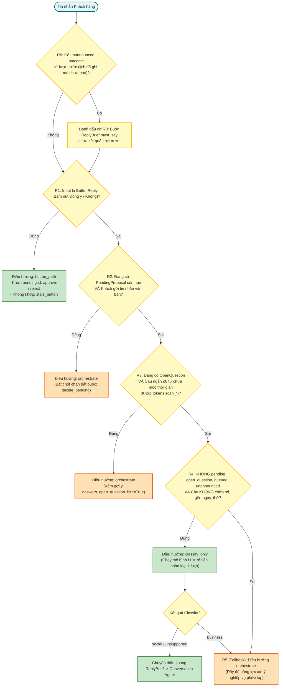
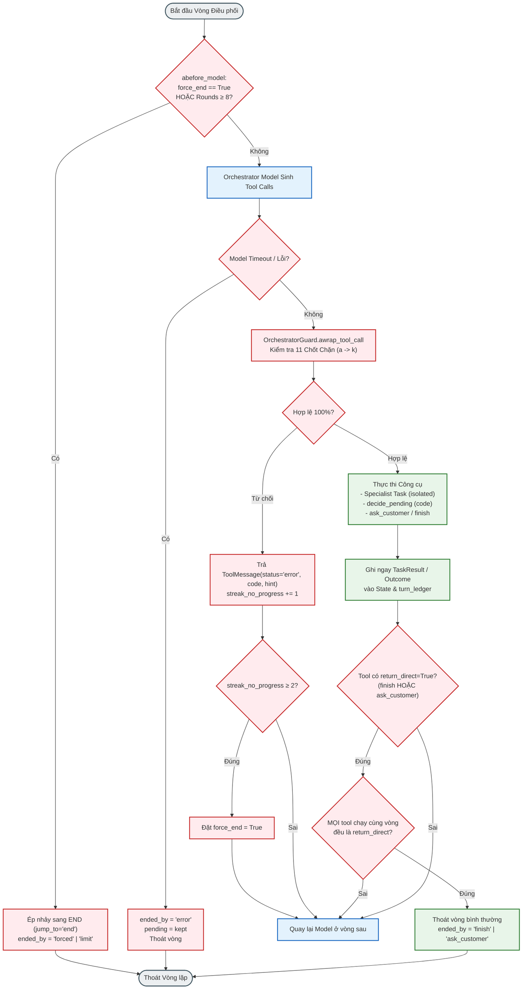
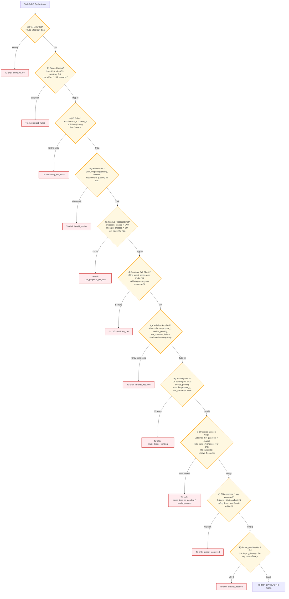
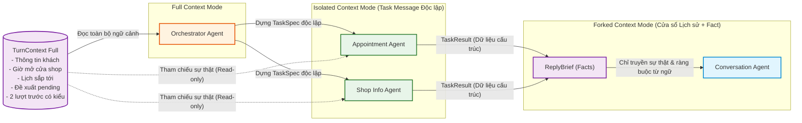
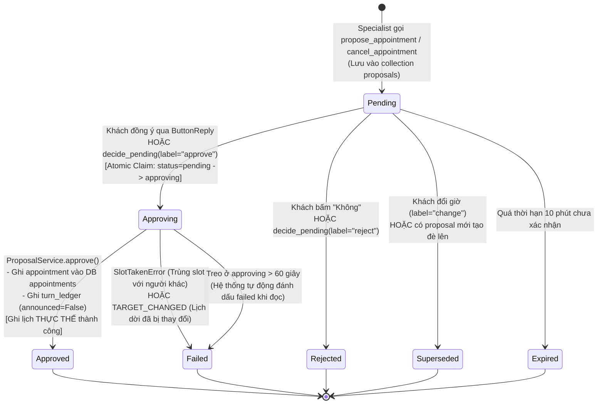
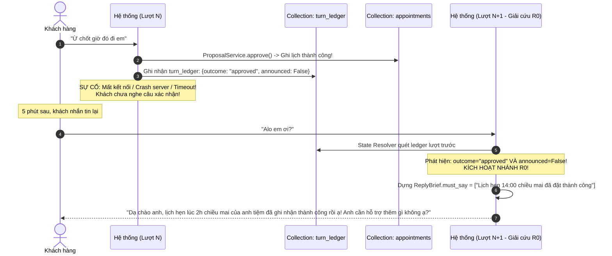
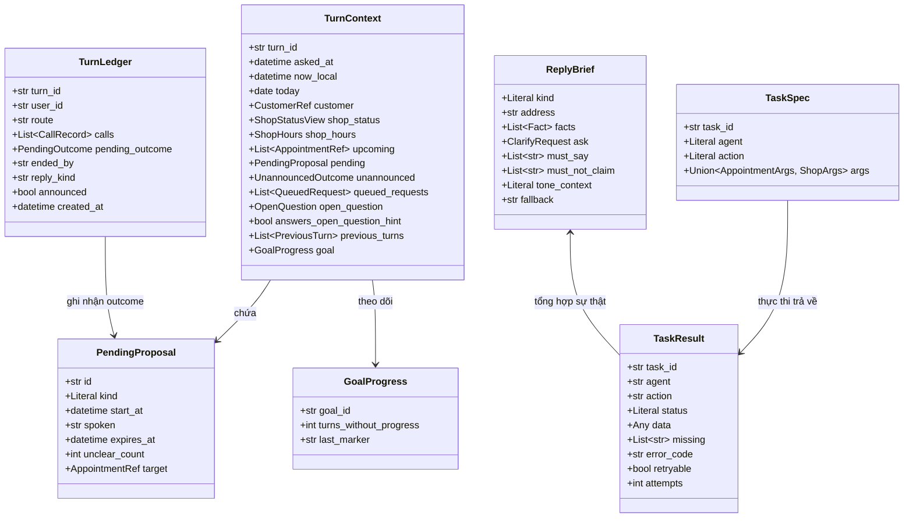
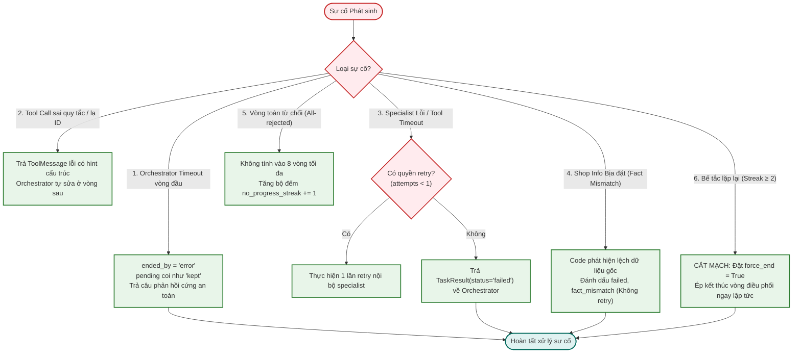

# Kiến trúc Hệ thống: LLM Orchestrator & 4-Agent Hybrid Workflow cho Salona Booking

**Tài liệu Tham chiếu Kiến trúc Chi tiết (Architecture Blueprint)**  
**Dựa trên Thiết kế**: `2026-10-29-llm-orchestrator-design.md`  
**Đối tượng Áp dụng**: Toàn bộ hệ thống AI điều phối đặt lịch (`app/agents/`)  
**Tác giả**: Lead System Architect  
**Trạng thái**: Hoàn thiện & Khả thi thi công (Ready for Implementation)

---

## 1. Tổng quan Hệ thống (System Architecture Overview & Topology)

### 1.1 Nguyên lý Mô hình Hybrid
Hệ thống xử lý hội thoại đặt lịch Salona Booking được thiết kế theo mô hình **Hybrid cấp cao**:
1. **Vỏ ngoài (Outer Workflow)**: Là một `StateGraph` của LangGraph thuần mã nguồn tất định (deterministic code). Vỏ này chịu trách nhiệm nạp trạng thái hội thoại từ cơ sở dữ liệu, kiểm tra các điều kiện tiên quyết (pre-conditions) thông qua **State Resolver**, và định tuyến luồng xử lý mà không cần tốn chi phí gọi LLM phân loại cồng kềnh.
2. **Lõi điều phối bên trong (Inner Orchestrator Tool-Loop)**: Sử dụng mô hình `create_agent` của LangChain hoạt động theo cơ chế *subagents-as-tools*. LLM Orchestrator đóng vai trò là "Tổng đài viên trưởng", nhận toàn bộ bối cảnh (`TurnContext full`), lập luận và triệu gọi các chuyên viên (Specialists) thông qua các công cụ chuyên biệt. Toàn bộ vòng lặp tool-calling này được kiểm soát nghiêm ngặt bởi **OrchestratorGuard** (Middleware can thiệp `awrap_tool_call`).
3. **Phát ngôn tập trung**: Duy nhất **Conversation Agent** được phép sinh văn bản trả lời khách hàng và phát luồng (stream) token mang nhãn tag `respond` ra giao diện Socket.IO.

```
                    KIẾN TRÚC HYBRID TỔNG QUAN
┌────────────────────────────────────────────────────────────────────────┐
│ VỎ NGOÀI: LangGraph StateGraph (Code tất định điều hướng)               │
│                                                                        │
│  [Socket.IO Input]                                                     │
│         │                                                              │
│         ▼                                                              │
│  [RateLimit & Dedupe]                                                  │
│         │                                                              │
│         ▼                                                              │
│  [State Resolver] ──── R1 (Button) ────► [button_path] ────────┐       │
│         │                                                      │       │
│         ├───────────── R4 (Social) ───► [classify_only] ───────┤       │
│         │                                                      │       │
│         ▼ R2, R3, R5 (Business)                                │       │
│  ┌──────────────────────────────────────────────────────────┐  │       │
│  │ LÕI ĐIỀU PHỐI: Orchestrator Loop (create_agent)          │  │       │
│  │                                                          │  │       │
│  │   [Orchestrator LLM] ◄──► [OrchestratorGuard Middleware] │  │       │
│  │         │                                                │  │       │
│  │         ├── appointment_task ──► [Appointment Agent]     │  │       │
│  │         ├── shop_info_task   ──► [Shop Info Agent]       │  │       │
│  │         ├── decide_pending   ──► [ProposalService (code)]│  │       │
│  │         ├── ask_customer     ──► [Record open_question]  │  │       │
│  │         └── finish           ──► [Return Direct]         │  │       │
│  └──────────────────────────────────────────────────────────┘  │       │
│         │                                                      │       │
│         ▼                                                      │       │
│  [ReplyBrief Builder] ◄────────────────────────────────────────┘       │
│         │                                                              │
│         ▼                                                              │
│  [Conversation Agent] (Stream DUY NHẤT tag "respond")                  │
│         │                                                              │
│         ▼                                                              │
│  [Final Guardrails] ──► [Record & Ledger] ──► [Socket.IO Output]       │
└────────────────────────────────────────────────────────────────────────┘
```

### 1.2 Phân định Trách nhiệm: 4 Agent và Các Thành phần Code Tất định

Hệ thống phân định ranh giới tuyệt đối giữa suy luận bằng AI và chốt chặn an toàn bằng code:

| Thành phần | Bản chất | Trách nhiệm chính | Điều CẤM kỵ tuyệt đối |
|---|---|---|---|
| **Orchestrator** | Agent LLM (`create_agent`) | Tiếp nhận bối cảnh, hiểu ý định tổng thể, lập kế hoạch gọi specialist hoặc công cụ điều phối. | CẤM sinh câu nói cho khách; CẤM gọi tool DB nghiệp vụ; CẤM ghi DB trực tiếp. |
| **Appointment Agent** | Specialist LLM (`create_agent`) | Tiếp nhận 1 `TaskSpec`, thực thi giải quyết thời gian, tìm slot trống, tạo đề xuất lịch (`propose_*`). | CẤM ghi lịch thật vào DB; CẤM tạo >1 đề xuất/task; CẤM nói chuyện với khách. |
| **Shop Info Agent** | Specialist LLM (`create_agent`) | Tiếp nhận 1 `TaskSpec`, truy vấn thông tin giờ mở cửa, trạng thái bận, suy luận tiệm có mở lúc $T$ không. | CẤM bịa đặt thông tin sai lệch dữ liệu gốc; CẤM nói chuyện với khách. |
| **Conversation Agent** | Agent LLM (Prompt thuần, không tool) | Nhận `ReplyBrief`, hành văn tự nhiên, thân thiện bằng tiếng Việt phù hợp với danh xưng khách hàng. | CẤM bịa sự thật ngoài brief; CẤM tự ý tuyên bố "đã đặt/huỷ" khi chưa có xác nhận; CẤM ra quyết định. |
| **State Resolver** | Mã nguồn Python thuần | Đọc DB/Ledger, phân tích sơ bộ tin nhắn, phân loại nhanh tuyến đường (R0 đến R5). | Không gọi LLM (Zero-LLM), không suy đoán ý định khách. |
| **OrchestratorGuard** | Middleware LangGraph | Chặn trước/sau mọi tool call của Orchestrator, thực thi 11 chốt an toàn nghiêm ngặt. | Không bỏ qua bất kỳ vi phạm tham số/logic nghiệp vụ nào. |
| **ReplyBrief Builder** | Mã nguồn Python thuần | Tổng hợp kết quả từ các task và quyết định pending để đóng gói thành Pydantic `ReplyBrief`. | Không phụ thuộc vào văn bản sinh ra từ `finish`. |
| **Write-Fence** | Lớp dịch vụ `ProposalService` | Đảm bảo Agent chỉ tạo đề xuất tạm. Chỉ hàm `approve` mới ghi dữ liệu vào bảng lịch hẹn. | Không cấp tool ghi trực tiếp cho LLM. |
| **Turn Ledger** | MongoDB Collection `turn_ledger` | Nhật ký bất biến lưu lại mọi bước chạy, kết quả task, đề xuất và cờ đã thông báo (`announced`). | Không phụ thuộc vào cơ chế checkpoint dễ bị reset. |

### 1.3 Sơ đồ Kiến trúc Chi tiết và Topology Thành phần



---

## 2. Vòng đời Một lượt Xử lý (Turn Lifecycle & Request Flow)

### 2.1 Sơ đồ Trình tự Hoàn chỉnh (Sequence Diagram)

Sơ đồ thể hiện chu trình nhận tin nhắn từ Socket.IO, đi qua các bước lọc, điều phối, thực thi công cụ cho đến khi trả lời khách hàng:



---

## 3. Cây Quyết định State Resolver (Decision Tree R0 -> R5)

State Resolver là trạm kiểm soát đầu tiên, chạy hoàn toàn bằng mã nguồn Python tĩnh (Zero-LLM), đảm bảo tính dự đoán tuyệt đối (predictability) và tốc độ phản hồi cực nhanh.

### 3.1 Sơ đồ Phân nhánh Quyết định (Decision Tree Flowchart)



### 3.2 Bảng Đặc tả Chi tiết các Tuyến Định tuyến

| Nhánh | Tên điều kiện | Logic kiểm tra dữ liệu | Đường đi kế tiếp | Chi phí LLM |
|---|---|---|---|---|
| **R0** | Unannounced Outcome | `TurnContext.unannounced is not None` (Lượt trước `ProposalService.approve` thành công nhưng ngắt kết nối trước khi phát tin). | Tiếp tục xét R1–R5 nhưng tiêm bắt buộc câu thông báo lịch thành công vào `must_say`. | Không tốn thêm LLM |
| **R1** | Button Reply | Tin nhắn gửi lên từ nút UI (`ButtonReply` chứa `proposal_id` và `decision`). | Gọi thẳng `button_path` (code thuần), không qua Orchestrator. Nếu stale trả câu mẫu. | 0 hoặc 1 lượt Conversation Agent |
| **R2** | Pending + Text | `pending is not None` (còn hạn) và khách nhập văn bản tự do. | `orchestrate`. OrchestratorGuard áp luật (h): từ chối mọi tool khác cho đến khi `decide_pending` được gọi. | LLM Orchestrator |
| **R3** | Answer Open Question | `open_question is not None` và số từ $\le 6$ và regex `tokens.scan_*` bắt được giờ/ngày/buổi. | `orchestrate` với `answers_open_question_hint=True` giúp Orchestrator hiểu ngay câu trả lời cho câu hỏi bot vừa hỏi. | LLM Orchestrator |
| **R4** | Classify Only | Trạng thái sạch (không pending/hỏi dở/hàng chờ) và câu thuần chữ không chứa bất kỳ mốc thời gian nào. | Gọi `classify_only` (prompt phân loại siêu nhẹ). Nếu xã giao hoặc ngoài phạm vi, bỏ qua Orchestrator đi thẳng vào Conversation. | 1 lượt LLM nhẹ |
| **R5** | Fallback Business | Các trường hợp còn lại (yêu cầu đặt lịch, dời lịch, huỷ lịch, hỏi giờ phức tạp). | Đưa toàn bộ vào `orchestrate` để Orchestrator lập luận và điều phối công cụ. | LLM Orchestrator |

---

## 4. Kiến trúc Orchestrator Tool Loop & OrchestratorGuard (Middleware Architecture)

Orchestrator không gọi trực tiếp API hay DB mà phát ra các tool calls. Toàn bộ các tool calls đều bị chặn lại bởi `OrchestratorGuard` tại hook `awrap_tool_call`.

### 4.1 Quy trình Vận hành Vòng lặp Orchestrator



### 4.2 Chi tiết 11 Chốt chặn Kiểm soát Tất định (Luật a đến k)

Mỗi lời gọi công cụ trong `messages[-1].tool_calls` đều phải vượt qua ma trận 11 chốt kiểm soát code tĩnh sau:



### 4.3 Phân tích Sâu Cơ chế Veto và Quản lý Đề xuất Chờ (Pending Proposal)
- **Luật (h) - Pending Fence**: Khi hệ thống ghi nhận có một đề xuất đang chờ (`TurnContext.pending`), Orchestrator **bắt buộc** phải giải quyết số phận của đề xuất đó thông qua `decide_pending` trước khi được phép đặt lịch mới, hỏi khách câu mới hoặc kết thúc. Nếu Orchestrator cố tình vi phạm 2 lần liên tiếp, code sẽ tự động can thiệp ghi nhận trạng thái `kept` (giữ nguyên đề xuất) và đánh dấu `pending_decided=True` để tránh kẹt hệ thống.
- **Luật (i) - Veto có cấu trúc**:
  - Nếu Orchestrator gán nhãn `approve` nhưng câu khách có mốc giờ khác với `pending.start_at` $\rightarrow$ Code tự động hạ cấp thành `change`.
  - Nếu Orchestrator gán nhãn `change` nhưng khách chỉ nhắc lại đúng giờ của đề xuất $\rightarrow$ Code từ chối công cụ với mã `same_time_as_pending`.
  - Nếu khách đồng ý nhưng kèm hoãn (`aside="defer_only"` hoặc `"defer_with_request"`) $\rightarrow$ Code hạ cấp thành `none` (`kept`), bảo lưu đề xuất cho khách.

---

## 5. Ranh giới và Hợp đồng 4 Agent (Agent Contracts & Context Modes)

Hệ thống thiết lập 3 chế độ cung cấp ngữ cảnh (Context Modes) riêng biệt nhằm cô lập dữ liệu, tối ưu hóa kích thước prompt và loại bỏ hoàn toàn lỗi "Agent tự suy diễn lệch khỏi chỉ đạo" (Lỗi nhóm B).



### 5.1 Ma trận Đặc tả Hợp đồng Giao tiếp giữa 4 Agent

| Đặc tính | 1. Orchestrator | 2. Appointment Agent | 3. Shop Info Agent | 4. Conversation Agent |
|---|---|---|---|---|
| **Mục đích** | Phân tích & điều phối vòng lặp tool | Xử lý logic đặt/dời/hủy/tìm slot | Tra cứu thông tin shop & giờ giấc | Tạo câu trả lời tự nhiên bằng tiếng Việt |
| **Loại hình** | LLM Agent (`create_agent`) | LLM Specialist (`create_agent`) | LLM Specialist (`create_agent`) | LLM Chat Model (Prompt chuẩn) |
| **Stream Token** | Không (`streaming=False`) | Không (`streaming=False`) | Không (`streaming=False`) | **CÓ** (Duy nhất stream tag `respond`) |
| **Chế độ Ngữ cảnh** | **Full Context** (Bối cảnh đầy đủ + 2 lượt gần nhất + câu khách) | **Isolated Context** (Chỉ nhận `TaskSpec` + Full context tham chiếu, không đọc lịch sử thô) | **Isolated Context** (Chỉ nhận `TaskSpec` + Full context tham chiếu) | **Forked Context** (`ReplyBrief` + Cửa sổ lịch sử hiển thị + câu khách) |
| **Công cụ được cấp** | 5 Tool điều phối: `appointment_task`, `shop_info_task`, `decide_pending`, `ask_customer`, `finish` | Allowlist động theo action: `parse_time`, `find_free_slots`, `propose_appointment`, `cancel_appointment`, `list_my_appointments` | Allowlist động: `get_shop_hours`, `get_shop_status`, `is_open_at` | **Không có công cụ nào (Zero-tool)** |
| **Đầu ra (Output)** | Danh sách Tool Calls có cấu trúc | `TaskResult` (Pydantic model) | `TaskResult` (Pydantic model) | Chuỗi văn bản tiếng Việt tự nhiên |
| **Cơ chế Hậu kiểm** | `OrchestratorGuard` kiểm 11 luật | Code đối chiếu `proposal_id` và DB | Code đối chiếu lại `ShopService` (phát hiện `fact_mismatch`) | `Final Guardrails` kiểm `must_say` và `must_not_claim` |

### 5.2 Hợp đồng Bắt buộc của ReplyBrief (Mapping sang Conversation Agent)

Để loại bỏ hoàn toàn hiện tượng LLM "nói hớ" (nhận đã đặt lịch trong khi DB chưa ghi), `ReplyBrief` đóng vai trò là hợp đồng dữ kiện bắt buộc:
- **`must_say`**: Danh sách chuỗi ký tự **bắt buộc phải xuất hiện** trong câu trả lời (ví dụ: mốc thời gian cụ thể `14:00 chiều mai`, số điện thoại hotline).
- **`must_not_claim`**: Danh sách các từ khoá hành động **tuyệt đối không được khẳng định**:
  - `booked`: Cấm nói "đã đặt xong" nếu đề xuất chỉ mới ở trạng thái `pending`.
  - `cancelled`: Cấm nói "đã huỷ xong" khi chưa qua `ProposalService.approve`.
  - `moved`: Cấm nói "đã dời xong" khi chưa xác nhận.
- **`fallback`**: Câu chốt an toàn được code sinh sẵn từ trước. Nếu mô hình Conversation Agent gặp sự cố hoặc vi phạm guardrails, hệ thống lập tức sử dụng câu `fallback` này để phản hồi cho khách.

---

## 6. State Machine của Write-Fence & Quản lý Đề xuất / Consent

Hệ thống Salona Booking tuân thủ nguyên tắc bảo mật tối thượng: **LLM không bao giờ có quyền ghi trực tiếp vào cơ sở dữ liệu lịch hẹn (`appointments`)**.

### 6.1 Vòng đời của một Đề xuất Lịch hẹn (Proposal Lifecycle)



### 6.2 Giải cứu Tranh chấp và Bẫy C1 (Lịch đã Ghi nhưng Khách Chưa Nghe)

**Bẫy C1 là gì?** Khi khách đồng ý đặt lịch, `ProposalService.approve` đã ghi dữ liệu vào bảng `appointments`, nhưng ngay sau đó tiến trình bị ngắt mạng, server sập hoặc Conversation Agent bị timeout. Khách hàng chưa nhận được câu "Đã đặt lịch cho anh thành công".

**Cơ chế Giải cứu Tự động (Recovery Mechanism):**
1. Ngay khi `ProposalService.approve` thành công trong vòng tool, hệ thống ghi ngay một bản ghi vào `turn_ledger` với cờ `announced = False`.
2. Khi tiến trình hoàn thành trọn vẹn và Socket.IO phát sự kiện `complete`, cờ này mới được lật thành `announced = True`.
3. Nếu lượt bị đứt gãy giữa chừng, ở lượt nhắn tin kế tiếp của khách, **State Resolver** đọc `turn_ledger`, phát hiện có `unannounced outcome` và kích hoạt ngay **Luật R0**.
4. **Luật R0** bắt buộc tiêm sự thật: *"Lịch hẹn lúc 14:00 chiều mai của anh đã được ghi nhận thành công từ trước đó"* vào trường `must_say` của `ReplyBrief`, đảm bảo khách luôn được thông báo về lịch hẹn của mình.



---

## 7. Mô hình Dữ liệu & Trạng thái (Data Architecture & Persistence)

### 7.1 Sơ đồ Phân tầng Lưu trữ (Storage Tiers)

Hệ thống phân tách rạch ròi giữa 3 tầng dữ liệu với vòng đời khác nhau:
1. **Checkpoint State (LangGraph)**: Lưu trạng thái thực thi từng bước trong RAM hoặc MongoDB checkpoint, có TTL 7 ngày. Đây là dữ liệu tạm, không phải nguồn chân lý (not source of truth).
2. **Turn Ledger (`turn_ledger`)**: Lưu trữ nhật ký kiểm toán (audit log) có kiểu của từng lượt hội thoại. TTL 7 ngày. Là nguồn tham chiếu tin cậy cho State Resolver đọc trạng thái lượt trước.
3. **Business Collections (MongoDB Core)**: `appointments`, `proposals`, `conversations`, `users`. Đây là nguồn dữ liệu nghiệp vụ trường tồn, quản lý trạng thái thực tế của tiệm và khách hàng.



---

## 8. Cơ chế Phục hồi Sự cố & Giới hạn Ngân sách (Resilience & Limits)

### 8.1 Sơ đồ Phục hồi Lỗi Toàn diện (Fault Recovery Matrix)



### 8.2 Giới hạn Ngân sách 3 Tầng (3-Tier Budget & Rate Limit Architecture)

Hệ thống áp dụng 3 tầng kiểm soát tài nguyên độc lập nhằm ngăn chặn triệt để tình trạng tiêu tốn token vô hạn và tấn công từ chối dịch vụ:

```
┌────────────────────────────────────────────────────────────────────────┐
│ TẦNG 1: KIỂM SOÁT TIẾN ĐỘ TRONG MỘT LƯỢT (INTRA-TURN LIMITS)          │
│ • orch_max_tool_rounds = 8 (Chỉ đếm các vòng có ít nhất 1 tool chạy)   │
│ • orch_max_calls_per_round = 3 (Chặn call thứ 4: too_many_calls)       │
│ • max_retries_per_task = 1 (Chỉ retry 1 lần khi lỗi mạng tạm thời)     │
│ • no_progress_streak = 2 (Hai vòng không tiến triển -> force_end)      │
│ • proposals_created = 1 / lượt (Orchestrator) & 1 / task (Specialist)  │
│ • Trần thời gian toàn bộ lượt: 150 giây                                │
└──────────────────────────────────┬─────────────────────────────────────┘
                                   │
                                   ▼
┌────────────────────────────────────────────────────────────────────────┐
│ TẦNG 2: KIỂM SOÁT TIẾN ĐỘ XUYÊN LƯỢT (CROSS-TURN GOAL PROGRESS)        │
│ • Quản lý bằng Pydantic model: GoalProgress                            │
│ • Mở goal_id khi có yêu cầu đặt/đổi lịch mới                           │
│ • turns_without_progress += 1 nếu lượt không sinh ra marker tiến triển │
│ • Ngưỡng tối đa: 3 lượt bế tắc -> Kích hoạt ReplyBrief(limit_reached)   │
│   (Hướng dẫn khách hàng gọi hotline tiệm qua settings.shop_phone)      │
│ • KHÔNG khoá tài khoản khách hàng, tự động reset khi có tiến triển mới │
└──────────────────────────────────┬─────────────────────────────────────┘
                                   │
                                   ▼
┌────────────────────────────────────────────────────────────────────────┐
│ TẦNG 3: TRẦN CHI PHÍ & RATE LIMIT KỸ THUẬT (TECHNICAL RATE LIMITS)     │
│ • RateLimitService: chat_max_per_hour = 30 tin nhắn / giờ              │
│ • Nút bấm Đồng ý / Không (confirm_proposal) KHÔNG tính vào rate limit  │
│ • Trần chi phí mô hình: llm_calls_per_user_per_hour = 150 calls / giờ │
│ • Khi vượt trần chi phí: Không từ chối phục vụ mà tự động ép trần      │
│   orch_max_tool_rounds từ 8 xuống còn 2 vòng/lượt                      │
└────────────────────────────────────────────────────────────────────────┘
```

---

## 9. Danh mục Kiểm tra Thực thi (Architectural Implementation Checklist)

Dành cho Đội ngũ Kỹ sư Phát triển khi hiện thực hóa mã nguồn:

- [ ] **Mô hình Hybrid**: Tạo vỏ ngoài LangGraph StateGraph kết hợp `create_agent` cho Orchestrator, cấu hình `streaming=False` cho mọi subagent trừ Conversation Agent.
- [ ] **State Resolver**: Hiện thực hóa đầy đủ 6 nhánh quyết định từ R0 đến R5 bằng code Python tĩnh; không phụ thuộc vào LLM phân loại.
- [ ] **OrchestratorGuard**: Cài đặt hook `awrap_tool_call` với đầy đủ 11 luật chốt chặn kiểm soát (a) đến (k).
- [ ] **Chế độ Context**: Đảm bảo Specialist nhận `TaskSpec` độc lập (`Isolated Context`), không nhận lịch sử hội thoại thô; Conversation Agent chỉ nhận `ReplyBrief` (`Forked Context`).
- [ ] **Write-Fence**: Tuyệt đối không tạo công cụ ghi trực tiếp vào collection `appointments`; chỉ `ProposalService.approve` mới có thẩm quyền chuyển đổi từ proposal sang appointment.
- [ ] **Turn Ledger & C1 Recovery**: Đảm bảo ghi nhận kết quả `approved` với `announced=False` ngay trong vòng tool, và kích hoạt R0 giải cứu ở lượt kế tiếp nếu có sự cố ngắt mạng.
- [ ] **Giới hạn & Ngắt mạch**: Hiện thực hóa `ToolRoundLimit` (8 vòng), `no_progress_streak` (ngưỡng 2), `GoalProgress` (ngưỡng 3) và cơ chế giảm trần vòng lặp khi vượt rate limit chi phí.
