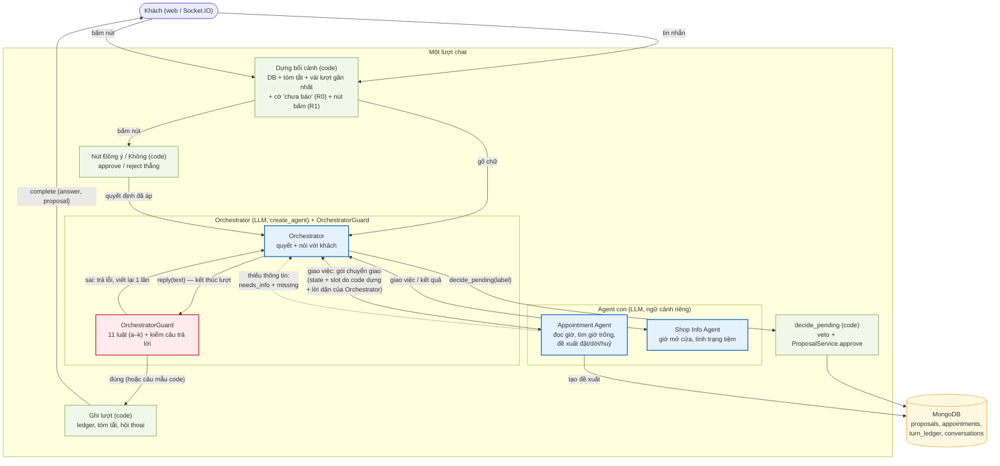
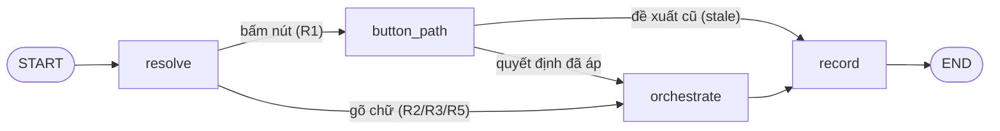
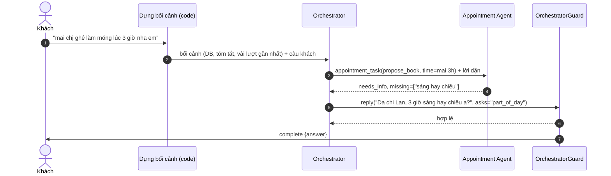
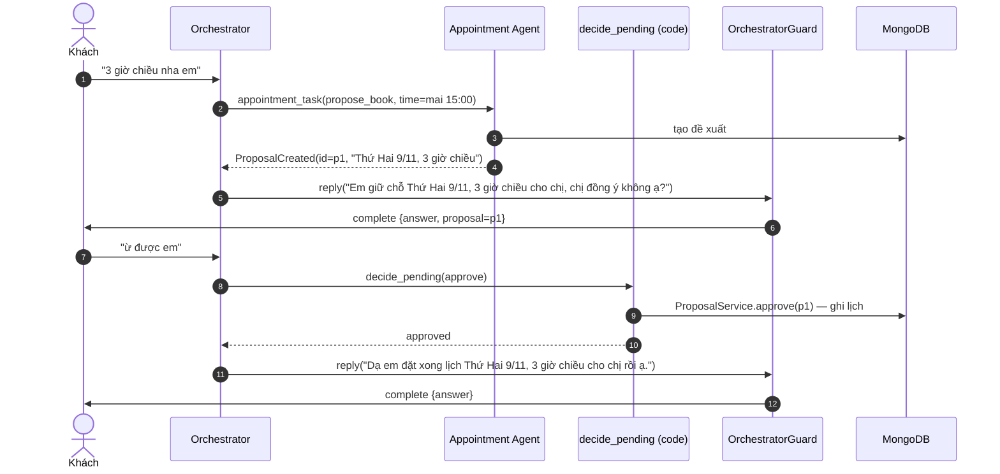

# Đợt A — Multi-agent thật: Orchestrator tự nói chuyện với khách

Ngày: 08/11/2026. Chủ dự án duyệt qua brainstorming cùng ngày; sửa lần 2 theo review thiết kế
(cùng ngày). Thay phần "ReplyBrief + Conversation Agent" của `2026-10-29-llm-orchestrator-design.md`
và `2026-10-29-llm-orchestrator-architecture.md`; những gì spec này không nhắc thì vẫn theo hai
tài liệu đó.

Chủ dự án chia việc làm **hai đợt** (08/11):

- **Đợt A (spec này):** Orchestrator vừa quyết vừa nói. Sửa đúng các lỗi thấy khi chạy thật.
- **Đợt B:** nhiều lịch + giữ chỗ — `2026-11-08-multi-booking-holds-design.md`. Làm sau khi đợt A
  chạy thật đạt. Đợt A **giữ nguyên** cơ chế một đề xuất đang chờ và hàng chờ hiện có.

## 1. Vì sao đổi

Kiến trúc hiện tại là một **pipeline cố định**: `resolve → orchestrate → brief → respond →
record`. Multi-agent chỉ có ở khúc giữa. Người **quyết** (Orchestrator, thấy đủ bối cảnh) và
người **nói** (Conversation Agent, chỉ thấy `ReplyBrief` do code tóm lại) là hai LLM khác nhau,
nối bằng một bản tóm tắt làm mất "lượt này nhằm làm gì".

Bằng chứng từ hai lần chạy 10 lượt thật ngày 08/11 (đọc draft gốc trong checkpoint):

- Conversation chép trơ dòng `must_say` làm cả câu trả lời ở 4/6 lượt có `must_say`
  ("Thứ Hai 9/11, 4 giờ chiều" sau khi đã dời lịch xong).
- Lượt đề xuất không có câu hỏi xác nhận, vì brief không nói "phải hỏi".
- Orchestrator dừng giữa chừng, brief gần như trống, Conversation tự nói "mình đổi sang
  4 giờ chiều mai nhé" khi chưa có gì được đổi.

## 2. Mục tiêu, không mục tiêu, phản mục tiêu

**Mục tiêu**

1. Orchestrator nhận tin khách, suy nghĩ, giao việc cho agent con, nhận kết quả, và **tự viết câu
   trả lời** cho khách.
2. Agent con thiếu thông tin thì báo lại Orchestrator; Orchestrator hỏi khách.
3. Câu trả lời được guard kiểm **trước khi** khách thấy; khách không bao giờ thấy câu sai.

**Không mục tiêu (đợt A)**

- Không đổi cách ghi lịch: vẫn chỉ `ProposalService.approve` ghi.
- Không đổi vai trò / tool của agent Appointment và Shop Info.
- Không nhiều đề xuất, không giữ chỗ, không đổi hàng chờ — để đợt B.
- Không giảm token, không đổi model.

**Phản mục tiêu** (chạy được mà vẫn là thất bại)

- Khách nghe "đã đặt / đã dời / đã huỷ" khi DB chưa ghi.
- Khách thấy một câu sai rồi câu đó bị thay.
- Có đường nào cho LLM ghi lịch, kể cả bọc HITL.
- Khách bị bảo "gọi cho tiệm" khi không có gì hỏng (chỉ dùng khi ghi lịch thất bại).
- Lượt có đề xuất mới mà khách không được hỏi đồng ý.

## 3. Kiến trúc các agent



| Thành phần | Loại | Làm gì | Không được làm |
|---|---|---|---|
| **Orchestrator** | LLM (`create_agent`, reasoning thấp) | Đọc bối cảnh, quyết bước tiếp, giao việc cho agent con, gọi `decide_pending`, **viết câu trả lời cho khách** bằng tool `reply`. | Ghi lịch; bịa giờ/ngày; tự tính ngày giờ. |
| **Appointment Agent** | LLM, ngữ cảnh riêng | Đọc giờ, tìm giờ trống, tạo đề xuất đặt/dời/huỷ, liệt kê lịch. Thiếu thông tin thì trả `needs_info` + `missing`. | Ghi lịch; nói với khách. |
| **Shop Info Agent** | LLM, ngữ cảnh riêng | Giờ mở cửa, ngày nghỉ, chủ tiệm bận tới mấy giờ, mốc giờ có mở không. | Nói với khách. |
| **OrchestratorGuard** | Code (middleware) | 11 luật (a)–(k) như hiện tại **và** kiểm câu trong `reply` trước khi nhận. | Gọi LLM. |
| **Kiểm câu + câu mẫu** | Code (`reply_check.py`) | Trích sự thật của lượt từ kết quả call / quyết định / bối cảnh; kiểm câu; dựng câu mẫu dự phòng. | Gọi LLM. |
| **decide_pending** | Code | Veto cấu trúc, rồi `ProposalService.approve/reject`. | — |
| **Nút Đồng ý / Không** | Code | Duyệt/từ chối thẳng, không cần Orchestrator quyết. | — |
| **ProposalService** | Code | Nơi **duy nhất** ghi lịch. | — |

Đã **bỏ**: Conversation Agent, bước `rewrite` bằng model riêng, stream token, cơ chế "3 lượt không
tiến triển". **Không bỏ mà chuyển chỗ**: phần trích sự thật và câu mẫu dự phòng của
`reply_brief.py` sang `reply_check.py` (§7). Các agent giao tiếp với nhau qua Orchestrator.

### 3.1 Các node trong graph

Graph LangGraph của một lượt (`app/agents/booking/graph.py`) đi từ 6 node xuống 4:



| Node | Trước | Sau đợt A |
|---|---|---|
| `resolve` | Code: dựng `TurnContext` từ DB, chọn luật R0–R5 | Giữ nguyên |
| `button_path` | Code: duyệt / từ chối theo nút, rồi sang `brief` | Code: duyệt / từ chối theo nút, rồi sang `orchestrate` với quyết định áp sẵn; nút cũ thì sang thẳng `record` với câu cố định |
| `orchestrate` | Orchestrator gọi agent con, kết thúc bằng `finish` / `ask_customer` | Orchestrator gọi agent con **và viết câu trả lời** bằng `reply`; guard kiểm câu ngay trong node này |
| `brief` | Code: dựng `ReplyBrief`, đếm "3 lượt không tiến triển" | **Bỏ** — phần trích sự thật chuyển vào `reply_check.py`, dùng trong guard |
| `respond` | Conversation Agent viết câu, stream token; guard kiểm, viết lại bằng model riêng | **Bỏ** — câu do Orchestrator viết, đã kiểm trong `orchestrate` |
| `record` | Code: ghi câu vào thread, chốt ledger, ghi tiến triển | Code: ghi câu vào thread, chốt ledger, đánh dấu R0 đã báo; không còn ghi tiến triển |

## 4. Luồng một lượt

### 4.1 Khách đặt lịch, thiếu thông tin



### 4.2 Đề xuất, rồi xác nhận ở lượt sau



Nếu `approve` thất bại (giờ vừa bị đặt mất, đề xuất hết hạn), `decide_pending` trả `failed` +
lý do; Orchestrator phải nói lịch **chưa ghi được** và đưa số điện thoại tiệm
(`settings.shop_phone`). Guard chặn mọi câu nói "đã đặt" trong lượt đó.

### 4.3 Khách bấm nút

Code duyệt/từ chối thẳng (không qua Orchestrator quyết, như R1 hiện tại). Sau đó Orchestrator
chạy **đủ tool như lượt gõ chữ**, với quyết định **đã được áp sẵn**: `pending_decided=True` và
`pending_outcome` = kết quả của nút, nên luật (h)/(k) coi như đã quyết. Orchestrator viết câu báo
kết quả, và nếu còn việc (ví dụ hàng chờ có lịch tiếp theo) thì làm tiếp như mọi lượt. Nút có
`proposal_id` khác đề xuất đang chờ → `stale`: câu cố định `BUTTON_STALE_REPLY`, không gọi model,
không chạm DB.

### 4.4 Orchestrator không xong việc (timeout, lỗi, trần vòng)

| Đường | Câu gửi khách |
|---|---|
| `reply` hợp lệ | câu của Orchestrator |
| `reply` bị từ chối 2 lần | câu mẫu code của lượt (§7) |
| Trả chữ thường 2 lần, hoặc trả chữ thường khi đã chạm trần vòng | câu mẫu code |
| Chạm trần vòng (`limit`) / ép dừng (`forced`) | câu mẫu code |
| Timeout hoặc lỗi model **sau** khi đã có call được phép | câu mẫu code dựng từ **ledger** của lượt (mọi `CallRecord` + `pending_outcome` đã ghi) — vd đã `approve` thì câu báo đặt xong |
| Timeout hoặc lỗi model **trước** mọi call được phép | `TURN_ERROR_MESSAGE` (như hiện tại) |

Trần thời gian giữ như hiện tại: `orch_orchestrate_timeout_seconds = 110`, cả lượt
`orch_turn_timeout_seconds = 150` — giờ gánh cả việc viết câu và một vòng viết lại.

### 4.5 User story

Câu bot chỉ để minh hoạ: câu thật do Orchestrator viết, mỗi lần khác chữ, nhưng phải đúng sự thật
như dưới đây. Số điện thoại là ví dụ (`settings.shop_phone`).

**1. Đặt lịch, thiếu thông tin.** Là khách, tôi muốn nhắn tự nhiên và được hỏi lại khi nói chưa rõ.

```
Chị Lan: mai chị ghé làm móng lúc 3 giờ nha em
Bot:     Dạ chị Lan, 3 giờ sáng hay 3 giờ chiều ạ?
```

Phía sau: Appointment Agent báo `needs_info` thiếu "sáng hay chiều"; Orchestrator tự viết câu hỏi
qua `reply(asks="part_of_day")`. Giờ "3 giờ" do khách nói nên guard cho phép nhắc lại.

**2. Đề xuất rồi xác nhận.** Là khách, tôi muốn được giữ chỗ và hỏi đồng ý trước khi ghi lịch.

```
Chị Lan: 3 giờ chiều nha em
Bot:     Em giữ chỗ Thứ Hai 9/11, 3 giờ chiều cho chị, chị đồng ý không ạ?
         [Đồng ý] [Không]
Chị Lan: ừ được em
Bot:     Dạ em đặt xong lịch Thứ Hai 9/11, 3 giờ chiều cho chị rồi ạ.
```

Phía sau: lượt sau Orchestrator gọi `decide_pending(approve)`, chỉ code ghi lịch. Câu "đặt xong"
qua guard vì lượt này có `approve` thành công.

**3. Ghi lịch thất bại.** Là khách, tôi muốn được nói thật khi chưa ghi được và biết làm gì tiếp.

```
Chị Lan: [Đồng ý]
Bot:     Dạ hệ thống chưa ghi được lịch 3 giờ chiều mai cho chị. Chị gọi giúp
         em số 0901 234 567 để tiệm xếp lịch trực tiếp nhé ạ.
```

Phía sau: `approve` thất bại (ví dụ đề xuất hết hạn). Trường hợp duy nhất có số điện thoại.

**4. Hỏi chuyện khác giữa chừng.** Là khách, tôi muốn hỏi giờ mở cửa mà không mất lịch đang chờ.

```
Chị Lan: tiệm mở cửa tới mấy giờ em?
Bot:     Dạ tiệm mở cửa từ 8 giờ sáng tới 7 giờ tối ạ. Lịch 3 giờ chiều mai
         em vẫn đang giữ cho chị, chị đồng ý không ạ?
         [Đồng ý] [Không]
```

Phía sau: Orchestrator gọi `decide_pending(none)` (đề xuất giữ nguyên), giao Shop Info Agent. Câu
"vẫn đang giữ" hợp lệ vì giờ đó đang có đề xuất chờ thật (§7).

## 5. Bối cảnh và trí nhớ

**Orchestrator, mỗi lượt** đọc: bối cảnh do code dựng từ DB (khách, giờ mở cửa, lịch sắp tới,
đề xuất đang chờ, hàng chờ, việc chưa báo R0), **bản tóm tắt** cuộc trò chuyện, và **vài lượt chat
gần nhất**. Nguồn sự thật về đề xuất luôn là DB (checkpoint có TTL, không phải nguồn sự thật).

**Gói chuyển giao cho agent con** = kết hợp:

- phần **trạng thái và slot do code dựng** (bối cảnh render từ object; id/iso lấy từ DB);
- **tham số có cấu trúc** của task (`TimeHint`, `appointment_id`, …) do Orchestrator điền, vẫn qua
  luật (a)–(k);
- một **lời dặn ngắn** do Orchestrator viết (trường mới `note`), trên một dòng riêng, không bao giờ
  là nguồn id/iso.

Agent con **không** nhận toàn bộ lịch sử chat.

## 6. Prompt Orchestrator

Mọi luật viết câu cho khách đang nằm trong `CONVERSATION_PROMPT` **chuyển nguyên sang**
`ORCHESTRATOR_PROMPT`: xưng "em", gọi khách theo dòng `Address`, câu ngắn dễ hiểu với người lớn
tuổi, nêu giờ đúng nguyên văn `spoken`, không nhắc tên tool / JSON, không lặp câu vừa nói, giọng
theo tình huống (sau khi khách từ chối thì nhẹ nhàng hơn). Thêm: không nói "đã đặt / dời / huỷ"
khi chưa duyệt; đề xuất mới thì kết thúc bằng câu hỏi xin đồng ý; chỉ đưa số điện thoại khi duyệt
thất bại. Prompt vẫn tiếng Anh, không câu mẫu tiếng Việt.

Rủi ro đã biết: một prompt (reasoning thấp) vừa điều phối vừa viết văn. Đo bằng hai lần chạy thật
(§10); nếu không đạt, quay lại chủ dự án trước khi thêm tầng mới.

## 7. Câu trả lời, guard và hiển thị

**Kết thúc lượt bằng tool `reply(text, asks, service, stated)`.** `text` là câu gửi khách;
`asks` là trường đang hỏi (`QuestionField | None`, code vẫn ghi `open_question` như
`ask_customer` cũ); `service`, `stated` như `finish` cũ. `finish` và `ask_customer` gộp vào `reply`.

**Phần trích sự thật và câu mẫu** của `reply_brief.py` chuyển sang `reply_check.py`: từ bối cảnh +
các call được phép của lượt + quyết định đề xuất (gõ chữ hoặc nút) + câu khách, code dựng các mốc
giờ có thật, các claim được phép, các cụm bắt buộc nhắc, cờ "cần số điện thoại", và câu mẫu.

**Guard kiểm trong `reply`** (cơ chế từ chối hiện có: `ToolMessage(status="error")`):

1. **Nhận vơ**: nói đã đặt / dời / huỷ khi lượt này không có `approve` thành công tương ứng (hoặc
   R0 approved) → từ chối. Câu chỉ nói **"giữ / đang giữ / giữ chỗ"** là hợp lệ khi giờ đó đang có
   đề xuất chờ thật hoặc vừa tạo trong lượt; "đã đặt / ghi / chốt xong" thì không.
2. **Giờ bịa**: mốc giờ trong câu phải khớp một mốc có thật: kết quả tool, đề xuất, lịch, giờ mở
   cửa, **hoặc giờ khách vừa nói trong tin nhắn** (để hỏi lại "3 giờ sáng hay chiều").
3. **Thiếu điều bắt buộc**: lượt tạo đề xuất mới phải nêu giờ đề xuất **và có câu hỏi** (có dấu
   `?`) — luật cấu trúc gắn với việc xin đồng ý; lượt có R0 phải báo việc đó; lượt ghi thất bại phải
   có số điện thoại; lượt không thất bại thì **không** được có số điện thoại.
4. Xoá tên tool / JSON lọt vào câu (tất định).

Không mang sang luật `bare_facts` (đáp trơ) — chỉ kiểm khi đọc tay hai lần chạy thật.

**Viết lại**: câu bị từ chối → lỗi (mã + gợi ý tiếng Anh) về lại Orchestrator; vòng kế **chỉ được
gọi `reply`** (gọi tool khác bị từ chối), viết lại **một lần**. Vẫn sai → câu mẫu code.

**Trả chữ thường thay vì `reply`**: lần đầu, nếu chưa chạm trần vòng, guard nhắc "phải kết thúc
bằng `reply`" và cho thêm một vòng (tính vào trần); lần hai, hoặc đã chạm trần → câu mẫu code.
(Thay đường "chữ thường = `finish(answer)`" thêm ở M6b.)

**Câu mẫu** (thứ tự): duyệt thất bại → nêu giờ, "chưa ghi được", số điện thoại; duyệt xong → câu
báo xong (`code_phrase`); có đề xuất mới hoặc đề xuất đang chờ → "em giữ chỗ … đồng ý không ạ?";
còn lại → câu chung **không** mời gọi tiệm ("anh chị nói lại giúp em được không ạ?").

**Không stream.** Câu trả lời chỉ tới khách qua `complete` sau khi guard kiểm xong. Không còn event
`token`. `turn_started`, `tool_started` / `tool_finished` vẫn gửi để hiện "đang trả lời".

## 8. Ràng buộc

Giữ nguyên (AGENTS.md *Hard constraints*): 1 worker; cấu hình chỉ từ `.env`; logic đặt lịch trong
`app/services/`; agent **không có tool ghi**, chỉ `ProposalService.approve` ghi
(`tests/test_write_fence.py`); bối cảnh đứng đầu, nêu ngày hôm nay, ngoài phần cache; partial
unique index, huỷ = lật `status`; chữ khách chỉ dưới nhãn untrusted, id/iso lấy từ object; không từ
điển từ khoá ý định; regex budget `{"draft_checks.py": 2}`; prompt tiếng Anh, không câu mẫu tiếng
Việt, gọi khách theo `address_phrase`; log có `user_id`/`turn_id`/`thread_id`, không chữ khách;
test không gọi Azure; chạy thật phải hỏi chủ dự án trước.

Đổi (phải cập nhật AGENTS.md, CONTEXT.md, spec cũ):

- "Chỉ stream token tag `respond`" → **"Không stream câu trả lời; chỉ `complete` sau guard"**.
- Giao thức Socket.IO: bỏ `token`.
- Orchestrator viết câu cho khách qua `reply`.
- Bỏ hẳn cơ chế "3 lượt không tiến triển → mời gọi tiệm" (`GoalProgress`, `progress.py`,
  `step_goal`, spec cũ §7.2) — chủ dự án 08/11.
- Nút bấm vẫn không tính vào giới hạn tin nhắn `chat:user`, nhưng lời gọi Orchestrator của lượt
  nút **có** tính vào `orch_llm_calls_per_user_per_hour`.

## 9. Giữ gì, bỏ gì

Làm tiếp trên gói `app/agents/booking/`. *(quyết định người viết spec)*

| Giữ (có thể sửa) | Chuyển chỗ | Bỏ | Mới |
|---|---|---|---|
| `orchestrator/` (agent, guard 11 luật, decide), `specialists/`, `context.py`, `resolver.py`, `ledger.py`, `tools.py`, hàng chờ hiện có, `timeparse.py`, `tokens.py`, `draft_checks.py`, `button_path.py`, `events.py`, `graph.py` | trích sự thật + câu mẫu của `reply_brief.py` → `reply_check.py`; luật viết văn của `prompts/conversation.py` → `prompts/orchestrator.py` | `conversation.py`, `prompts/conversation.py`, `rewrite.py` + `prompts/rewrite.py`, phần `ReplyBrief`, luật `missing_question`-dạng-cũ / `bare_facts`, đường "chữ thường = finish", `progress.py` + `GoalProgress` | tool `reply`, lời dặn `note`, nút bấm chạy Orchestrator với quyết định áp sẵn, frontend bỏ token |

Gói cũ `app/agents/booking_graph/` (Task 6.3) xoá trước.

## 10. Thế nào là xong

- `pytest` toàn bộ xanh, không test nào gọi Azure.
- `scripts/test_live_10_turns.py` (cập nhật cho `reply`, ghi thời gian từng lượt) chạy thật
  **2 lần**, cả hai lần:
  - mọi lượt `complete`, không `error`;
  - không câu nào nhận vơ đã đặt / dời / huỷ;
  - mọi lượt có đề xuất mới đều hỏi khách xác nhận;
  - không câu trả lời nào chỉ là dòng giờ trơ (đọc tay);
  - không hỏi lại điều khách đã nói;
  - DB cuối đúng với những gì khách đã đồng ý;
  - **độ trễ** lượt gõ chữ (từ lúc gửi tới `complete`): trung vị ≤ **10 giây**, chậm nhất
    ≤ **25 giây** (chủ dự án 08/11).
- Chạy thật cần chủ dự án duyệt trước mỗi lần.

## 11. Để người lập plan quyết

- Số lượt chat gần nhất đưa cho Orchestrator (hiện 2).
- Tên / hình dạng chính xác của các mã lỗi `reply`.
- Chia task, thứ tự xoá gói cũ.

## Các quyết định người viết spec tự đưa ra (chủ dự án kiểm khi đọc)

1. Làm tiếp trên gói hiện tại, không viết lại từ đầu.
2. Gộp `finish` và `ask_customer` thành `reply(text, asks, service, stated)`.
3. Chữ thường thay vì `reply` → nhắc một lần (nếu chưa chạm trần), rồi câu mẫu code.
4. Guard từ chối → chính Orchestrator viết lại một lần, vòng đó chỉ được gọi `reply`.
5. Giữ luật "đề xuất mới phải có câu hỏi" (cấu trúc, gắn với xin đồng ý); bỏ luật đáp trơ.
6. Câu "giữ chỗ / đang giữ" hợp lệ khi giờ đó đang có đề xuất chờ thật.
7. Guard cho phép nhắc lại giờ khách vừa nói.
8. Nút bấm: code quyết, rồi Orchestrator chạy đủ tool với quyết định áp sẵn.
9. Timeout sau khi đã có call được phép → câu mẫu dựng từ ledger.
