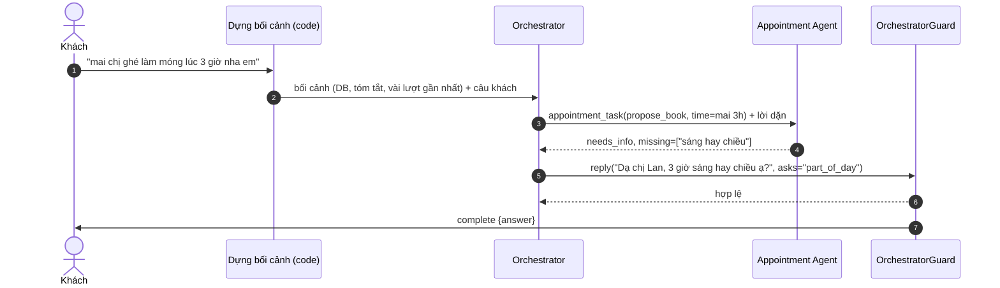
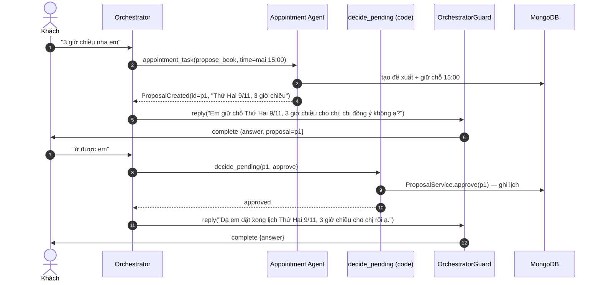

# Multi-agent thật: Orchestrator tự nói chuyện với khách

Ngày: 08/11/2026. Chủ dự án duyệt qua brainstorming cùng ngày.
Thay phần "Conversation Agent + ReplyBrief" của `2026-10-29-llm-orchestrator-design.md`
và `2026-10-29-llm-orchestrator-architecture.md`. Những gì spec này không nhắc tới thì
vẫn theo hai tài liệu đó.

## 1. Vì sao đổi

Kiến trúc hiện tại là một **pipeline cố định**: `resolve → orchestrate → brief → respond →
record`. Multi-agent chỉ có ở khúc giữa (Orchestrator gọi agent Appointment / Shop Info như
tool). Người **quyết** (Orchestrator, thấy đủ bối cảnh) và người **nói** (Conversation Agent,
chỉ thấy `ReplyBrief` do code tóm lại) là hai LLM khác nhau, nối bằng một bản tóm tắt làm mất
"lượt này nhằm làm gì".

Bằng chứng từ hai lần chạy 10 lượt thật ngày 08/11 (đọc draft gốc trong checkpoint):

- Conversation chép trơ dòng `must_say` làm cả câu trả lời ở 4/6 lượt có `must_say`
  ("Thứ Hai 9/11, 4 giờ chiều" sau khi đã dời lịch xong).
- Lượt đề xuất không có câu hỏi xác nhận, vì brief không nói "phải hỏi".
- Orchestrator dừng giữa chừng, brief gần như trống, Conversation tự nói "mình đổi sang
  4 giờ chiều mai nhé" khi chưa có gì được đổi.

Mỗi lỗi được vá bằng một lớp code nữa (rewrite, câu mẫu, `missing_question`, `bare_facts`).
Chủ dự án muốn sửa tận gốc: **một Orchestrator vừa quyết vừa nói**, các agent con làm việc và
báo lại cho nó.

## 2. Mục tiêu, không mục tiêu, phản mục tiêu

**Mục tiêu**

1. Orchestrator nhận tin khách, suy nghĩ, gọi tool hoặc giao việc cho agent con, nhận kết quả,
   và **tự viết câu trả lời** cho khách.
2. Agent con thiếu thông tin thì báo lại Orchestrator; Orchestrator hỏi khách.
3. Khách đặt nhiều lịch trong một lần: xác nhận **từng lịch một**, các lịch sau **được giữ
   chỗ** trong lúc chờ.
4. Câu trả lời được guard kiểm **trước khi** khách thấy; khách không bao giờ thấy câu sai.

**Không mục tiêu**

- Không đổi cách ghi lịch: vẫn chỉ `ProposalService.approve` ghi.
- Không đổi agent Appointment / Shop Info về vai trò và tool.
- Không giảm token, không đổi model (việc giảm token vẫn gác như quyết định 5 trong CONTEXT.md).
- Không làm thí nghiệm "phẳng" trong spec này.

**Phản mục tiêu** (chạy được mà vẫn là thất bại)

- Khách nghe "đã đặt / đã dời / đã huỷ" khi DB chưa ghi.
- Khách thấy một câu sai rồi câu đó bị thay.
- Có đường nào cho LLM ghi lịch, kể cả bọc HITL.
- Khách bị bảo "gọi cho tiệm" khi không có gì hỏng (chỉ dùng khi ghi lịch thất bại).
- Giờ đang giữ cho khách bị người khác đặt mất, **kể cả qua web (REST) hay chủ tiệm đặt hộ**,
  hoặc chỗ giữ đã hết hạn vẫn chặn người khác.

## 3. Kiến trúc các agent

| Thành phần | Loại | Làm gì | Không được làm |
|---|---|---|---|
| **Orchestrator** | LLM (`create_agent`, reasoning thấp) | Đọc bối cảnh, quyết bước tiếp, giao việc cho agent con, gọi `decide_pending`, **viết câu trả lời cho khách** bằng tool `reply`. | Ghi lịch; bịa giờ/ngày; tự tính ngày giờ. |
| **Appointment Agent** | LLM, ngữ cảnh riêng | Đọc giờ (`parse_time`), tìm giờ trống, tạo đề xuất đặt/dời/huỷ (kèm giữ chỗ), liệt kê lịch. Thiếu thông tin thì trả `needs_info` + `missing`. | Ghi lịch; nói với khách. |
| **Shop Info Agent** | LLM, ngữ cảnh riêng | Giờ mở cửa, ngày nghỉ, chủ tiệm bận tới mấy giờ, mốc giờ có mở không. | Nói với khách. |
| **OrchestratorGuard** | Code (middleware) | 11 luật (a)–(k) như hiện tại **và** kiểm câu trả lời trong `reply` trước khi nhận. | Gọi LLM. |
| **decide_pending** | Code | Veto cấu trúc, rồi `ProposalService.approve/reject`. | — |
| **Nút Đồng ý / Không** | Code | Duyệt/từ chối thẳng, không cần Orchestrator quyết. Orchestrator chỉ viết câu báo. | — |
| **ProposalService** | Code | Nơi **duy nhất** ghi lịch; quản lý giữ chỗ. | — |

Đã **bỏ**: `ReplyBrief` builder, Conversation Agent, bước `rewrite` bằng model riêng, stream
token. Các agent giao tiếp với nhau qua Orchestrator: agent con không gọi nhau, không nói với
khách.

## 4. Luồng một lượt

### 4.1 Khách đặt lịch, thiếu thông tin

### 4.2 Đề xuất, rồi xác nhận ở lượt sau

Nếu `approve` thất bại (giờ vừa bị đặt mất, đề xuất hết hạn), `decide_pending` trả `failed` +
lý do; Orchestrator phải nói lịch **chưa ghi được** và đưa số điện thoại tiệm
(`settings.shop_phone`). Guard chặn mọi câu nói "đã đặt" trong lượt đó.

### 4.3 Nhiều lịch trong một tin nhắn

Khách: "đặt cho chị 3 giờ chiều mai, với đặt cho con gái chị 4 giờ luôn nha".

1. Appointment Agent tạo **hai** đề xuất: `p1` (15:00) ở trạng thái **đang hỏi**, `p2`
   (16:00) ở trạng thái **giữ chỗ chờ hỏi**. Cả hai giờ đều bị chặn với khách khác.
2. Orchestrator hỏi xác nhận `p1` trước, có thể nhắc "xong em hỏi tiếp lịch 4 giờ cho con gái".
3. Khách đồng ý → `p1` ghi lịch; `p2` thành **đang hỏi**; Orchestrator hỏi tiếp `p2`.
4. Khách từ chối `p1` → `p1` nhả chỗ; `p2` vẫn được hỏi tiếp.

Nút Đồng ý / Không chỉ hiện cho đề xuất **đang hỏi**.

**Khách thêm lịch khi đang chờ xác nhận** (chủ dự án 08/11): bot vừa hỏi "chị đồng ý 3 giờ chiều
không ạ?", khách nhắn "đặt thêm cho cháu chị 5 giờ nữa nha". Orchestrator gọi tool tạo **thêm một
chỗ giữ** cho lịch mới mà **không** phải quyết `p1` trước; `p1` vẫn đang hỏi, lịch mới vào hàng giữ
chỗ chờ hỏi. Đổi giờ / huỷ chính `p1`, hay dời / huỷ một lịch đã có, vẫn phải qua `decide_pending`
trước như luật (h) hiện tại. Việc phân biệt "thêm lịch" với "đổi `p1`" là lựa chọn tool của
Orchestrator, không phải từ khoá; nếu nó chọn nhầm, không có gì được ghi vì mỗi lịch vẫn cần khách
đồng ý riêng, và khách từ chối được chỗ giữ thừa.

### 4.4 Khách bấm nút

Code duyệt/từ chối thẳng (không qua Orchestrator quyết, như R1 hiện tại). Sau đó Orchestrator
được gọi ở chế độ **chỉ báo kết quả**: nhận kết quả duyệt + bối cảnh, không được gọi tool
nghiệp vụ, chỉ được gọi `reply`. Nếu còn đề xuất giữ chỗ chờ hỏi, Orchestrator hỏi tiếp lịch đó.

## 5. Bối cảnh và trí nhớ

**Orchestrator, mỗi lượt** đọc: bối cảnh do code dựng từ DB (khách, giờ mở cửa, lịch sắp tới,
các đề xuất đang hỏi / giữ chỗ, việc chưa báo R0), **bản tóm tắt** cuộc trò chuyện, và **vài
lượt chat gần nhất**. Giống hiện tại; nguồn sự thật về đề xuất luôn là DB đọc qua bối cảnh /
tool, không phải trí nhớ của model (checkpoint có TTL, không phải nguồn sự thật — CONTEXT.md).

**Gói chuyển giao cho agent con** = kết hợp:

- phần **trạng thái và slot do code dựng** (bối cảnh render từ object, các id/iso lấy từ DB —
  không từ chữ model);
- **tham số có cấu trúc** của task (`TimeHint`, `appointment_id`, …) do Orchestrator điền,
  vẫn qua luật (a)–(k);
- một **lời dặn ngắn** do Orchestrator viết (trường mới, ví dụ "khách muốn làm cho con gái,
  ưu tiên giờ liền nhau"), đặt dưới nhãn riêng, không bao giờ là nguồn id/iso.

Agent con **không** nhận toàn bộ lịch sử chat.

## 6. Giữ chỗ cho nhiều lịch

- Một đề xuất **đang hỏi** + tối đa **2** đề xuất **giữ chỗ chờ hỏi** mỗi khách (tổng 3,
  khớp `slots ≤ 3` hiện có). *(quyết định của người viết spec)*
- Mỗi chỗ giữ có hạn **10 phút** kể từ khi tạo (`PROPOSAL_MAX_AGE_MINUTES`). Hết hạn thì nhả.
  Tới lượt hỏi mà chỗ giữ đã hết hạn, Orchestrator giao Appointment Agent kiểm và đề xuất lại.
- Giờ đang giữ phải **bị chặn** với mọi người khác ở **mọi đường đặt lịch**: `find_free_slots`,
  tạo đề xuất trong chat, `POST /api/v1/appointments` (khách đặt qua web, chủ tiệm đặt hộ với
  `for_user_id`), và dời lịch (chủ dự án 08/11). Vì vậy kiểm chỗ giữ nằm trong
  `AppointmentService` (create / reschedule), không chỉ trong chat. Việc chặn phải **nguyên tử**
  (hai người cùng giữ / đặt một giờ cùng lúc → chỉ một người được). Chỗ giữ hết hạn **không được**
  chặn ai. Chủ tiệm **không** ghi đè được chỗ đang giữ; lỗi trả về nói giờ đó đang được giữ tới
  mấy giờ. *(quyết định của người viết spec: chỗ giữ tối đa 10 phút nên cái giá nhỏ)*
- Unique index hiện tại trên `appointments.slot_keys` là partial `{status: "booked"}` — giữ
  nguyên (bẫy đã sửa trong CONTEXT.md). Cách cài chỗ giữ (collection/index riêng, lật trạng thái
  hết hạn trong transaction trước khi chèn, …) để người lập plan chọn, nhưng phải thoả các điều
  trên và chạy được trên replica set `rs0` hiện có.
- `ProposalService.create` hiện tự `supersede` mọi pending cũ của khách. Hành vi đó đổi:
  chỉ supersede khi khách **đổi ý về chính lịch đó**, không supersede các lịch khác đang giữ.
- **Giữ chỗ thay hàng chờ cũ** (`QueuedRequest`, `set_queued`, `TimeHint.anchor="queued"` /
  `queue_id`, phần `queued` của veto và luật (c)(d)). Lịch nào khách nói rõ giờ thì giữ chỗ ngay;
  lịch chưa rõ giờ thì Orchestrator hỏi cho rõ rồi mới giữ. *(quyết định của người viết spec)*
- Luật (e) "một đề xuất mỗi lượt" và `OneProposalPerTaskMiddleware` của specialist nới thành
  "tối đa đủ trần 3 chỗ giữ của khách"; luật (h) nới đúng một chỗ: cho tạo **thêm** đề xuất đặt mới
  khi đang có đề xuất đang hỏi (§4.3). Các luật còn lại giữ.

## 7. Câu trả lời, guard và hiển thị

**Kết thúc lượt bằng tool `reply`.** Orchestrator kết thúc mọi lượt bằng
`reply(text, asks)`: `text` là câu gửi khách (tiếng Việt), `asks` là trường đang hỏi
(`QuestionField | None`, thay `ask_customer` để code vẫn ghi `open_question`). `finish` và
`ask_customer` gộp vào `reply`. *(quyết định của người viết spec)*

**Guard kiểm trong `reply`** (cùng cơ chế từ chối hiện có: `ToolMessage(status="error")`),
đối chiếu với kết quả các call của lượt và DB:

1. **Nhận vơ**: nói đã đặt / dời / huỷ khi lượt này không có `approve` thành công tương ứng
   (hoặc không có lịch đó trong DB) → từ chối.
2. **Giờ sai**: mọi mốc giờ trong câu phải khớp một mốc có thật trong lượt (kết quả tool,
   đề xuất, lịch trong DB) → khác thì từ chối.
3. **Thiếu điều bắt buộc**: lượt tạo đề xuất mới thì câu phải nêu giờ đề xuất; lượt có R0
   (việc chưa báo) thì câu phải báo việc đó; lượt ghi thất bại thì phải có số điện thoại tiệm.
4. Xoá tên tool / JSON lọt vào câu (tất định, như `strip_tool_names` hiện có).

Câu bị từ chối: lỗi (mã + gợi ý, tiếng Anh) về lại Orchestrator, nó viết lại **một lần**.
Vẫn sai → dùng **câu mẫu do code viết** (như `code_phrase` / `PROPOSAL_FALLBACK` /
`FAILED_FALLBACK` hiện có). Guard **chỉ kiểm sự thật**, không kiểm giọng văn — không mang
`missing_question` / `bare_facts` sang.

**Model trả chữ thường thay vì gọi `reply`**: không tự coi là kết thúc. Guard trả lại một lời
nhắc "phải kết thúc bằng `reply`" và cho model thêm một vòng (tính vào trần vòng). Vẫn không
gọi → câu mẫu code. (Thay đường "chữ thường = `finish(answer)`" thêm ở M6b, vốn lệch spec §275.)

**Không stream.** Câu trả lời chỉ tới khách qua `complete` sau khi guard kiểm xong. Không còn
event `token`. Khách thấy dấu "đang trả lời" (`turn_started`, `tool_started` / `tool_finished`
vẫn gửi). Frontend bỏ phần ghép token.

## 8. Ràng buộc

Giữ nguyên (AGENTS.md *Hard constraints*):

- Đúng 1 worker; cấu hình chỉ từ `.env`.
- Mọi logic đặt lịch nằm trong `app/services/`.
- Agent **không có tool ghi**; chỉ `ProposalService.approve` ghi; `tests/test_write_fence.py`
  giữ xanh (cập nhật danh sách cho phép theo vị trí mới).
- Bối cảnh đứng đầu sau system prompt và nêu ngày hôm nay; không nằm trong phần prompt cache.
- Partial unique index; huỷ = lật `status`.
- Chữ khách chỉ nằm dưới nhãn untrusted; mọi id/iso gửi model lấy từ object.
- Không từ điển từ khoá ý định; regex budget của gói mới giữ như hiện tại.
- Prompt tiếng Anh, không câu mẫu tiếng Việt; khách được gọi theo
  `TurnContext.customer.address_phrase` (mặc định "anh chị", không đoán giới tính từ tên).
- Log có cấu trúc, `extra` luôn có `user_id`, `turn_id`, `thread_id`; không log chữ khách.
- Test không gọi Azure; chạy thật phải hỏi chủ dự án trước.

Đổi (phải cập nhật AGENTS.md, CONTEXT.md, spec cũ):

- Bỏ hẳn cơ chế "3 lượt không tiến triển → mời gọi tiệm" (`GoalProgress`, `progress.py`,
  `step_goal`, `_limit_reached`, spec cũ §7.2) — chủ dự án 08/11. Câu "gọi tiệm" chỉ còn ở lượt
  ghi lịch thất bại.
- Nút bấm (`confirm_proposal`) vẫn không tính vào giới hạn tin nhắn `chat:user`, nhưng lần gọi
  Orchestrator ở chế độ "chỉ báo kết quả" **có** tính vào ngân sách gọi LLM mỗi giờ
  (`orch_llm_calls_per_user_per_hour`). *(quyết định của người viết spec)*

- "Chỉ stream token tag `respond`" → **"Không stream câu trả lời; chỉ `complete` sau guard"**.
  Tag `respond` không còn.
- Giao thức Socket.IO: bỏ `token`; `complete.proposal` là đề xuất **đang hỏi**.
- Orchestrator thôi trả "routing JSON"; nó viết câu cho khách qua `reply`.

## 9. Giữ gì, bỏ gì trong code hiện tại

Làm tiếp trên gói `app/agents/booking/`, không viết lại từ đầu. *(quyết định của người viết
spec — chủ dự án chưa trả lời câu này)*

| Giữ (có thể sửa) | Bỏ | Mới |
|---|---|---|
| `orchestrator/` (agent, guard 11 luật, decide), `specialists/`, `context.py`, `resolver.py` (R0 + R1), `ledger.py`, `tools.py`, `timeparse.py`, `tokens.py`, phần kiểm sự thật của `guard.py` / `draft_checks.py`, `button_path.py`, `events.py`, `graph.py` | `reply_brief.py`, `conversation.py`, `prompts/conversation.py`, `rewrite.py` + `prompts/rewrite.py`, luật `missing_question` / `bare_facts`, đường "chữ thường = finish", `progress.py` + `GoalProgress`, hàng chờ `queued` | tool `reply`, chế độ "chỉ báo kết quả" cho nút bấm, nhiều đề xuất + giữ chỗ trong `ProposalService` và kiểm chỗ giữ trong `AppointmentService`, lời dặn trong gói chuyển giao, frontend bỏ token |

Gói cũ `app/agents/booking_graph/` (Task 6.3) xoá trước hoặc trong plan này — người lập plan
chọn thứ tự. Các commit M6b (`f25c166`…`0013ee8`) nằm trên nhánh; phần nào chạm vào thứ bị bỏ
thì bị xoá cùng.

## 10. Thế nào là xong

- `pytest` toàn bộ xanh, không test nào gọi Azure.
- Kịch bản `scripts/test_live_10_turns.py` (cập nhật cho kiến trúc mới, thêm một lượt đặt hai
  lịch) chạy thật **2 lần**, cả hai lần:
  - 10/10 lượt `complete`, không `error`;
  - không câu nào nhận vơ đã đặt / dời / huỷ;
  - mọi lượt có đề xuất mới đều hỏi khách xác nhận;
  - không câu trả lời nào chỉ là dòng giờ trơ;
  - không hỏi lại điều khách đã nói;
  - DB cuối đúng với những gì khách đã đồng ý; chỗ giữ của lịch thứ hai còn hiệu lực trong lúc
    hỏi lịch thứ nhất.
- Có test: đặt qua REST / chủ tiệm đặt hộ vào giờ đang giữ của khách khác bị từ chối; giờ có chỗ
  giữ đã hết hạn thì đặt được.
- Chạy thật cần chủ dự án duyệt trước mỗi lần (ngân sách Azure).

## 11. Để người lập plan quyết

- Cách cài giữ chỗ (§6), miễn đủ các điều kiện ở đó.
- Số lượt chat gần nhất đưa cho Orchestrator (hiện 2; "vài lượt").
- Tên và hình dạng chính xác của trường lời dặn trong gói chuyển giao.
- Chia milestone, thứ tự xoá gói cũ, cách giữ test hiện có còn chạy trong lúc chuyển.

## Các quyết định người viết spec tự đưa ra (chủ dự án kiểm khi đọc)

1. Làm tiếp trên gói hiện tại, không viết lại từ đầu.
2. Tối đa 1 đề xuất đang hỏi + 2 giữ chỗ chờ hỏi mỗi khách.
3. Gộp `finish` và `ask_customer` thành một tool `reply(text, asks)`.
4. Chữ thường thay vì `reply` → nhắc model một lần, rồi câu mẫu code.
5. Guard từ chối → chính Orchestrator viết lại một lần (bỏ model `rewrite` riêng).
6. Chỗ giữ hết hạn sau 10 phút kể từ khi tạo, không gia hạn khi tới lượt hỏi.
7. Chủ tiệm không ghi đè được chỗ đang giữ.
8. Giữ chỗ thay hẳn hàng chờ cũ; lịch chưa rõ giờ thì hỏi rõ rồi mới giữ.
9. Lượt bấm nút tính vào ngân sách gọi LLM mỗi giờ, không tính vào giới hạn tin nhắn.

Chủ dự án trả lời sau bước kiểm của người lập plan (08/11): giữ chỗ chặn **mọi** đường đặt lịch
(cả REST / chủ tiệm); khách thêm lịch khi đang chờ thì giữ chỗ cả hai; bỏ hẳn cơ chế "3 lượt
không tiến triển".
