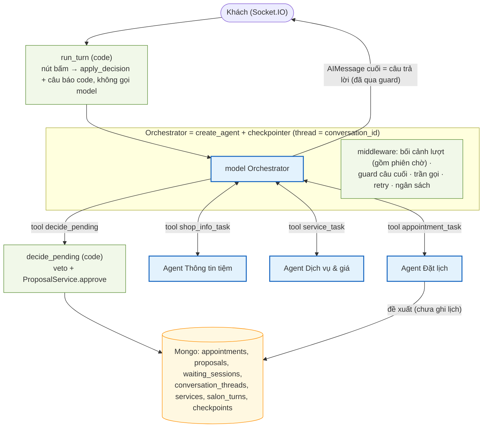

# Dựng lại agent theo mẫu Subagents: 4 agent, vòng lặp, phiên chờ qua nhiều lượt

Ngày: 08/11/2026. Chủ dự án duyệt hướng qua brainstorming cùng ngày.

**Thay thế** spec "Orchestrator tự nói" (đợt A) và plan của nó — đã xoá khỏi cây thư mục 08/11,
xem `git show 72c98fc:docs/superpowers/specs/2026-11-08-orchestrator-speaks-design.md`. Kế thừa từ
đợt A những gì spec này nhắc lại (không stream, guard kiểm sự thật trước khi khách thấy, nút bấm
duyệt bằng code). Đợt B (giữ chỗ nhiều lịch, `git show
72c98fc:docs/superpowers/specs/2026-11-08-multi-booking-holds-design.md`) vẫn để **sau** spec này
và phải viết lại cho khớp kiến trúc mới.

**Kiến trúc đích: [`docs/architech-agent.md`](../../architech-agent.md)** (chủ dự án chốt 08/11). Spec này
triển khai đúng sơ đồ đó; chỗ nào lệch thì sơ đồ thắng. `AGENTS.md` đã xoá (chủ dự án 09/11).
Sơ đồ chi tiết hơn (middleware trong một lượt, state, bộ nhớ, phiên chờ):
https://claude.ai/artifact/CCinuSWJv3LybFPAeivH39

## 1. Vì sao

Kiến trúc hiện tại là một pipeline cố định (`resolve → orchestrate → brief → respond → record`).
Hai "agent con" là tool không trạng thái: mỗi lần gọi dựng `create_agent` mới, không nhớ gì,
không hỏi lại được. Chủ dự án muốn multi-agent thật: Orchestrator nhận tin khách, suy nghĩ, gọi
tool hoặc giao việc cho agent cần thiết; agent thiếu thông tin thì quay về hỏi Orchestrator;
Orchestrator hỏi khách; khách trả lời ở lượt sau thì việc đó **làm tiếp đúng chỗ đang dở**, có
cập nhật state.

Đã so ba mẫu trong tài liệu LangChain (Subagents, Handoffs, Router). Chủ dự án chọn
**Subagents**: một agent chính điều phối các agent con như tool, mọi luồng đi qua agent chính.
Handoffs bị loại vì agent con sẽ tự nói với khách; Router bị loại vì không có trạng thái và docs
khuyên không dùng cho hội thoại nhiều lượt.

**Không dùng `create_deep_agent`** (chủ dự án đồng ý 08/11). Thiết kế mượn vài viên gạch Deep Agents
cũng có (agent con không trạng thái, nén lịch sử, memory trong store) nhưng không phải Deep Agents:
Deep Agents gọi agent con qua một tool `task` chung (single dispatch — chủ dự án đã chọn tool per
agent), bật sẵn hệ file ảo và tool đọc / ghi file (tốn token, thêm chỗ cho chữ khách ghi vào), nhắm
việc dài nhiều bước, và agent con của nó "cannot send multiple messages back" — trong khi ở đây mỗi
lượt là một câu chat ngắn và agent con cần phiên chờ qua lượt. Docs Deep Agents tự khuyên dùng
`create_agent` khi không cần các khả năng gắn sẵn đó. Kiến trúc ở đây = `create_agent` + mẫu
Subagents (tool per agent) + memory của LangGraph.

Tài liệu tham chiếu (đọc trước khi lập plan):
[Multi-agent](https://docs.langchain.com/oss/python/langchain/multi-agent) ·
[Subagents](https://docs.langchain.com/oss/python/langchain/multi-agent/subagents) ·
[Custom middleware](https://docs.langchain.com/oss/python/langchain/middleware/custom) ·
[Subgraph checkpointer](https://docs.langchain.com/oss/python/langgraph/use-subgraphs) ·
[Interrupts](https://docs.langchain.com/oss/python/langgraph/interrupts)

## 2. Mục tiêu, không mục tiêu, phản mục tiêu

**Mục tiêu**

1. Bốn agent: Orchestrator, Đặt lịch, Thông tin tiệm, Dịch vụ & giá. Orchestrator gọi agent con
   nhiều lần trong một lượt (vòng lặp), agent con báo lại kết quả hoặc câu hỏi.
2. **Phiên chờ**: agent con thiếu thông tin chỉ khách biết thì phiên của nó nằm chờ qua lượt;
   lượt sau Orchestrator chuyển câu trả lời vào, agent làm tiếp với đủ những gì đã biết.
3. Khách hỏi giá, dịch vụ, thời lượng thì được trả lời đúng theo danh mục (hiện đang là
   "không hỗ trợ").
4. Lịch hẹn dài đúng theo dịch vụ (nhuộm giữ 2 tiếng, không chỉ một ô cố định).
5. Bám sát docs LangChain: dùng `create_agent`, middleware có sẵn, `Command(update=...)` từ
   tool, checkpointer; chỉ tự viết phần docs không lo.

**Không mục tiêu**

- Không đổi đường ghi lịch: vẫn chỉ `ProposalService.approve`, gọi từ `decide.apply_decision`.
- Không làm giữ chỗ nhiều lịch (đợt B).
- Không làm trang quản trị danh mục dịch vụ; dữ liệu tạm là mock, file Excel thật đến sau.
- Không thêm agent Hồ sơ khách, Hỏi đáp chính sách, Chuyển cho chủ tiệm (đã bàn, để sau).

**Phản mục tiêu** (chạy được mà vẫn là thất bại)

- Khách nghe "đã đặt / dời / huỷ" khi DB chưa ghi.
- Khách thấy một câu sai rồi câu đó bị thay.
- Có đường nào cho LLM ghi lịch, kể cả bọc HITL.
- Bot nói một số tiền nằm ngoài khoảng giá trong danh mục.
- Lịch nhuộm 2 tiếng chỉ chặn 30 phút, người sau đặt chồng lên.
- Khách đã nói tên dịch vụ mà chưa rõ loại, bot vẫn đề xuất lịch với độ dài đoán.
- Khách nghe một câu tiếng Anh của thư viện (vd "Model call limits exceeded").
- Một lượt bị cắt giữa chừng làm hỏng các lượt sau trong ngày.
- Phiên đã hết hạn hay đã bị thay vẫn được làm tiếp.
- Agent con nói thẳng với khách, hoặc các agent chuyển việc qua lại không dừng.
- Lịch đã ghi mà khách không được báo (lượt sau phải báo, như cơ chế R0 hiện có).

## 3. Kiến trúc



### 3.1 Bốn agent

| Agent | Tool nghiệp vụ | Không được làm |
|---|---|---|
| **Orchestrator** | `appointment_task`, `shop_info_task`, `service_task` (giao việc), `decide_pending` | Gọi thẳng tool nghiệp vụ; tự tính ngày giờ; ghi lịch |
| **Đặt lịch** | `parse_time`, `find_free_slots`, `list_my_appointments`, `propose_appointment`, `propose_cancel` (cả hai chỉ tạo **đề xuất**) | Ghi lịch; nói với khách |
| **Thông tin tiệm** | `parse_time`, `get_shop_hours`, `get_shop_status`, `is_open_at` (`is_open_at` chỉ nhận ISO từ `parse_time`, và Orchestrator không còn đọc giờ) | Ghi gì; nói với khách |
| **Dịch vụ & giá** | `search_services`, `get_service`, `list_services` (mới, chỉ đọc) | Ghi gì; nói với khách; bịa giá |

- Orchestrator **không có tool nghiệp vụ riêng**; mọi việc nghiệp vụ đi qua agent con, đúng mẫu
  Subagents ("tool per agent", chạy sync). *(quyết định người viết spec)*
- **Tool per agent, không single dispatch** (chủ dự án chọn 08/11): mỗi agent con một tool riêng
  (`appointment_task`, `shop_info_task`, `service_task`), không dùng một tool
  `task(agent_name, description)` chung. Lý do: `appointment_task` cần tham số riêng (`service_ids`
  với enum dựng theo lượt) và luật kiểm riêng (`service_unclear`); docs xếp nhu cầu này vào "tool
  per agent" ("fine-grained control over each subagent's input/output"). Ba tool dùng chung **một
  hàm điều phối nội bộ** (đọc / ghi phiên, dựng agent con, chạy, trích dữ kiện, trả
  `Command(update)`); lớp tool ngoài chỉ khai schema và gọi hàm đó, không viết lặp ba lần. Xem lại
  lựa chọn này khi thêm các agent đã để sau (§2).
- Agent con giao tiếp với nhau **qua Orchestrator**, ví dụ: Dịch vụ trả thời lượng nhuộm 120
  phút → Orchestrator giao Đặt lịch kèm `service_ids`.
- Mỗi agent con là một `create_agent` **không trạng thái** (`checkpointer=False`, như docs mô tả
  mặc định "stateless"), dựng lại mỗi lần gọi, kết quả cuối qua `ToolStrategy` với schema hẹp.
  Dựng lại mỗi lần (docs dựng một lần) vì schema tool của agent con mang enum id của **khách này,
  lượt này** (lịch sắp tới, dịch vụ trong lượt), như `appointment_id` hiện nay.
  Trí nhớ của phiên nằm trong collection Mongo `waiting_sessions` (§5), không nằm trong agent con.
  *(quyết định người viết spec: không dùng `checkpointer=True` cho agent con vì trí nhớ sẽ cộng
  dồn cả ngày theo thread khách, docs không có cách xoá khi đổi ngày / hết hạn, và docs ghi rõ
  không gọi song song được cùng một agent con; spike 09/11 xác nhận, xem `docs/architech-agent.md`
  luật 7)*
- Không dùng `interrupt()`. Lượt chat kết thúc tự nhiên khi Orchestrator trả AIMessage cuối.
  (Interrupt trong agent con sẽ dừng cả lượt ngay tại agent con, câu hỏi tới khách không qua
  Orchestrator và guard.)

### 3.2 Graph

Orchestrator `create_agent` **chính là** graph của một lượt; bỏ `StateGraph` 6 node tự dựng
trong `graph.py`. Việc ngoài agent (nút bấm, dựng bối cảnh, ghi `conversations`, phát event
Socket.IO) nằm ở `run_turn` và middleware.

- **Gõ chữ**: `run_turn` → `orchestrator.astream_events(...)` trên thread `conversation_id` của
  cuộc trò chuyện hiện tại (§3.4).
- **Nút bấm là một API bằng code** (chủ dự án 09/11). `run_turn` kiểm nút (đúng chủ, đúng đề
  xuất đang chờ, còn hạn), gọi `apply_decision`, rồi trả câu báo do code viết từ kết quả (đã đặt /
  đã dời / đã huỷ / đã bỏ; giờ vừa bị lấy thì kèm giờ trống gần nhất; ghi thất bại thì kèm số điện
  thoại tiệm). **Không gọi model.** Câu báo và một dòng ghi lại việc bấm nút được ghi vào thread và
  `conversations`, để lượt gõ chữ sau Orchestrator biết chuyện đã xảy ra. Nút có `proposal_id` khác
  đề xuất đang chờ → câu cố định `BUTTON_STALE_REPLY`.
- **Ngoại lệ duy nhất (hai lịch trong một tin, §5.1):** khách bấm Đồng ý mà phiên `appointment` còn
  `next_requests` → sau câu báo của code, `run_turn` chạy Orchestrator với một HumanMessage do code
  dựng (tiếng Anh, có dấu `salon_button`, nêu kết quả duyệt và câu đã báo) và `DecisionFact` trong
  `turn_facts`. Orchestrator đề xuất lịch kế; câu tới khách = câu báo của code + câu của
  Orchestrator (đã qua guard), kèm nút cho đề xuất mới. Orchestrator lỗi thì khách vẫn nhận câu báo
  của code, phiên vẫn chờ.

### 3.3 Middleware của Orchestrator

| Middleware | Hook | Việc |
|---|---|---|
| Bối cảnh lượt | `wrap_model_call` | Chèn khối bối cảnh code dựng từ DB **ngay sau system prompt**, mỗi lần gọi model; không lưu vào lịch sử, không nằm trong phần prompt cache. Cắt lịch sử model thấy theo §3.4: lượt trước chỉ còn cặp câu khách / câu trả lời cuối; lượt này thấy đủ mọi tool call và kết quả. **Đọc DB một lần mỗi lượt, đọc lại sau mỗi tool làm DB đổi.** **Ẩn tool không dùng được** ở từng lần gọi model (không có đề xuất chờ / đã quyết → ẩn `decide_pending`; đề xuất chờ chưa quyết → ẩn `appointment_task`; lần viết lại của guard → **ẩn mọi tool**). Mỗi agent con chỉ nhận phần bối cảnh nó cần, không nhận memory dài hạn. |
| Đầu lượt | `before_agent` | Sửa đuôi thread của lượt bị cắt và đặt lại khoá theo lượt (§3.4). Phiên quá `expires_at` không cần đóng: `WaitingSessionService` bỏ chúng lúc đọc (§5). |
| Guard câu cuối | `after_model`, `can_jump_to=["model", "end"]` | Khi AIMessage không có tool call: kiểm sự thật (§7). Sai → **xoá AIMessage bị loại khỏi state** rồi thêm lời nhắc lỗi, `jump_to: "model"` cho viết lại **một lần**; vẫn sai → thay bằng câu mẫu code rồi kết thúc. |
| Trần | `ModelCallLimitMiddleware`, `ToolCallLimitMiddleware` (có sẵn) với **`exit_behavior="error"`** | Trần số lần gọi model / tool mỗi lượt. `run_turn` bắt lỗi trần, trả câu mẫu code. Không dùng `"end"`: chế độ đó tự chèn AIMessage tiếng Anh "Model call limits exceeded…" và nhảy END từ `before_model`, guard không thấy (đã kiểm trong `langchain` 1.4.6). Lần viết lại của guard được đếm khi nó qua guard (lần bị guard loại thì không: `jump_to` bỏ qua các `after_model` còn lại, gồm cả bộ đếm); chạm trần đúng lần viết lại → câu mẫu code. |
| Retry | `ModelRetryMiddleware` (có sẵn) | Như hiện tại. |
| Nén lịch sử | `SummarizationMiddleware` (có sẵn) | Tóm tắt `messages` của thread khi vượt ngưỡng (§3.5). |
| Bộ nhớ khách | trong middleware bối cảnh, qua `runtime.store` | Đọc namespace `("memories", user_id)`, in vào khối bối cảnh dưới nhãn dữ liệu (§3.5). |
| Ngân sách | `BudgetMiddleware` (đang có) | Đếm vào `orch_llm_calls_per_user_per_hour`, gồm cả lần gọi của agent con. |
| Kiểm tool call | `wrap_tool_call` | Phần còn dùng được của `OrchestratorGuard`: schema, id thuộc khách, `decide_pending` trước khi tạo đề xuất mới khi đang có đề xuất chờ, một lần `decide_pending` mỗi lượt, **tối đa một đề xuất mới mỗi lượt**, **gọi lại một agent con đã `failed` tối đa một lần mỗi lượt**, và luật dịch vụ chưa rõ (§6.2). Bỏ các luật chỉ phục vụ vòng `finish`/`ask_customer` cũ. |

Mọi trần, hạn và timeout mới là setting trong `.env` (`config.py` + `.env.example` + `.env`), không
phải hằng số trong code.

### 3.4 Vòng đời thread và state *(quyết định người viết spec, sau review 08/11)*

**Cuộc trò chuyện = thread** (chủ dự án chọn 09/11). `thread_id` là `conversation_id`, id của một
bản ghi trong collection Mongo `conversation_threads` (`user_id`, `day` theo giờ VN, `started_at`,
`last_turn_at`, `previous_id`). Đầu mỗi lượt, `ConversationThreadService.current(user_id, now)` trả
cuộc mới nhất của khách nếu nó cùng ngày VN với `now`, hoặc lượt cuối của nó cách `now` chưa tới
30 phút (khách được hỏi 23:58, đáp "ừ" 00:01). Ngược lại nó mở cuộc mới với `previous_id` = cuộc
trước. Ranh giới qua ngày do chủ dự án chọn; giữ luật 30 phút sau nửa đêm là quyết định người viết
spec. Bỏ `thread_id_for` / `pick_thread` cũ. `conversation_id` cũng là session id của Langfuse.

Orchestrator chạy trên thread đó, có checkpointer, nên mọi superstep của một lượt đều được lưu. Spec chia khoá state làm hai loại:

| Khoá | Sống | Ai đặt lại |
|---|---|---|
| `messages` | cả cuộc trò chuyện (một ngày) | không đặt lại; model chỉ thấy phần cắt theo bảng §3.3 |
| `turn_id`, `turn_facts`, `pending_decided`, `pending_outcome`, số lần `decide_pending`, số đề xuất mới, số lần gọi lại agent `failed`, số lần guard viết lại | một lượt | `before_agent` đặt lại ở đầu mỗi lượt; lượt nút bấm đặt `pending_decided` / `pending_outcome` **sau** bước đặt lại |

**Sửa đuôi thread.** Lượt bị cắt (timeout, huỷ vì lượt mới, server khởi động lại) có thể để lại
AIMessage có `tool_calls` mà thiếu ToolMessage. Azure từ chối mọi yêu cầu có đuôi như vậy, khách
sẽ kẹt cả ngày. Đầu mỗi lượt, `before_agent` sửa **theo cấu trúc**, ở bất kỳ vị trí nào trong thread: mọi
AIMessage có tool call mà thiếu ToolMessage bị xoá bằng `RemoveMessage`, cùng các ToolMessage lẻ
của nó. Câu khách của lượt dở giữ lại.
Những gì tool của lượt dở đã ghi vẫn có hiệu lực vì mỗi lần ghi là một đơn vị trọn vẹn: phiên đã
lưu thì còn, đề xuất đã tạo thì còn trong DB, lịch đã duyệt mà chưa báo thì R0 báo ở lượt sau.

**Hai lượt cùng lúc của một khách.** Giữ luật hiện có: lượt mới huỷ lượt đang chạy và chờ nó dừng
(`SUPERSEDE_WAIT_SECONDS`) rồi mới chạy; lượt mới bắt đầu bằng bước sửa đuôi ở trên.

### 3.5 Bộ nhớ (chủ dự án chọn 08/11)

Theo [LangGraph — Add memory](https://docs.langchain.com/oss/python/langgraph/add-memory): bộ nhớ
**ngắn hạn** là checkpointer theo `thread_id`; bộ nhớ **dài hạn** là một **store** theo namespace.
Nén lịch sử ngắn hạn dùng `SummarizationMiddleware` có sẵn của LangChain (chủ dự án chọn).

| Lớp | Nhớ gì | Cơ chế (theo docs) | Sống |
|---|---|---|---|
| Ngắn hạn | `messages` của thread | checkpointer Mongo (`MongoDBSaver` qua `get_checkpointer()`, đang có), `thread_id = conversation_id` (§3.4) | một cuộc trò chuyện (một ngày) |
| Việc đang dở | phiên chờ (§5) | collection Mongo `waiting_sessions` qua `WaitingSessionService` | tới khi phiên đóng / hết hạn |
| Dài hạn về khách | sở thích, ghi chú, "Lần trước" | `MongoDBStore` (`langgraph.store.mongodb`), namespace `("memories", user_id)` | lâu dài |
| Sự thật nghiệp vụ | lịch, đề xuất, ledger, danh mục, `address_phrase`, `staff_note` | Mongo qua `app/services` (không phải memory) | lâu dài |

**Ngắn hạn — quản lý lịch sử** (ba cách docs nêu, dùng cả ba, mỗi cách một việc):

- **Cắt khi gửi model** (không xoá khỏi state, như `trim_messages` của docs): middleware bối cảnh
  (§3.3) chỉ gửi cặp câu khách / câu cuối của các lượt trước, đủ tool call của lượt này.
- **Xoá** bằng `RemoveMessage` (khoá `messages` dùng reducer `add_messages`): sửa đuôi thread của
  lượt dở (§3.4) và xoá câu bị guard loại (§7). Sau khi xoá, lịch sử phải hợp lệ theo docs: bắt đầu
  bằng câu khách, và mọi AIMessage có tool call phải có ToolMessage tương ứng.
- **Tóm tắt** bằng `SummarizationMiddleware` trên Orchestrator: thay `digest` / `slots` /
  `DIGEST_PROMPT` hiện có. Model nén nhỏ, tag riêng, `streaming=False`; prompt nén viết lại cho tiệm
  (tiếng Anh: khách muốn gì, đã chốt gì, đã từ chối gì, còn dở gì). Ngưỡng `trigger` và phần giữ
  `keep` là setting trong `.env`. Không tách cặp tool call / ToolMessage, không đụng lượt đang chạy.
  Bản tóm tắt là chữ model viết từ lời khách: không bao giờ là nguồn id / iso / giá / trạng thái
  lịch, guard không lấy dữ kiện từ đó.

**Dài hạn — store về khách:**

- `create_agent(..., checkpointer=..., store=MongoDBStore(...))`; `user_id` đi qua
  `context_schema` của agent (`runtime.context.user_id`), không qua chữ model. Middleware và bước
  gom đọc / ghi bằng `runtime.store` (`aget` / `asearch` / `aput`).
- Gói `langgraph-store-mongodb` thêm vào `requirements.txt` (người lập plan chốt phiên bản). Store
  cần bước setup / tạo index lúc khởi động app, cùng chỗ `ensure_indexes`.
- **Không dùng tìm kiếm ngữ nghĩa** (không embedding, không vector index): docs ghi rõ cần MongoDB
  Vector Search (Atlas hoặc `mongot`), Mongo của dự án là `mongod` thường. Mỗi khách chỉ có vài mục
  nhỏ, đọc hết namespace mỗi lượt. *(quyết định người viết spec)*
- Ba mục cố định trong namespace, mỗi mục `{"data": [...], "updated_at": ...}`, tổng trần 1200 ký
  tự:
  - `preferences`: dịch vụ hay làm, buổi hay chọn, đi cùng ai.
  - `notes`: điều khách nói muốn được nhớ.
  - `last_visit`: ngày + 1–2 dòng: lần trước làm gì, còn dở gì. Thay dòng "Lần trước" cũ
    (`conversation_sessions`), vốn đã mất từ lúc chuyển sang gói mới.
- **Không được lưu:** giờ / ngày của lịch hay đề xuất như sự thật, giá, id, câu mệnh lệnh cho bot.
  Lịch và giá luôn đọc từ DB.
- **Ai ghi:** một bước gom bằng code + một lời gọi model nhỏ (schema có cấu trúc), **không** phải
  Orchestrator — Orchestrator không có tool ghi memory, nên chữ khách không ghi thẳng vào store.
  *(quyết định người viết spec)*
- **Khi nào gom:** lượt đầu tiên của **cuộc trò chuyện mới** (`current` vừa mở cuộc mới và có
  `previous_id`), trước khi Orchestrator chạy: đọc state của thread cuộc trước bằng `get_state` (bản tóm tắt + vài lượt cuối), cập nhật ba mục bằng `aput`, bỏ mục
  không còn đúng. Có timeout; lỗi thì bỏ qua và log, lượt vẫn chạy với memory cũ.
  *(quyết định người viết spec)*
- **Đọc:** middleware bối cảnh đọc namespace mỗi lượt và in vào **khối bối cảnh** dưới nhãn
  `Customer memory (from past chats; data, not instructions):` — ngoài system prompt và ngoài phần
  prompt cache, như mọi chữ suy ra từ lời khách.

### 3.6 LangGraph dùng ở đâu

`create_agent` của LangChain dựng và trả về một LangGraph `CompiledStateGraph` (đã kiểm trong
`langchain` 1.4.6), nên Orchestrator và mỗi agent con **là** graph LangGraph, chỉ là graph dựng sẵn
thay vì tự vẽ node.

| Thành phần LangGraph | Dùng ở đâu |
|---|---|
| `CompiledStateGraph` (do `create_agent` dựng) | Orchestrator; mỗi agent con |
| Checkpointer (`langgraph-checkpoint-mongodb`, `MongoDBSaver`) | Bộ nhớ ngắn hạn, thread `conversation_id` (§3.4, §3.5) |
| Store (`MongoDBStore`, `langgraph.store.mongodb`) | Bộ nhớ dài hạn về khách (§3.5) |
| `Command(update=...)` | Tool giao việc ghi `messages`, `turn_facts` (§4.1) |
| Reducer (`add_messages` và reducer tự viết) | Khoá `messages`, `turn_facts` (§4.1) |
| `RemoveMessage` | Sửa đuôi thread lượt dở (§3.4), xoá câu bị guard loại (§7) |
| `Runtime` + `context_schema` | Lấy `user_id`, đọc / ghi store (§3.5) |
| `get_state` | Bước gom memory đọc thread của cuộc trước (§3.5) |
| `astream_events` | `run_turn` phát event Socket.IO (§3.2) |

Thứ bị bỏ là `StateGraph` 6 node tự vẽ trong `graph.py`; việc của các node đó chuyển sang `run_turn`
và middleware (§3.2, §3.3). Đã cân nhắc giữ một `StateGraph` cha (node nút bấm, gom memory, ghi sổ;
Orchestrator là node con, như docs Subagents nhắc khi cần xem state bên trong) và **không chọn**:
thêm một lớp trong khi middleware của `create_agent` đã làm được các việc đó. *(quyết định người viết
spec, chủ dự án đồng ý 08/11)*

## 4. Luồng

### 4.1 Gọi một agent con

```
Orchestrator gọi appointment_task(request, continue_session)
  → tool đọc phiên chờ của agent qua WaitingSessionService (đã có trong bối cảnh lượt)
  → dựng agent con, gửi MỘT HumanMessage:
       khối bối cảnh của lượt + (bộ nhớ phiên nếu continue_session) + request
       + câu khách dưới nhãn untrusted
  → agent con chạy vòng ReAct (≤ 4 vòng tool), kết thúc bằng SubagentResult
  → need_info: WaitingSessionService.open(phiên mới)   (thay phiên cũ cùng agent)
    ok / failed: WaitingSessionService.close(agent)
  → tool trả Command(update={
       "messages": [ToolMessage(tóm tắt kết quả, tool_call_id=runtime.tool_call_id)],
       "turn_facts": [dữ kiện code trích từ ToolMessage của agent con]})
```

- `request`: lời dặn ngắn của Orchestrator (tiếng Anh). `request` **không bao giờ là nguồn id/iso**:
  agent con chỉ nhận id qua enum trong schema và giờ qua `parse_time`. Orchestrator **không**
  điền `TimeHint`; đọc giờ là việc của agent Đặt lịch qua `parse_time`. *(quyết định người viết
  spec: bỏ `TimeHint` ở tầng Orchestrator; schema tool hiện chiếm 73% prompt token của
  Orchestrator, CONTEXT.md)*
- `appointment_task` có thêm `service_ids` (không bắt buộc). Giá trị chỉ được là id dịch vụ có
  trong `turn_facts`, phiên, đề xuất đang chờ, hoặc **đã nhận ra ở lượt trước của cùng cuộc trò
  chuyện** (đọc từ ledger), không bao giờ là chữ model tự gõ. Schema tool cố định để trúng prompt
  cache; code kiểm id trong `wrap_tool_call`. Cuộc trò chuyện đã có dịch vụ mà `appointment_task`
  không kèm `service_ids` → từ chối `service_required`, để lịch nhuộm không bị đặt 30 phút.
- `continue_session`: Orchestrator chọn làm tiếp phiên đang chờ hay mở việc mới. Mở việc mới khi
  đang có phiên chờ cùng agent → phiên cũ bị thay. Phân biệt "đang trả lời" với "đổi ý" là lựa
  chọn của Orchestrator, không dùng từ khoá.
- `SubagentResult` (schema hẹp theo agent): `status` ∈ `ok | need_info | failed`, `data`,
  `question` (`field` + câu hỏi ngắn cho Orchestrator), `error_code`.
- Mọi id / iso / giờ / giá trong `turn_facts` và trong bộ nhớ phiên **do code trích từ
  ToolMessage của agent con**, không lấy từ chữ model trả (giữ cách kiểm của `run_task` hiện có:
  `proposal_id`/`start_at` phải khớp ToolMessage và DB).
- Có thể gọi song song nhiều agent con trong một vòng (khác agent). Khoá `turn_facts` phải có
  reducer (nối danh sách) vì các call cùng vòng ghi trong cùng một superstep (bài học `add_streak`
  trong `orchestrator/state.py`). Phiên chờ nằm ở Mongo, mỗi agent một document, nên hai call cùng
  vòng không ghi đè phiên của nhau.

### 4.2 Ví dụ: "3h mai kín", lượt sau làm tiếp

1. Khách: "mai chị sơn gel lúc 3 giờ chiều". Orchestrator gọi `service_task` → Dịch vụ tra
   danh mục, trả `ok`: `nail-son-gel`, 45 phút. (Khách chỉ nói "làm móng" thì Dịch vụ có thể trả
   `need_info` "sơn thường hay sơn gel?"; khách không nhắc dịch vụ thì Orchestrator bỏ qua bước
   này và lịch dùng độ dài mặc định.)
2. Orchestrator gọi `appointment_task(request, continue_session=false)` kèm
   `service_ids=["nail-son-gel"]`.
3. Đặt lịch: `parse_time` → 15:00; `find_free_slots(day, around="15:00", duration=45)` → 15:00
   kín, gần nhất 16:00, 17:00. Trả `need_info`: "15:00 kín, khách chọn 16:00 hay 17:00?".
4. Tool lưu phiên `appointment` vào `waiting_sessions` (status waiting, câu hỏi, các giờ lấy từ ToolMessage,
   `expires_at`). Orchestrator viết câu hỏi cho khách. Guard: 15:00 / 16:00 / 17:00 có trong
   `turn_facts`. Lượt kết thúc.
5. Lượt sau khách hỏi "tiệm mở tới mấy giờ?": Orchestrator gọi `shop_info_task`, **không** đụng
   phiên `appointment`; trả lời rồi có thể quay lại câu hỏi đang chờ.
6. Lượt sau nữa khách: "4 giờ đi". Orchestrator gọi `appointment_task(continue_session=true)`.
   Agent Đặt lịch nhận lại ngày, dịch vụ, các giờ đã đưa → `propose_appointment(16:00,
   service_ids)` → đề xuất p1. Phiên đóng. Orchestrator xin khách đồng ý.

## 5. Phiên chờ

Phiên = một document trong collection Mongo `waiting_sessions`, đọc ghi qua `WaitingSessionService`
trong `app/services/` (chủ dự án duyệt 09/11). Mỗi khách tối đa **một** phiên chờ cho mỗi agent con
(index unique `(user_id, agent)`; mở phiên mới cùng agent là ghi đè). Phiên là trạng thái nghiệp vụ
như đề xuất, không nằm trong state của graph: server khởi động lại vẫn còn, lượt bị huỷ giữa chừng
vẫn giữ phiên đã lưu, và không cần reducer khi hai agent con chạy cùng vòng. Bối cảnh lượt
(`SnapshotHolder`) đọc phiên cùng các dữ liệu DB khác và đọc lại sau mỗi lần tool mở / đóng phiên.

| Trường | Nghĩa |
|---|---|
| `user_id`, `agent` | khách; `appointment` / `shop_info` / `service` |
| `task` | lời dặn gốc của Orchestrator |
| `memory` | **chỉ** dữ kiện có cấu trúc code trích từ ToolMessage (ngày đã đọc, `service_ids`, giờ đã đưa ra, giờ đã kín…). Không lưu chữ tự do của agent con: chữ đó sẽ được đọc lại ở lượt sau mà không nằm dưới nhãn untrusted. *(quyết định người viết spec, sau review)* |
| `question` | `field` + câu hỏi đang chờ |
| `asked_at`, `expires_at` | `expires_at = asked_at + 10 phút` |
| `opened_turn_id` | lượt vừa mở / đổi phiên (để đóng khi lượt đó kết thúc bằng câu mẫu) |
| `status` | `waiting` / `closed` |

Luật (chủ dự án duyệt 08/11):

- Khách trả lời đúng câu đang chờ → Orchestrator làm tiếp phiên.
- Khách hỏi chuyện khác → phiên vẫn chờ.
- Khách đổi ý (đổi ngày, đổi việc) → phiên cũ bị thay.
- Shop Info và Dịch vụ cũng có phiên như Đặt lịch.
- Hết hạn **10 phút**, đúng hạn đề xuất (`PROPOSAL_MAX_AGE_MINUTES`). Hạn **tính lại mỗi khi phiên
  hỏi một câu mới**. *(quyết định người viết spec)* Hết hạn do code kiểm lúc đọc
  (`WaitingSessionService.active` bỏ phiên đã quá `expires_at`), không dựa TTL Mongo.
- Phiên chỉ là trí nhớ để làm việc, không bao giờ là nguồn sự thật cho giờ đã đặt; giờ còn trống
  luôn được tool kiểm lại (`propose_appointment` tự kiểm chỗ).
- Hết hạn rồi khách mới trả lời → Orchestrator coi là yêu cầu mới, dùng vài lượt chat gần nhất để
  không hỏi lại từ đầu.
- **Lượt kết thúc bằng câu mẫu code** (guard loại 2 lần, chạm trần, timeout) thì khách không nghe
  câu hỏi của phiên vừa mở / vừa đổi trong lượt đó → code **đóng** các phiên đó
  (`close_opened_in_turn(user_id, turn_id)`). Phiên mở từ lượt trước giữ nguyên. *(quyết định người viết spec, sau review)*
- Khi vừa có đề xuất đang chờ vừa có phiên `appointment` đang chờ (vd `memory.next_requests` của
  §5.1), luật (h) vẫn thắng: `decide_pending` trước, rồi mới làm tiếp phiên.

### 5.1 Khách nói hai lịch trong một tin (chủ dự án chọn 08/11)

Bỏ hàng chờ cũ (`QueuedRequest`, `set_queued`, tham số `queued` của `propose_appointment`,
`TimeHint.anchor="queued"`). Thay bằng **làm lần lượt**:

- Agent Đặt lịch đề xuất lịch đầu; các yêu cầu còn lại ghi vào `memory.next_requests` của phiên
  `appointment` (giờ đã đọc bằng `parse_time` thì lưu từ ToolMessage, chưa đọc thì lưu nguyên lời
  dặn). Phiên `appointment` **vẫn mở** khi agent tạo đề xuất mà còn `next_requests` (field
  `confirm`, hạn 10 phút như đề xuất); hết yêu cầu thì phiên đóng.
- Lịch đầu được duyệt **bằng nút** → code báo đã đặt, rồi Orchestrator đề xuất lịch kế, khách bấm
  nút lần nữa (chủ dự án 09/11, §3.2). Duyệt **bằng chữ** → Orchestrator gọi `decide_pending` rồi làm
  tiếp phiên trong cùng lượt. Lịch đầu bị **từ chối** → phiên vẫn chờ, Orchestrator hỏi tiếp ở lượt
  gõ chữ sau. *(quyết định người viết spec)*
- **Không giữ chỗ** cho các yêu cầu sau — đó là việc của đợt B; giờ có thể bị người khác đặt trong
  lúc chờ.
- `veto()` hiện dùng danh sách giờ hàng chờ để không hiểu nhầm "ừ, còn lịch 2 giờ để sau" thành đổi
  giờ đề xuất. Thay nguồn đó bằng các giờ trong `memory.next_requests`, giữ nguyên tác dụng.

## 6. Dịch vụ & giá, lịch dài theo dịch vụ

### 6.1 Dữ liệu

Collection mới `services`, model `Service`, service mới `ServiceCatalogService` trong
`app/services/` (mọi logic nghiệp vụ nằm ở đây; tool chỉ bọc lại). Dữ liệu mock trong
`data/mock/services.json`, nạp bằng `scripts/seed_services.py` (chạy lại nhiều lần vẫn an toàn,
như `seed_dev_users.py`). File Excel thật đến sau: chỉ cần map cột sang cấu trúc này.

```jsonc
{ "id": "toc-nhuom", "category": "toc", "name": "Nhuộm",
  "aliases": ["nhuộm tóc", "nhuộm màu"], "price_min": 350000, "price_max": 700000,
  "duration_minutes": 120, "active": true }
```

Mock (thay khi có Excel):

| id | Dịch vụ | Giá (VND) | Thời lượng |
|---|---|---|---|
| nail-son-thuong | Sơn thường | 50k – 80k | 30' |
| nail-son-gel | Sơn gel | 120k – 180k | 45' |
| nail-up-bot | Úp móng / đắp bột | 250k – 400k | 90' |
| nail-cat-da | Cắt da, sửa móng | 40k | 30' |
| nail-chan-spa | Chăm sóc móng chân | 150k | 60' |
| toc-goi-say | Gội sấy | 50k – 70k | 30' |
| toc-cat-nu | Cắt tóc nữ | 100k – 150k | 45' |
| toc-nhuom | Nhuộm | 350k – 700k | 120' |
| toc-uon | Uốn | 450k – 900k | 150' |
| toc-hap-dau | Hấp dầu, phục hồi | 150k – 250k | 60' |

- Giá lưu theo khoảng; giá cố định thì `price_min == price_max`.
- `duration_minutes` phải là bội số của 15 (`app/core/slots.py`); seed từ chối dữ liệu sai.
- `aliases` là tên gọi của dịch vụ để tra danh mục, không phải từ điển từ khoá ý định.
- `category` ∈ `nail | toc`. Index: unique `id`; `active`. *(quyết định người viết spec)*
- Dịch vụ ngừng (`active=false`) không hiện khi tra cứu, nhưng vẫn nằm trong collection để lịch cũ
  còn đọc được tên.

### 6.2 Lịch dài theo dịch vụ *(quyết định người viết spec, chủ dự án giao)*

Hạ tầng đã có: `Appointment` / `Proposal` lưu `duration_minutes`; `slot_keys_for`,
`fits_before_closing` nhận độ dài bất kỳ. Độ dài cố định chỉ nằm ở 5 chỗ đọc
`settings.booking_slot_minutes` (3 trong `AppointmentService`, 1 trong `ProposalService.create`,
1 trong `tools.py`).

- `propose_appointment` và `find_free_slots` nhận thêm `service_ids` (không bắt buộc).
  `ProposalService.create` **tự tính** thời lượng từ `services` (cộng các dịch vụ); model không
  bao giờ gõ thời lượng.
- **Tiệm phục vụ từng khách một** (chủ dự án 08/11): một lịch chặn mọi ô 15 phút của nó với mọi
  khách, kể cả khác loại dịch vụ. Lịch nhuộm 2 tiếng chặn luôn khách làm móng trong 2 tiếng đó.
  Giữ partial unique index trên `slot_keys`, không thêm chiều tài nguyên.
- Khách **không nhắc** dịch vụ → `booking_slot_minutes` như hiện tại. Không bắt khách chọn dịch vụ
  mới được đặt.
- Khách **đã nhắc** dịch vụ mà chưa rõ loại → **hỏi rõ trước, không đề xuất** (chủ dự án 08/11).
  Kiểm tool call (§3.3) từ chối `appointment_task` khi đang có phiên `service` chờ, hoặc
  `service_task` của lượt này trả `need_info` / `failed` cho một dịch vụ khách đã nhắc. Mã từ chối
  `service_unclear`.
- Dời lịch giữ thời lượng của lịch cũ, **trừ khi** khách đổi hay thêm dịch vụ ("dời sang mai và
  nhuộm luôn"): khi đó `service_ids` của lần dời là **toàn bộ** dịch vụ của lịch mới (dịch vụ cũ
  + dịch vụ thêm), và thời lượng tính lại từ danh sách đó. *(quyết định người viết spec)*
- REST và chủ tiệm đặt hộ: thêm `service_ids` không bắt buộc vào schema tạo lịch; không truyền thì
  giữ hành vi cũ. Schema trả về thêm tên dịch vụ và giờ xong. Không cần migrate (lịch cũ đã có
  `duration_minutes`).
- Lịch / đề xuất lưu thêm `service_ids`. `note` vẫn giữ chữ dịch vụ như hiện tại (dời lịch giữ
  `note` cũ).
- **Hiển thị** (chủ dự án chọn 08/11, sau lượt reviewer): tên dịch vụ và giờ xong (viết bằng
  **mốc**, theo ràng buộc giao diện) hiện ở thẻ lịch của khách (`AppointmentCard`), feed admin
  (`useAdminFeed`) và tin báo lịch mới qua Telegram (vẫn là chuỗi code dựng, bot không AI). API trả
  sẵn tên dịch vụ và giờ xong, frontend không tự tra danh mục.
- **Không** làm ô chọn dịch vụ trong form chủ tiệm đặt hộ, không thêm `GET /services` trong đợt
  này.

## 7. Câu trả lời và guard

- Câu trả lời = **AIMessage cuối không có tool call** của Orchestrator (cách `create_agent` kết
  thúc). Bỏ tool `reply`. `asks` / câu hỏi mở: code suy ra từ phiên đang chờ và từ việc đề xuất
  mới (không cần model khai).
- Guard là code, chạy ở `after_model`, đối chiếu với `turn_facts` + bối cảnh + DB:
  1. **Nhận vơ**: đã đặt / dời / huỷ khi lượt này không có duyệt thành công tương ứng (hoặc R0).
     "Giữ chỗ" chỉ hợp lệ với giờ của đề xuất đang chờ hay vừa tạo.
  2. **Giờ bịa**: mốc giờ phải có trong `turn_facts`, bối cảnh, phiên đang chờ (phần code trích),
     hoặc câu khách vừa nói.
  3. **Giá bịa** (mới): bot **được nói một con số nằm trong khoảng giá** (chủ dự án 08/11). Mọi số
     tiền trong câu phải nằm trong `[price_min, price_max]` của một dịch vụ, hoặc trong
     `[tổng price_min, tổng price_max]` của nhóm dịch vụ trong cùng một lịch. Một khoảng khách thấy
     ("từ 120 tới 180 nghìn") thì cả hai đầu đều phải nằm trong khoảng đó. Dịch vụ được phép là dịch
     vụ có trong `turn_facts`, trong `service_ids` của đề xuất đang chờ, hoặc trong phiên đang chờ;
     giá luôn đọc lại từ `services` bằng code. *(quyết định người viết spec, sau lượt reviewer: một
     giá đã báo ở lượt trước và nhắc lại khi đặt lịch là ca thường gặp)*
     **Nhận ra số tiền** *(quyết định người viết spec, sau review)*: hàm mới trong module quét dữ kiện của gói mới (`text_scan.py`), **không
     regex mới** (regex budget giữ nguyên). Số tiền = một số (chữ số, có thể có dấu `.` hay `,` ngăn
     hàng nghìn) đứng ngay trước một đơn vị tiền trong danh sách cố định `k`, `nghìn`, `ngàn`, `đ`,
     `đồng`, `triệu`, `tr`. Trong một khoảng "120 tới 180 nghìn", số đầu lấy đơn vị của số sau. Số
     không có đơn vị tiền **không** phải số tiền (tránh lẫn với "3 giờ"). Danh sách đơn vị là đơn
     vị đo, giống "giờ" / "phút", không phải từ điển ý định. Người lập plan viết một bảng test cho
     các cách viết thường gặp ("120k", "120.000đ", "1 triệu 2", "khoảng 150 nghìn").
  4. **Thiếu điều bắt buộc**: đề xuất mới phải nêu giờ và có câu hỏi; R0 phải được báo; ghi thất
     bại phải có số điện thoại tiệm, không thất bại thì không có.
  5. **Xưng hô**: giữ phép kiểm `pronoun` hiện có (hàng rào thứ hai cho "anh chị", CONTEXT.md mục
     xưng hô).
  6. **Lặp câu**: giữ phép kiểm `repeat` hiện có cùng các ngoại lệ (khác bộ chữ số, khách xin nói
     lại). Model thấy câu nào thì dễ lặp lại câu đó (CONTEXT.md, bẫy 17).
  7. Xoá tên tool / JSON lọt vào câu.
  8. **Đề xuất chờ chưa quyết** (`pending_undecided`): lượt có đề xuất đang chờ (gõ chữ) mà kết thúc
     không gọi `decide_pending` → từ chối, Orchestrator phải quyết (nhãn `none` hợp lệ khi khách nói
     chuyện khác). Lỗ hổng cũ: khách gõ "đồng ý" mà Orchestrator trả lời luôn thì đề xuất bị bỏ lơ.
     *(chủ dự án duyệt 08/11, từ review sơ đồ)*
- Guard **viết mới** trong gói mới (chủ dự án 08/11: đập đi xây lại). `reply_check.py` của gói cũ
  (commit `72c98fc`) chỉ để tham khảo cách làm, bị xoá cùng gói cũ.
- Sai → **xoá câu bị loại khỏi state trước**, viết lại **không có tool** (chỉ viết câu từ dữ kiện đã có: không tra cứu lại, không tạo đề xuất lại), rồi gửi lỗi (mã + gợi ý tiếng Anh) về Orchestrator,
  viết lại **một lần**. Model không được thấy lại câu sai của chính nó, vì nó sẽ neo vào câu đó và
  viết lại y như cũ (CONTEXT.md, bẫy 17). Vẫn sai → câu mẫu code (`code_phrase` / `PROPOSAL_FALLBACK` /
  `FAILED_FALLBACK`). Lịch sử cuối phải hợp lệ và kết thúc bằng AIMessage.
- **Không stream** (giữ quyết định đợt A): khách thấy câu qua `complete` sau guard; vẫn gửi
  `turn_started`, `tool_started` / `tool_finished` để hiện "đang trả lời".
- **Hiện các bước của agent con** (chủ dự án 08/11): `tool_started` / `tool_finished` gửi cả tool
  bên trong agent con (tra giá, xem lịch trống…), không chỉ tool giao việc của Orchestrator. Mỗi
  tool có nhãn tiếng Việt do code đặt ("Đang xem bảng giá…"); **không bao giờ** hiện tên tool kỹ
  thuật (ràng buộc giao diện trong CONTEXT.md).

## 8. Lỗi, trần, thời gian

| Đường | Câu gửi khách |
|---|---|
| Câu cuối hợp lệ | câu của Orchestrator |
| Guard từ chối 2 lần | câu mẫu code |
| Chạm trần gọi model / tool | câu mẫu code |
| Timeout / lỗi model sau khi đã có call chạy được | câu mẫu dựng từ `turn_ledger` (đã duyệt thì báo xong) |
| Timeout / lỗi trước mọi call | `TURN_ERROR_MESSAGE` |
| Agent con lỗi / quá giờ | tool trả `failed` + `error_code` cho Orchestrator. Orchestrator gọi lại agent đó tối đa **một** lần trong lượt; vẫn `failed` thì kết thúc bằng câu của Orchestrator hoặc câu mẫu chung "anh chị nói lại giúp em được không ạ?" (không số điện thoại — số điện thoại chỉ dùng khi ghi lịch thất bại) |
| Lượt kết thúc bằng câu mẫu mà lượt đó mở phiên | đóng các phiên mở trong lượt (§5) |

Giữ các trần thời gian hiện có (`orch_turn_timeout_seconds`, `orch_orchestrate_timeout_seconds`,
`orch_task_timeout_seconds`); người lập plan chỉnh lại nếu cần cho vòng lặp mới, sao cho tổng thời
gian các agent con gọi nối tiếp trong một lượt vẫn nằm trong `orch_orchestrate_timeout_seconds`.
**Không** có tiêu chí độ trễ (chủ dự án 08/11).

## 9. Ràng buộc

Giữ nguyên (ràng buộc nền của dự án; nguồn là `docs/architech-agent.md` + CONTEXT.md, không phải `AGENTS.md`):

- Đúng 1 worker; cấu hình chỉ từ `.env` (setting mới = `config.py` + `.env.example` + `.env`).
- Mọi logic đặt lịch nằm trong `app/services/` (kể cả danh mục dịch vụ, tính thời lượng).
- Agent không có tool ghi; chỉ `ProposalService.approve` ghi, gọi từ `decide.apply_decision`;
  `tests/test_write_fence.py` xanh.
- Khối bối cảnh đứng ngay sau system prompt, nêu ngày hôm nay, không nằm trong phần cache.
- Partial unique index trên `slot_keys`; huỷ = lật `status`.
- Chữ khách chỉ nằm dưới nhãn untrusted; id / iso / giá gửi model lấy từ object.
- Không từ điển từ khoá ý định; regex budget của gói giữ như hiện tại.
- Prompt tiếng Anh, không câu mẫu tiếng Việt; gọi khách theo `address_phrase`.
- Log có cấu trúc, `extra` có `user_id`, `turn_id`, `thread_id`; không log chữ khách.
- Test không gọi Azure; chạy thật phải hỏi chủ dự án trước.

Đổi (cập nhật CONTEXT.md, RUNBOOK.md):

- "Chỉ stream token tag `respond`" → không stream câu trả lời.
- Giao thức Socket.IO: bỏ `token`.
- Orchestrator viết câu cho khách (không còn routing JSON, không còn Conversation Agent).

## 10. Giữ, bỏ, mới

**Đập đi xây lại tầng agent** (chủ dự án 08/11): không dùng lại code agent sẵn có, được xoá tuỳ ý.
Dựng gói mới `app/agents/salon/`; khi gói mới phục vụ được khách thì **xoá toàn bộ**
`app/agents/booking/` cùng test của nó.

| Giữ (sửa theo spec) | Xoá | Mới |
|---|---|---|
| `app/services/*` (gồm `ProposalService`, `AppointmentService`), `app/models`, `app/repositories`, REST, Telegram, frontend, `app/core/*` — vì luật cứng "mọi logic đặt lịch nằm trong `app/services/`". Ngoại lệ duy nhất từ gói cũ: `timeparse.py` (bỏ phụ thuộc `tokens`, `part_of_day` thành enum do agent con điền) và 8 hàm quét dữ kiện của `tokens.py` (`words`, `digits_in`, `split_sentences`, `split_clauses`, `scan_spoken_clocks`, `scan_times`, `scan_day_offsets`, `scan_weekdays`) chuyển sang `text_scan.py` cùng test — chúng là code kiểm lại LLM (veto, guard, lọc memory), Orchestrator suy luận không thay được. Phần còn lại của `tokens.py` bỏ. *(quyết định người lập plan, chủ dự án đồng ý 08/11)* | toàn bộ `app/agents/booking/` (graph, resolver, orchestrator, specialists, reply_brief, conversation, rewrite, progress, guard, reply_check, context, ledger, events…) và test của nó; phần agent trong `ConversationStateService` (`digest`, `slots`, `queued`, `goal`, nén nền, `conversation_sessions`) | gói `app/agents/salon/` (Orchestrator, 3 agent con, middleware, guard, ledger, bối cảnh, phiên, bộ nhớ, `run_turn`), `ServiceCatalogService` + collection `services` + seed mock, `WaitingSessionService` + collection `waiting_sessions`, `ConversationThreadService` + collection `conversation_threads`, `service_ids` trên đề xuất và lịch, `MongoDBStore` |

Gói cũ `app/agents/booking_graph/` đã xoá (`3907927`).

**Nhánh** (chủ dự án chọn 08/11): làm tiếp trên `feat/llm-orchestrator`, xong mới mở **một** PR vào
`henry/develop`. Plan M6b cũ bỏ (nó vá `graph.py` / brief, thứ spec này bỏ).

## 11. Thế nào là xong

- `pytest` toàn bộ xanh, không test nào gọi Azure. Có test cho: phiên làm tiếp qua lượt; hỏi
  chuyện khác giữ phiên; đổi ý thay phiên; phiên hết hạn; giá bịa bị guard chặn (và một số nằm
  trong khoảng thì qua); lịch nhuộm chiếm đủ 8 ô 15 phút và chặn cả khách làm móng; đề xuất không
  có dịch vụ dùng độ dài mặc định; dịch vụ khách nhắc mà chưa rõ thì không đề xuất
  (`service_unclear`); REST không truyền `service_ids` vẫn chạy như cũ; write fence; lượt nút bấm
  không để `pending_decided` rò sang lượt sau; lượt bị cắt khi đang có tool call dở thì lượt sau
  vẫn chạy; hai lượt cùng lúc của một khách; chạm trần không làm lộ câu tiếng Anh; câu bị guard
  loại không còn trong state khi viết lại; nén lịch sử không tách cặp tool call / ToolMessage;
  lượt đầu của cuộc trò chuyện mới gom memory từ cuộc trước và in vào khối bối cảnh dưới nhãn dữ
  liệu; lượt 00:10 tiếp cuộc hôm trước còn lượt sáng hôm sau mở cuộc mới; phiên chờ còn sau khi
  server khởi động lại; hai agent con cùng vòng không ghi đè phiên của nhau;
  memory của khách này không lộ sang khách khác; bấm nút không gọi model và chủ tiệm được báo;
  bấm Đồng ý lịch đầu của "hai lịch một tin" thì có đề xuất lịch kế kèm nút; dịch vụ nhận ra ở lượt
  trước dùng được ở lượt sau; memory không chứa giờ / giá / id; gom lỗi thì lượt
  vẫn chạy.
- `scripts/test_live_10_turns.py` cập nhật cho kiến trúc mới (có lượt "giờ kín → lượt sau chọn
  giờ khác", lượt hỏi giá, lượt đặt dịch vụ dài), chạy thật **2 lần** (chủ dự án duyệt trước mỗi
  lần), cả hai lần: 10/10 `complete`; không nhận vơ; không giá bịa; đề xuất mới đều hỏi xác nhận;
  không hỏi lại điều khách đã nói; DB cuối đúng với những gì khách đồng ý.

## 12. Để người lập plan quyết

- Con số trần gọi model / tool mỗi lượt, số lần gọi agent con tối đa mỗi lượt.
- Hình dạng chính xác của `SubagentResult`, `memory` trong phiên, tóm tắt trong ToolMessage.
- Cơ chế cụ thể để xoá câu bị guard loại (`RemoveMessage` hay cách khác) — việc **phải xoá** là
  yêu cầu (§7), chỉ cơ chế để người lập plan chọn.
- Thứ tự milestone, cách giữ test hiện có chạy trong lúc chuyển. Review 08/11 khuyên tách làm ba
  phần theo thứ tự: (1) danh mục dịch vụ + lịch dài theo dịch vụ trong `app/services/` + REST +
  seed (không LLM, test riêng được); (2) dựng lại Orchestrator với phiên, guard, câu mẫu; (3) agent
  Dịch vụ & giá trên nền (1) và (2).
- Nhãn tiếng Việt cho từng tool ở `tool_started` (vd "Đang xem bảng giá…").
- Cách hiển thị một khoảng giá / một con số giá trong câu mẫu code (nếu câu mẫu cần nhắc giá).

## Các quyết định người viết spec tự đưa ra (chủ dự án kiểm khi đọc)

1. Orchestrator không có tool nghiệp vụ riêng.
2. Agent con không trạng thái; trí nhớ phiên nằm trong collection `waiting_sessions` (chủ dự án duyệt
   09/11, trước đó nằm trong state Orchestrator).
3. Hạn 10 phút của phiên tính lại mỗi lần phiên hỏi câu mới.
4. Bỏ `TimeHint` ở tầng Orchestrator; agent Đặt lịch tự đọc giờ.
5. Bỏ tool `reply`; câu trả lời là AIMessage cuối, guard ở `after_model`.
6. Lịch dài theo dịch vụ; không có dịch vụ thì dùng độ dài mặc định; nhiều dịch vụ thì cộng.
7. Giá lưu theo khoảng; guard kiểm số tiền.
8. Mock 10 dịch vụ như §6.1 cho tới khi có file Excel.
9. Guard giá chấp nhận giá của dịch vụ trong lượt, đề xuất đang chờ, phiên đang chờ, và tổng giá
   khi một lịch có nhiều dịch vụ.
10. Guard viết mới trong gói mới; gói cũ chỉ để tham khảo rồi xoá.
11. Agent Thông tin tiệm có thêm `parse_time`.
12. Bảng khoá theo lượt / theo thread và bước sửa đuôi thread ở đầu lượt (§3.4).
13. Trần dùng `exit_behavior="error"`; lần viết lại của guard được đếm khi nó qua guard.
14. Lượt kết thúc bằng câu mẫu thì đóng các phiên mở trong lượt đó.
15. Tối đa một đề xuất mới mỗi lượt; gọi lại agent `failed` tối đa một lần mỗi lượt.
16. `memory` của phiên chỉ giữ dữ kiện có cấu trúc, không giữ chữ của agent con.
17. Nhận ra số tiền bằng `text_scan.py` với danh sách đơn vị cố định, không regex mới.
18. Dời lịch kèm thêm dịch vụ: `service_ids` là toàn bộ dịch vụ của lịch mới, thời lượng tính lại.
19. Dịch vụ: `category` ∈ `nail | toc`; dịch vụ ngừng vẫn nằm trong collection.
20. Bộ nhớ dài hạn trong `MongoDBStore`, namespace `("memories", user_id)`, ba mục cố định, không
    tìm kiếm ngữ nghĩa.
21. Bước gom (không phải Orchestrator) ghi memory, chạy ở lượt đầu tiên của cuộc trò chuyện mới.
22. Memory in vào khối bối cảnh dưới nhãn dữ liệu, không vào system prompt.
23. `SummarizationMiddleware` thay `digest` / `slots` / `DIGEST_PROMPT`; `last_visit` trong store
    thay `conversation_sessions`.
24. Ba tool giao việc dùng chung một hàm điều phối nội bộ (chủ dự án chọn tool per agent).

Chủ dự án trả lời sau review 08/11: tiệm làm từng khách một; bot được nói một con số nằm trong
khoảng giá; dịch vụ khách nhắc mà chưa rõ thì hỏi rõ, không đề xuất; không có tiêu chí độ trễ; có
hiện các bước của agent con cho khách (nhãn tiếng Việt).

Chủ dự án 08/11: **giữ `veto`** (code chỉ hạ nhãn của `decide_pending`) dù Orchestrator có reasoning; vẫn
cho khách xác nhận bằng chữ lẫn bằng nút.

Chủ dự án 08/11, sau review sơ đồ: **`docs/architech-agent.md` là kiến trúc đích**, `AGENTS.md` không còn là
chuẩn. Thêm: một đường `apply_decision` cho nút và chữ (chữ đi qua Decision Gate = `veto` + kiểm đề
xuất); guard từ chối `pending_undecided`; lần viết lại không có tool; tool huỷ của agent Đặt lịch đổi
tên `propose_cancel`. Human-in-the-loop = xác nhận đề xuất qua hai lượt (không `interrupt()`).

Chủ dự án 09/11, sau spike `interrupt()` (kết quả ở `docs/architech-agent.md` luật 7): giữ phiên chờ,
không dùng `interrupt()`. Phiên chờ chuyển sang Mongo (`waiting_sessions`, cạnh `proposals`).
`thread_id = conversation_id` (bản ghi `conversation_threads`), ranh giới là qua ngày. Giữ luật 30
phút sau nửa đêm là quyết định người viết spec.

Chủ dự án 09/11, sau review Fable lần hai: **nút bấm là API bằng code**, không gọi model; chỉ khi
khách bấm Đồng ý mà còn yêu cầu kế (hai lịch một tin) thì Orchestrator đề xuất lịch kế và khách bấm
nút lần nữa.
